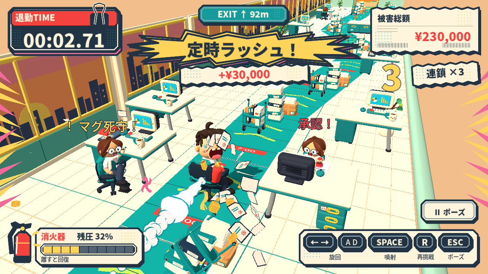
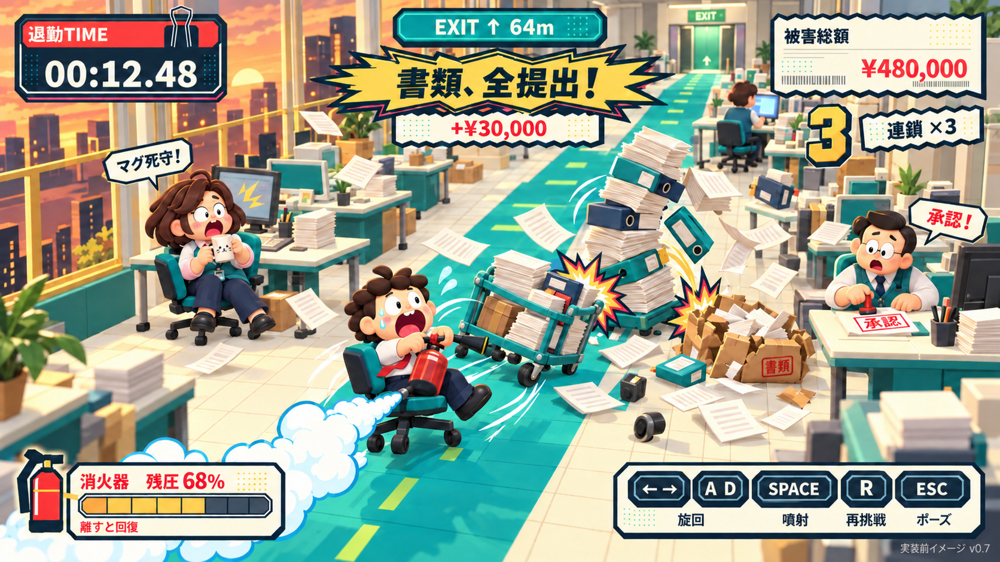
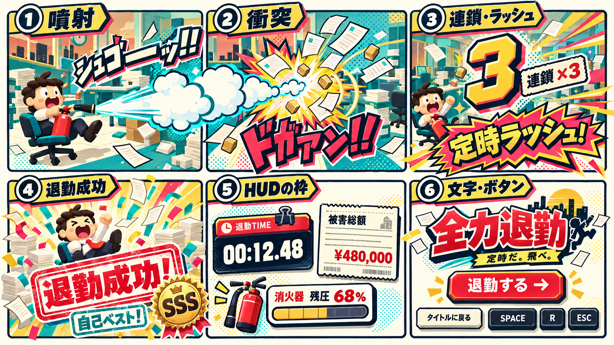
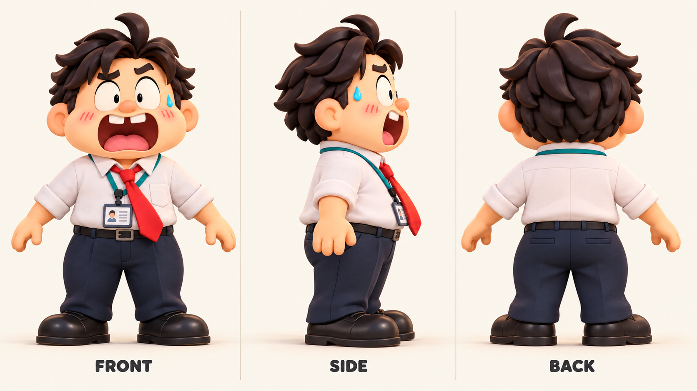
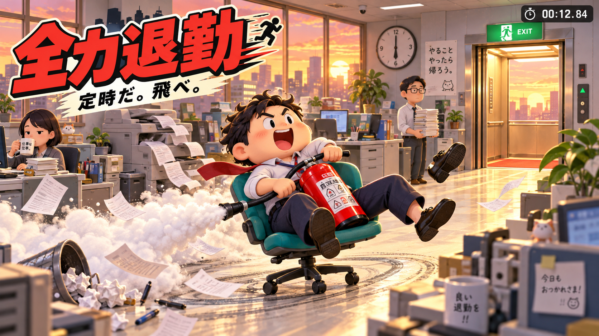
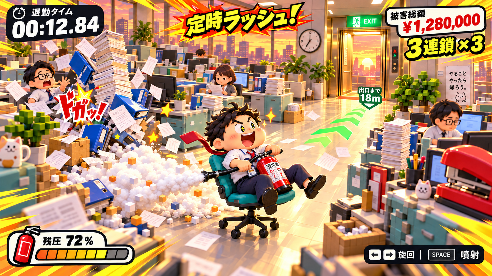
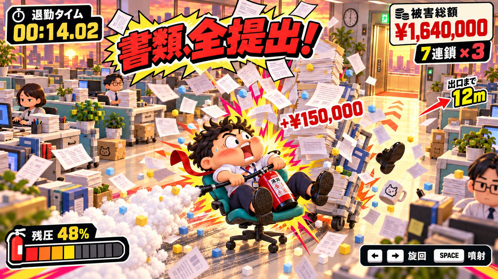
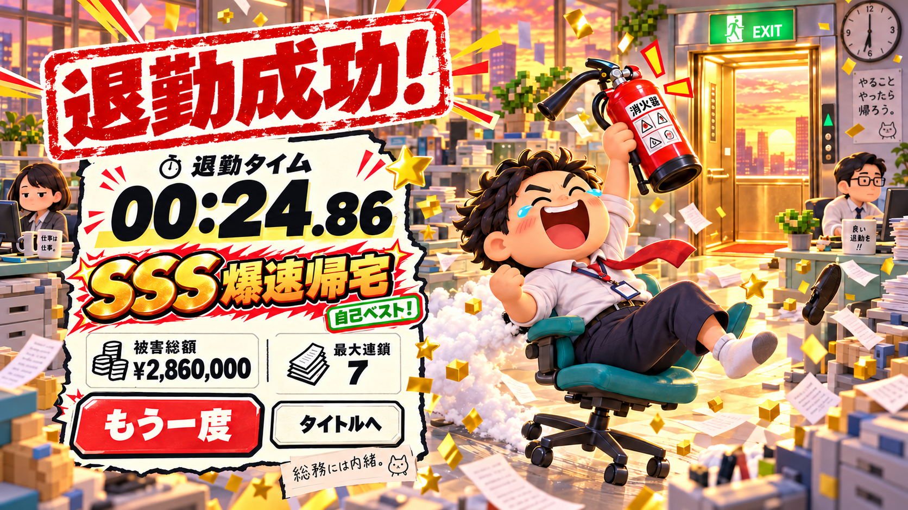

# 全力退勤

**定時だ。飛べ。**

消火器の噴射でオフィスチェアを走らせ、定時から最短で会社を脱出する物理コメディゲーム。

## 破壊がつながる職場 v0.7（ローカル検証済み）

[公開中のv0.6で遊ぶ](https://hayatok.github.io/100challenge/2026-10-14/)。v0.7は下の手順でローカル起動できます。公開更新・リリースタグは作成していません。

Godot 4.6.3でオフィス一面を実装しました。消火器の反動と慣性、残圧の回復、家具との衝突、3種・24個の破壊物、連鎖と「定時ラッシュ！」、表情と紙吹雪、結果と自己ベストの保存が動きます。



これは実際のブラウザのスクリーンショットです。v0.7ではワゴンが走って塔に当たり、倒れた書類が箱を潰します。0.35秒ずつ伝わる3段の破壊で、曲がったワゴン・紙・バインダー・車輪が床へ残ります。24個の小道具は8組の有限の連鎖で、同じ物へ二重に加点しません。

近くの最大2人は、それぞれ猫マグを守る動作と、赤い印鑑を机上の紙へ押す「承認！」で反応します。遠い社員は通常業務を続けます。最初の二つの机を連鎖の横へ寄せ、主役・進路・二人の顔と手元を実画面で確認しました。

噴射はノズルの後ろからつながる白い形と青緑の縁。実速度とラッシュで大きくなり、旋回へ追従し、離すと素早く引きます。破壊は進行方向と小道具の種類に応じた星形と紙の扇。タイムカード、被害明細、残圧メーター、漫画文字と成功の判子はv0.5から引き継いでいます。

3Dはv0.4の20種類のBlenderモデル。大きな口と靴の会社員、むっちりした椅子、ワニのホチキス、猫マグ、眠そうな同僚を、丸い玩具の造形と配色でそろえています。

## 実装前に確認した画面イメージ v0.7

実装前に生成し、ユーザー確認後に上のゲームへ反映した設計用モックです。ワゴンから書類の塔、紙箱へ破壊が伝わり、飛んできた紙へ承認印を押す上司と猫マグを守る同僚が反応する場面を描いています。生成画像と実際のゲーム画面は分けて保存しています。



[生成条件と使用プロンプト](art/screens/v0.7/generation.json)、[連鎖と二人の動作の仕様](docs/CHAIN_REACTION_DESIGN.md)、[実画面と検証結果](docs/VERIFICATION.md)。

## 起動

Node.js 24とGodot 4.6.3を使います。LinuxではセットアップがGodot本体とWebテンプレートを準備します（curlとunzipが必要。テンプレートの初回ダウンロードは約1.2GB）。macOS / Windowsでは公式Godot 4.6.3と一致するWeb export templatesを先に導入し、必要なら `GODOT_BIN` を指定してください。

```bash
cd 2026-10-14
npm ci
npm run setup
npm run check
npm run preview
```

ブラウザで `http://127.0.0.1:4184/` を開きます。`dist/` はWeb配布用。HTMLを直接ダブルクリックする方法では起動できません。

`npm run dev` はGodotエディタ、`npm run play` はネイティブ実行です。PCキーボードと横画面が対象で、タッチ操作はまだありません。

| 操作 | 動作 |
| --- | --- |
| ← → / A・D | 椅子を旋回 |
| Space | 噴射して加速。離すと惰性走行と残圧回復 |
| R | 即再挑戦 |
| Esc | ポーズ / 再開。別タブへ移ると自動ポーズ |

「派手 / 標準 / 控えめ」の演出と、BGM・効果音の音量を設定できます。主記録は退勤タイム。被害総額と最大連鎖は別の副記録です。

## 仕様と検証

- [仕様 v0.2と初期実装の記録](docs/SPEC.md)
- [制作計画](docs/PLAN.md)、[モジュールと接続](docs/IMPLEMENTATION.md)
- [実装の検証結果](docs/VERIFICATION.md)：ルール、実物理、経路、ポーズ、ブラウザの通しプレイと記録保存。
- [破壊連鎖と同僚の個性 v0.7](docs/CHAIN_REACTION_DESIGN.md)：ワゴン・塔・箱、残骸、猫マグと承認印、時計と再挑戦。
- [20種類の3視点・Blenderモデルと制作手順](docs/ASSET_REWORK.md)
- [演出と文字・枠の設計 v0.5](docs/FX_DESIGN.md)：生成した見本と4画面、発生条件、時間、表示の優先順位と負荷上限。
- [操作に応える職場 v0.6](docs/INTERACTION_DESIGN.md)：先に生成した見本、社員の反応、連続した噴射と方向に応じる破壊演出。
- [アート方針](docs/ART_DIRECTION.md)、[クレジット](THIRD_PARTY_NOTICES.md)

v0.7はmacOS・Chromium 153・Apple M5（Metal）で実キーの通し操作を確認し、採取したfpsは60でした。1280×720、1920×1080、960×540の実画面を確認しています。他のGPU・ブラウザ、スマホのタッチ操作と初見プレイヤーの面白さは未確認です。

## 相互作用の画面イメージ v0.6

実装前に生成・共有した設計用の画像です。既存の社員と配置を使い、実際の噴射は椅子の後方へ向けます。実画面と固定場面の確認画像は [検証記録](docs/VERIFICATION.md) に分けて保存しています。


[仕様](docs/INTERACTION_DESIGN.md) ／ [生成条件](art/screens/v0.6/generation.json)。v0.5の画面設計と各版の原本も保存しています。

## 演出と画面イメージ v0.5

以下は実装前に生成した設計用の画像です。実画面は上と [検証記録](docs/VERIFICATION.md) に分けて保存しています。



| 画面イメージ | ねらい |
| --- | --- |
| [ラッシュ中のプレイ](art/screens/v0.5/01-rush-play.png) | 後方の白い噴射、金の帯、3連鎖と加算札 |
| [大衝突](art/screens/v0.5/02-impact.png) | 星形、衝撃輪、紙の扇、対象の通知 |
| [退勤成功](art/screens/v0.5/03-result.png) | 巨大判子、金のランク印、実際の自己ベストと再挑戦 |
| [タイトル](art/screens/v0.5/04-title.png) | 太いロゴ、職場の紙、操作札と大きい開始ボタン |

生成条件は [generation.json](art/screens/v0.5/generation.json)。画像を確認してからGodotへ実装しました。

## 3Dアセットの参考画像 v0.4

主役の正面・側面・背面。以下はモデリング前に生成した参考画像です。



椅子・消火器、破壊物、机・PC、同僚、小物、出口・時計、背景、演出素材の全9シートと、Godotで読み込んだ実モデルの60枚の3視点は [アセット改稿の記録](docs/ASSET_REWORK.md) から見られます。編集可能な原本は `art/models/`、再生成はBlender 4.3.2で `npm run assets:build`。通常の起動とWebビルドにBlenderは不要です。

## コンセプトアート初稿



制作開始日：2026-10-14（Asia/Tokyo）。以下のアートとモックは、実装前に制作した方向案です。

「左右で向きを変える」「押して噴射、離して惰性走行」。速く帰りたいほど制御が難しくなり、机に引っかかったり回転したりする。一面で出口までの時間を縮める遊びです。

## 初期仕様と制作計画

- [仕様 v0.2](docs/SPEC.md)：操作、残圧、退勤、被害総額と連鎖、カメラとHUD、演出、試作での確認項目。
- [仕様策定・制作計画](docs/PLAN.md)：今回の工程と完了条件、操作試作から一面の完成までの順番。
- [アート方針](docs/ART_DIRECTION.md)：初稿と派手なバカゲー方向への改稿。

PCブラウザ・横画面を暫定の中心とする。主記録は退勤タイム、副記録は被害総額と最大連鎖。3連鎖で「定時ラッシュ！」、大衝突で「書類、全提出！」、ゴールで「退勤成功！」の巨大判子を出す。

## 画面イメージ v0.3

以下は仕様検討用の生成モック。実際のゲーム画面ではなく、カメラ距離と演出量は操作試作で調整する。

2026-10-15更新：丸いキャラクターと派手な演出に、紙箱・家具・植物の一部と小さな粒子のボクセル要素を加えた。画風は丸みのある3Dを中心にする。

通常プレイ：連鎖噴射と定時ラッシュ。



大衝突：書類の塔へ突っ込み、漫画文字と紙の扇が出る。



退勤成功：巨大な判子、時間ランク、泣き笑いの会社員、すぐ再挑戦。



開発課題：[Issue #159](https://github.com/hayatok/100challenge/issues/159)。GitHub Projectへの追加・状態更新は、現在の接続の権限不足で未実施。
