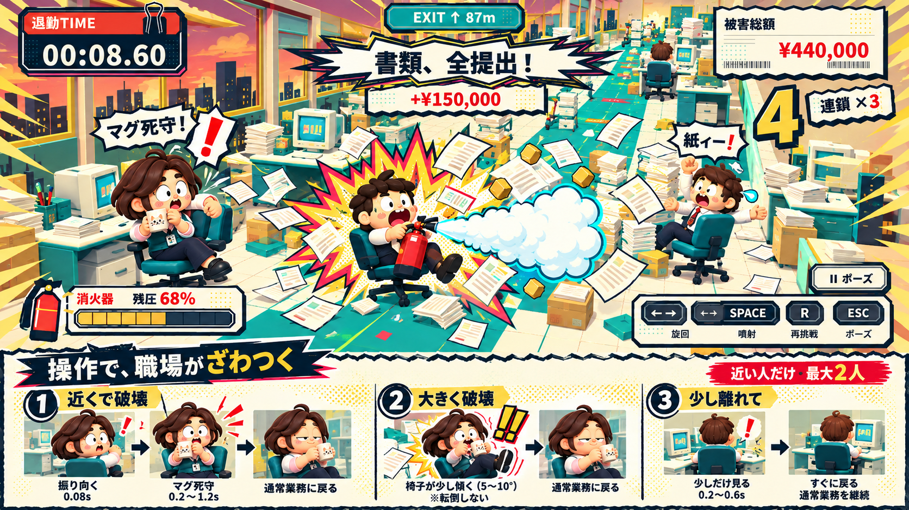

# 全力退勤：操作に応える職場 v0.6

2026-10-15（Asia/Tokyo）。v0.5の漫画調UIと玩具の3Dを引き継ぎ、ユーザーの操作が周囲へ伝わる演出を加える。大きな文字だけで盛り上げず、破壊した場所・進む向き・勢いによって粉、紙、社員の反応が変わるようにする。

## 現行画面との距離と今回の目標

変更前の実画面は [プレイ](verification/v0.6/before-play.png) と [タイトル](verification/v0.6/before-title.png)。v0.5のモックに比べ、噴射は小さな塊が離れて見え、破壊の瞬間が弱く、社員は背景として動かない。主役と局所演出の見え方を強め、周囲の反応を加える。

制作順は、実画面の比較、反応の見本の画像生成・確認、実装、実際の操作と描画の確認、公開更新。見本は `art/screens/v0.6/`、実画面と測定は `docs/verification/v0.6/` に保存する。生成画像は完成目標で、実行画面とは分ける。

[生成条件](../art/screens/v0.6/generation.json)。画像は見せ方を強調した設計資料。実装では噴射を椅子の後方へ向け、既存の社員の造形と配置を使う。

## 操作と反応

| 操作・結果 | 返す反応 | 何が分かるか |
| --- | --- | --- |
| 噴射開始 | ノズル直後からつながる白い錐形と青緑の縁、小さな立ち上がりの脈動 | 押した瞬間に噴射が始まった |
| 加速・旋回 | 実速度とラッシュで噴射の長さと幅が増し、粉の尾が旋回へ追従 | 推進方向と勢い、曲がった軌跡 |
| 噴射を離す | 連続した噴射が素早く引き、残った粉は短く消える | 離した操作が届き、惰性と回復へ移った |
| 書類の塔を破壊 | 接触点の大きい漫画の星形、薄い輪、進行方向へ広がる紙の扇 | 何に、どの向きから、どの勢いで当たったか |
| 紙箱を破壊 | 短くまとまる破裂と少量の金色の破片 | 軽い破壊との違い |
| ワゴンを破壊 | 強く幅広い扇と短い大きなピーク | 大きい対象を壊した手応え |
| 社員の近くで破壊 | 椅子ごと振り向く、目を見開く、上体がのけぞる、猫マグを守る | 周りが今の破壊に気付いた |
| 大きい破壊・連鎖 | 同じ社員の反応を強め、短い「!!」や一言を社員の上に置く | 破壊の規模が職場へ伝わった |
| 時間がたつ | 社員が元の姿勢と眠そうな顔へ戻る | 騒ぎの後も通常業務へ戻るバカゲーの温度差 |

## 社員の反応の条件

対象は既存の5人。実際に新しく壊れ、ルールで受理された小道具の位置から距離を測る。半径12m以内の近い社員を最大2人選ぶ。別区画の社員や壊した物へ戻っただけの操作は反応させない。反応は0.05〜0.26秒の短い遅れ、約1.4秒の動き、約2.8秒の個人ごとの再発生間隔を基準にする。

顔と椅子の向きは破壊地点へ、上体の反動はその逆へ向ける。頭・上体・マグを持つ腕を別の支点にし、目と口も変える。個体ごとの違いで「びっくり」と「マグ死守」を使い分ける。強い破壊が続いた場合は反応を強めるが、毎回一言や開始動作を連打しない。

反応は見た目のものとし、社員を障害物にしたり、得点・タイム・時間ランクへ足したりしない。走行、残圧、既存の衝突形状と出口への経路を維持する。

## 画面と負荷

既存の太い文字、タイムカード、明細、判子を維持する。プレイ中の主役は少し近く見せ、進路と曲がり角を読める距離を実画面で決める。社員の一言はその社員の上に短く出し、主役、時計、残圧と前方の床を覆わない。

成功時は到着した向きにかかわらず、見た目の椅子と社員が短くカメラ側へ向き、祝いの顔を見せる。物理の座標・向きと確定した記録は変えず、フォーカス喪失でこの動きも止め、再挑戦で戻す。

連続した噴射は少数の共有メッシュで描き、粒子の上限80／52／20と重要イベントの予約枠を維持する。社員は共有メッシュ・素材で、動く部位だけを静的背景の合成から外す。影と物理ボディを増やさない。控えめでは大きい跳ねや速線を止め、振り向き・表情と情報は残す。

ポーズ・非アクティブ時は社員の遅延、動作、再発生間隔も止める。R、結果ボタン、タイトルへの復帰で社員の姿勢・表情・一言と噴射を初期化する。実ブラウザでは実キーだけで破壊・周囲の反応・退勤を確認し、撮影用の固定場面と通しプレイを区別する。
