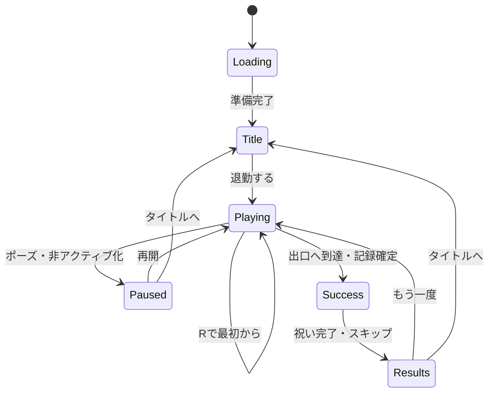

# 全力退勤：初期仕様 v0.2

## 体験の目標

**定時だ。飛べ。** 消火器の反動でオフィスチェアを走らせ、派手に散らかしながら最速の退勤を目指す、短時間の3D物理コメディ。

ユーザーの「ドーパミン放出系」という希望を、噴射する手応え、連鎖破壊の気持ちよさ、極端な表情、巨大な漫画文字、音が上がっていく反応、退勤成功の大げさな祝福として具体化する。

この文書は仕様策定の成果物。操作性と面白さは試作で確かめる。時間、残圧、倍率、演出量、ランクの数値は調整開始用の仮値。

2026-10-15追記：現在の演出と画面造形は [FX_DESIGN.md](FX_DESIGN.md) のv0.5を基準にする。エフェクトの見本を先に生成し、その見本に沿った4画面のモックから実装した。太い漫画文字、紙の枠、後方噴射の錐形、局所の星形と衝撃輪、ラッシュ突入と成功の判子を、段階と時間を分けて設計する。操作・物理・記録と時間ランクはこの改稿で変更しない。

v0.6は [操作に応える職場](INTERACTION_DESIGN.md) を参照する。破壊位置の近くの社員が振り向き、表情を変え、マグを守り、通常業務へ戻る。連続した後方噴射は実速度と旋回に追従し、破壊の局所演出は小道具・向き・勢いで変わる。見本を先に生成し、実画面で操作と可読性を確認する。

## 体験の柱

1. 押した瞬間に噴射と加速が返る。椅子の方向と移動方向を見て、自分で立て直せる。
2. 連鎖するほど音と画面の反応が盛り上がる。顔、ネクタイ、紙、家具の動きにもバカゲー感を出す。
3. 本人は必死で、職場は平然としている。会社員の日常と、無茶な退勤方法の組み合わせで笑いを作る。
4. 退勤タイムを縮める遊びと、散らかす楽しさを両立する。主記録は退勤タイム、破壊は別の副記録として表示する。
5. 結果から一操作で再挑戦できる。演出中にも出口、主役、次の障害物を読める。

## 初期制作範囲

PCブラウザ、横16:9を中心とする。主な基準解像度は1920×1080、最低確認幅は1280×720。画面比率が変わる場合はHUDを内側へ置き、ゲーム領域の見通しを維持する。スマホ用入力と画面配置は、プレイ環境の希望に合わせて別途確定する。

固定のオフィス一面、主役一人、同僚一種類の外見バリエーション、壊せる小道具三種類、衝突する固定家具、出口、タイトル・プレイ・ポーズ・結果画面、ローカルの自己ベストを作る。

一回の目安は30〜60秒。初見は45〜90秒、慣れたプレイヤーは20〜35秒を目標に、進路と移動感を調整する。最初の数秒で噴射と反応を体験できる構成にする。

## 操作と移動

| 入力 | 動作 |
| --- | --- |
| 左右矢印 / A・D | 椅子の向きを左右へ旋回。噴射中・惰性中・残圧ゼロでも使える |
| Spaceを押す | 消火器を後方へ噴射し、椅子が向く方向へ加速 |
| Spaceを離す | 噴射を止め、惰性で進む。摩擦で減速し、残圧が回復 |
| R | 同じ一面を最初から即再挑戦。物体、残圧、タイム、連鎖をリセット |
| Esc / ポーズボタン | 物理、タイム、連鎖期限、ゲーム内の演出時間を止める |

旋回で椅子の向きが変わっても、速度の向きは瞬時には変わらない。噴射を少しずつ加え、滑りながら曲がる。旋回と噴射の組み合わせで進路を作り、噴射を離すことが姿勢と残圧を整える選択になる。

噴射方向は椅子の後方。前進方向は床の影、椅子の向き、後方の粉、短い軌跡で示す。キャラクターの体や顔は大きく揺れるが、椅子本体は基本的に床面を走り続ける。

### 残圧

残圧は0〜100。満タンから連続噴射で約4秒、離して約2秒で全回復する値を初期候補にする。回復開始までの待ちを作らず、惰性走行と同時に回復する。

残圧ゼロでは追加の推進力が止まり、旋回と惰性移動は続く。ゲージに「離して回復」を出す。小刻みな操作を要求するより、加速・旋回・離す動きが自然に使い分けられる消費量を試作で選ぶ。

### 衝突と復帰

固定の机や壁では反発と旋回が起き、体と椅子の見た目が大きく揺れる。書類や紙箱は壊れ、紙が飛ぶ。主役はその場で立て直して走行を続ける。

横倒しは見た目の演出を中心にして、操作不能な姿勢を長く維持しない。軽い衝突からは0.5〜1秒、大きな衝突からも1〜2秒程度で自分の旋回・噴射が効く状態を目標にする。

家具の隙間に挟まった場合は、残圧があり噴射中で、固定家具との接触が続き、実際の移動がほぼない状態を約1.2秒検出して復旧する。旋回だけ、残圧ゼロ、ポーズ中は検出しない。

復旧先は直近の安全な床を優先し、接触を解消する最小限の距離だけ押し戻す。壁、曲がり角、ゴールを飛び越えず、進行方向へショートカットしない。「椅子、復旧！」の短い反応を付ける。復旧はタイムの計測中に行い、残圧や破壊物を再生成しない。Rによる全体のやり直しも常に用意する。

## 退勤、記録、ランク

開いたエレベーターの床へ椅子の中心が入った瞬間に退勤成功とする。入口を幅広くし、高速で飛び込んでも成功が分かるようにする。

退勤タイムは最初の旋回または噴射入力からゴールまでの実プレイ経過時間。短い衝突停止の間も進み、ポーズと非アクティブ時は止める。演出用の時間倍率でタイムを変えない。ゴールでタイムと被害総額を確定し、その後は加点しない。

ブラウザの非アクティブ化では自動ポーズへ入り、物理、残圧、連鎖期限、演出時間も停止する。押下状態を解除し、復帰後は明示的な再開操作を待つ。

| ランク | 初期候補のタイム | 文言 |
| --- | --- | --- |
| SSS | 30秒以内 | 爆速帰宅 |
| SS | 45秒以内 | 定時の覇者 |
| S | 60秒以内 | 見事な退勤 |
| A | 90秒以内 | おつかれさま |
| B | 90秒超 | 帰れたので勝ち |

公式の自己ベストは退勤タイムだけで比較する。同タイムなら同順位。被害総額でタイムを補正したり、時間ランクを上書きしたりしない。

成功した試行の最短タイム、最大被害総額、最大連鎖を別々にローカル保存する。保存に失敗してもプレイと再挑戦は継続し、結果に「記録を保存できませんでした」と示す。

## 被害総額と連鎖

被害総額は散らかした勢いを表す副記録。漫画文字と跳ねる金額で見せ、結果ではタイムの下へまとめる。

| 小道具 | 基本金額の仮値 | 動き・笑い |
| --- | --- | --- |
| 紙箱 | ¥10,000 | 箱がぺしゃんこになり、コピー用紙が噴き出す |
| 書類の塔 | ¥50,000 | 高すぎる束が扇状に倒れ、ファイルが宙を舞う |
| 書類ワゴン | ¥100,000 | ワゴンがずれて紙箱まで連鎖し、机上に紙が飛ぶ |

各小道具は一回の試行に一度だけ加点する。破片、紙の粒子、同僚、固定家具への再接触は加点対象にしない。別の小道具へ伝わった衝突は、その小道具が未加点なら一度だけ成立する。

未破壊の別の対象を2秒以内に壊し、前回の加点対象よりコース上で出口側へ進んでいれば連鎖を更新する。時間切れ、または戻って別の対象を壊した場合は、新しい1連鎖として始める。後方の対象も基本金額は加算し、連鎖の更新だけを前進に結び付ける。

連鎖倍率は1個目×1、2個目×2、3個目以降×3。連鎖数は7、8…と増えるが、倍率の上限は×3。連鎖の条件は発生時の数字・音と、小道具の前進経路への配置で伝える。

加算額は「基本金額 × その破壊時に成立した連鎖倍率」。画面イメージの「+¥150,000」は、基本金額¥50,000の書類の塔を倍率×3で壊した例。

各対象に入口から出口へ増える固定のコース進行値を持たせ、前進条件は対象同士の値で比較する。同一の物理更新で複数対象が壊れた場合は進行値の昇順、同値なら固定ID順に処理する。同じ更新にゴール到達も含まれる場合は、その更新の破壊処理後に記録を確定する。

加点対象はコース内で有限にし、同じ場所での往復による無限加点を防ぐ。最短経路にもいくつか配置し、進みながら散らかす遊びを成立させる。

### 定時ラッシュ

3連鎖の成立で「定時ラッシュ！」が自動発生する。同じ連鎖中は一度、再発生は5秒以上間隔を空ける。約1.2秒、金色の速度線、強まる噴射の見た目、椅子と顔の誇張、短いジングルを重ねる。

ラッシュ中も旋回、推進力、残圧の消費、衝突の条件は通常どおり。演出のために入力を奪わず、加速と連鎖が互いを無制限に強める状態を作らない。

## 一面の構成

レイアウトの寸法は、噴射時の速度、旋回半径、惰性での停止距離を操作試作で測って決める。装飾前に、床と箱だけでゴールまで進めるブロックアウトを作る。

| コースの進行 | 区間 | 体験と配置 |
| --- | --- | --- |
| 0〜15% | 自席前の広い直線 | 出口の方向が見える。最初の噴射と、離す操作を安全に試す |
| 15〜40% | 書類通路 | 進路の脇に連鎖用の小道具。真っ直ぐでも帰れ、狙うと大騒ぎになる |
| 40〜65% | 曲がり角 | 二つの緩い曲がり角で旋回と惰性を使う。見通しを確保する |
| 65〜80% | 出口の見える直線 | 少し落ち着き、残圧と姿勢を整える。緑の出口が大きく見える |
| 80〜100% | 退勤の花道 | 任意の書類ワゴン、最後の連鎖、エレベーターへの飛び込み |

ゴールへの最短経路を常に通れるようにする。小道具の破壊で入口が塞がらないよう、破片は短時間で非衝突化する。出口は開いたままにし、停止や追加操作を要求しない。

## グラフィック

初稿の会社員、青緑の椅子、赤い消火器、夕日のオフィスを引き継ぐ。丸い立体と明快な色の面、太い輪郭を中心にして、バカゲー感を以下の動きで出す。

2026-10-15の画風更新では、丸みのある3Dへ控えめなボクセル要素を組み合わせる。紙箱や家具の角に段差のある小さなブロック、観葉植物の一部に緑の立方体、紙・粉・紙吹雪の中に少量の四角い粒子を使う。主役の顔と体、椅子、消火器は曲線と伸縮を中心に作り、表情を読めるようにする。

- 噴射：頬が後ろへ引かれ、ネクタイが旗のように伸び、髪が逆立つ。
- 衝突：顔と椅子のクッションがつぶれ、目が飛び出しそうになり、足と靴が跳ねる。
- 連鎖：書類が妙に大きく舞い、ファイルの塔があり得ない高さで揺れる。
- 成功：消火器をトロフィーのように掲げ、社員が泣き笑いする。
- 周囲：破壊から12m以内の近い社員が最大2人、短い遅れで振り向き、目を見開き猫マグを守る。強い破壊では姿勢を強める。同じ破壊の再通知は無視し、約1.4秒で通常業務へ戻る。遠い社員は書類とコーヒーに集中し、大騒ぎとの温度差を作る。詳しい条件は [v0.6の仕様](INTERACTION_DESIGN.md)。

巨大ホチキス、猫のマグ、傾いた観葉植物などの小ネタは、進路と出口を邪魔しない場所に置く。紙や粉の描き込みより、主役のシルエット・表情・向き、家具の衝突範囲を先に仕上げる。

## カメラとHUD

プレイ時は斜め上からの三人称カメラ。進路、床、椅子の向き、障害物の奥行きが読める角度とし、水平向きを固定して、椅子の回転で画面全体が回らないようにする。

主役は中央より下に置き、前方に約45%の見通しを確保する。実装試作では主役と椅子が画面高の20〜30%程度からカメラ距離を比較する。高速時は少し前方を見る。壁や高い家具が主役を隠す場合は、手前側の遮蔽物を薄くする。

生成した画面イメージは、表情と演出を伝えるために主役と通知を大きく描いている。実際のカメラ距離と通知の大きさは、下記の可読性基準で調整する。

| 画面領域 | 表示 | 優先順位 |
| --- | --- | --- |
| 左上 | 退勤タイム | 常時。衝突演出で隠さない |
| 右上 | 被害総額、連鎖数と倍率 | 常時。連鎖時だけ短く拡大 |
| 左下 | 消火器アイコン、残圧の数値と目盛り | 常時。低下時は文字でも知らせる |
| 右下 | 左右旋回・Space噴射の入力ヒント | プレイ開始と必要時に表示 |
| 上中央の空いた帯 | ラッシュ・衝突の漫画文字 | 同時に一つ。主役とゴールへ重ねない |
| 出口付近 / 画面端 | EXIT、出口方向、距離 | 色、文字、矢印を併用。出口が画面外なら端に矢印 |

1080pのHUD本文は28px以上、タイムは40px以上を初期基準とし、縮小表示でも読める大きさを保つ。出口までの距離は通れるコースに沿って測る。プレイ中には大きなタイトルロゴを置かない。

## 演出仕様

タイミングは仮値。操作を伝える音と視覚が同時に返り、弱い反応・連鎖・成功の差が分かるようにする。

| 発生条件 | 画面と音の反応 | 時間・上限の候補 |
| --- | --- | --- |
| 噴射入力 | 後方の粉、体と椅子の反動、風のループ音、周辺の速度線 | 入力から100ms以内に初動。噴射を離すと減衰 |
| 初回の小道具破壊 | 紙と局所の星形バースト、金額が跳ねる、短い破裂音 | 金額表示0.4〜0.6秒 |
| 連鎖更新 | 数字が膨らむ、音階が一段上がる、色付きの漫画アクセント | 拡大0.12秒。音階の上昇にも上限を設ける |
| 大衝突 | 80〜100msの停止、顔と椅子の20〜30%の伸縮、局所の黄・マゼンタのバースト、紙の扇 | 停止は250ms以上間隔を空け、1秒あたり合計200ms以内 |
| 大衝突の通知 | 「書類、全提出！」「総務、見てない！」など、物と状況に合う漫画文字 | 0.7〜1.0秒。同時に大きな通知は一つ |
| 定時ラッシュ | 金色の速度線、白い噴射の強調、輪郭の輝き、短いジングル | 約1.2秒。同じ連鎖で一度、再発生間隔5秒 |
| 退勤成功 | 「退勤成功！」の巨大判子、紙吹雪、消火器を掲げる、短い勝利音 | 0.8〜1.2秒の祝福。入力で即座に結果を確定表示 |
| 自己ベスト | 「自己ベスト！」の判子と一度の軽い星の反応 | 0.4秒。結果確定後に表示 |

カメラの揺れは1080p換算で振幅4〜8px、150〜220msから調整する。連続イベントでも揺れを積み上げず、現在の強い一つへまとめる。粉や紙が主役と前方の進路を完全に覆う時間は200ms以下を目標にする。大きい効果は画面の周辺と衝突位置を中心に出す。

衝突の停止は床面の移動・衝突シミュレーションにだけ適用し、入力状態は受け取り続ける。退勤タイム、連鎖期限、残圧の計算には停止時間も含める。顔、椅子の伸縮、漫画文字の演出は進める。

紙の音、椅子のきしみ、消火器の噴射、短い連鎖音、退勤時のジングルを用意する。連鎖は音量を増やし続けるより、音程とリズムで盛り上げる。ゲーム開始の入力を受けて音声を有効にする。

### 演出設定

「派手」を初期の画風とし、設定には「標準」「控えめ」も用意する。控えめではカメラの揺れと速度線を止め、紙と粉を約25%へ減らし、顔・椅子の伸縮を弱める。光は局所のバーストで出す。

設定によらず、衝突結果、残圧、物理性能、タイム、加点条件は同じにする。衝突の停止時間も共通とし、記録条件をそろえる。BGMと効果音は別々に音量調整でき、消音でも連鎖と成功が文字と形で分かる。

## 画面と遷移

| 状態 | 内容と操作 |
| --- | --- |
| 起動・読み込み | 素材を準備。分かる範囲の実際の進行を示す。起動失敗時は「再読み込み」を表示 |
| タイトル | 「全力退勤」「定時だ。飛べ。」、主ボタン「退勤する」、操作案、設定 |
| プレイ開始 | 主役を自席前へ配置。「定時！」を短く表示し、最初の入力でタイムを開始 |
| 通常プレイ・連鎖・衝突 | 同じ操作画面の中で反応。長いカットインで操作を中断しない |
| ポーズ | 「再開」「最初から」「設定」「タイトルへ」。物理とゲーム時間を停止 |
| 退勤成功 | 記録を確定し、判子と祝い。結果をすぐ表示できる |
| 結果 | タイム、時間ランク、自己ベスト、被害総額、最大連鎖。「もう一度」を主操作にする |

メニューと操作ボタンは、ルートの共通UI定義（生成りの面、濃い輪郭、朱赤の主操作、44px以上の操作面）を使用する。時間ランクの金色や漫画文字は作品部分の表現とする。

## 画面イメージ

最新は2026-10-15の [操作と社員の反応の見本 v0.6](../art/screens/v0.6/01-action-reaction.png)。文字・枠と4画面は下のv0.5を引き継ぐ。画像は先に生成した設計の例であり、実装済みのスクリーンショットではない。

| v0.5の見本・モック | 共有する見た目 |
| --- | --- |
| [エフェクトと文字・枠の見本](../art/screens/v0.5/00-fx-guide.png) | 噴射・星形・輪・連鎖・判子と紙の造形 |
| [ラッシュ](../art/screens/v0.5/01-rush-play.png) | 後方の錐形、ラッシュ突入、明細とメーター |
| [大衝突](../art/screens/v0.5/02-impact.png) | 対象の通知、紙の扇、短いピーク |
| [成功結果](../art/screens/v0.5/03-result.png) | 判子、時間ランク、実際の自己ベストと再挑戦 |
| [タイトル](../art/screens/v0.5/04-title.png) | 太いロゴ、紙、主役と開始の主操作 |

以前のv0.3は、控えめなボクセル要素を加えた画風検討として保存する。

| イメージ | 見るポイント |
| --- | --- |
| [通常プレイ](../art/screens/v0.3/01-play.png) | 後方への噴射、緑の出口、連鎖と残圧、箱・植物と四角い粒子 |
| [大衝突](../art/screens/v0.3/02-impact.png) | バカな表情、書類の扇、「書類、全提出！」、ボクセルの破片 |
| [退勤成功](../art/screens/v0.3/03-result.png) | 巨大な退勤判子、タイムとSSS、泣き笑い、小さな金色の立方体 |

結果の例は24.86秒なので、上記の仮ランクではSSSとなる。被害総額と最大連鎖は副記録として別々に表示する。

## 実装の方針と素材の優先順位

初期実装はGodot 4.6.3、Compatibility描画、単一スレッドWeb出力で確定。`npm run setup` が同じ版の本体とテンプレートを準備し、`npm run check` がimport・テスト・Web書き出しを行う。

床面の移動・旋回・衝突と、顔・体・椅子の派手な見た目を分ける。紙や粉をすべて物理オブジェクトにせず、装飾粒子としてまとめる。小道具の加点済みID、連鎖期限、コース進行、タイム、ポーズ状態を別々に管理する。

制作の優先順は、操作と衝突 → 主役と出口 → 一面の進路 → 小道具一種類と連鎖 → HUD → 残りの小道具 → 表情・漫画文字・音 → 同僚と背景小ネタ → 結果と記録保存。作品の細部は、操作感と可読性を確認してから増やす。

素材の最小リストは、会社員と椅子・消火器、表情4種（通常・噴射・衝突・成功）、机・椅子・床・壁・エレベーター、破壊物3種、同僚、紙・粉・星の粒子、漫画文字と判子、噴射・衝突・連鎖・成功の音。

## 試作の確認項目

| 仮説・リスク | 確かめる方法 | 採用の判断 |
| --- | --- | --- |
| 押した瞬間の反応が気持ちよい | 仮の椅子で噴射・旋回を触り、入力と初動を確認 | 入力方向と反動が説明なしでも理解できる |
| 残圧が遊びを作る | 消費量を変え、惰性走行と回復の頻度を比較 | 噴射を離す工夫があり、回復待ちで何度も停滞しない |
| 衝突後も遊びが続く | 机と壁へ複数方向からぶつかり、狭い場所も試す | 1〜2秒以内を目安に立て直せ、長く挟まらない |
| 破壊しても退勤目的が保たれる | 最短経路と破壊経路、往復・破片再接触を比較 | 有限の加点と正しい時間記録。出口へ進む経路に楽しさがある |
| 最大演出でも読める | 派手・控えめ、1080p・720pで主役と出口を追う | 向き、残圧、次の障害物を読める |
| ラッシュが操作を妨げない | 連鎖前後に同じ旋回・噴射を試す | 入力と物理条件が変わらず、通知で進路を失わない |
| 再挑戦が軽い | 結果、祝いの途中、ポーズからやり直す | 一操作で同じ一面へ戻り、長い再読み込みがない |

文書とモックのレビューでは、破壊の無限加点、時間と副記録の混同、連鎖による物理性能の暴走、通知による進路の遮蔽を検討した。初期実装の動作確認は [VERIFICATION.md](VERIFICATION.md) を参照する。初見の遊びやすさと面白さ、実GPUの処理性能は引き続き評価する。

## 初期実装の確定値と範囲

2026-10-15時点で、一面をゴールまで遊べる。最高速度9m/s、噴射加速度7.5m/s²、惰性の減速1.8m/s²、旋回2.25rad/s、残圧消費25/秒・回復50/秒。通れる進路は約108m、24個の破壊物を配置した。

椅子の床面移動はCharacterBody3Dの掃引衝突で制御し、体・顔・座面の弾む動きは見た目として分ける。大衝突の移動停止は80ms、1秒に2回まで。粒子は派手80・標準52・控えめ20個を上限にし、紙片には衝突ボディを付けない。

破壊物は接触で本体を非表示にして紙と破片を出す初期表現。モックのような家具の細かな崩壊や床への破片の残留は未実装。v0.4では20種類の3Dモデルを3視点の参考画像に沿ってBlenderで再制作した。細かな崩壊や残留破片は引き続き今後の調整対象。成功時は結果を即表示し、紙吹雪と勝利ポーズを同時に出す。

演出の初期値は派手。控えめでは速度線・画面揺れを止め、粒子と顔・椅子の伸縮を減らす。物理とランクは設定で変わらない。記録はGodotの `user://record.json` へ保存し、Webではブラウザの保存領域を使う。

## 3Dアセット v0.4

9枚の生成シートに、20種類の正面・側面・背面をまとめた。造形と配色を「角が丸い、おもちゃのオフィス」で統一する。個別モデルの対応は [ASSET_REWORK.md](ASSET_REWORK.md)。

主役の顔と手足は可動部を保持し、噴射・衝突・成功の表情とポーズへ接続する。成功時は消火器を顔より下で持ち、左腕を上げる。椅子、同僚、破壊物、家具、PC、猫マグ、ワニ型ホチキス、植物、時計、出口、背景と粒子をGLBとして読み込む。既存の24個の破壊物、移動・加点・退勤条件は同じ値を使う。

画風の参照画像と実GLBの描画、ブラウザの実画面を区別し、検証記録にそれぞれ保存する。
