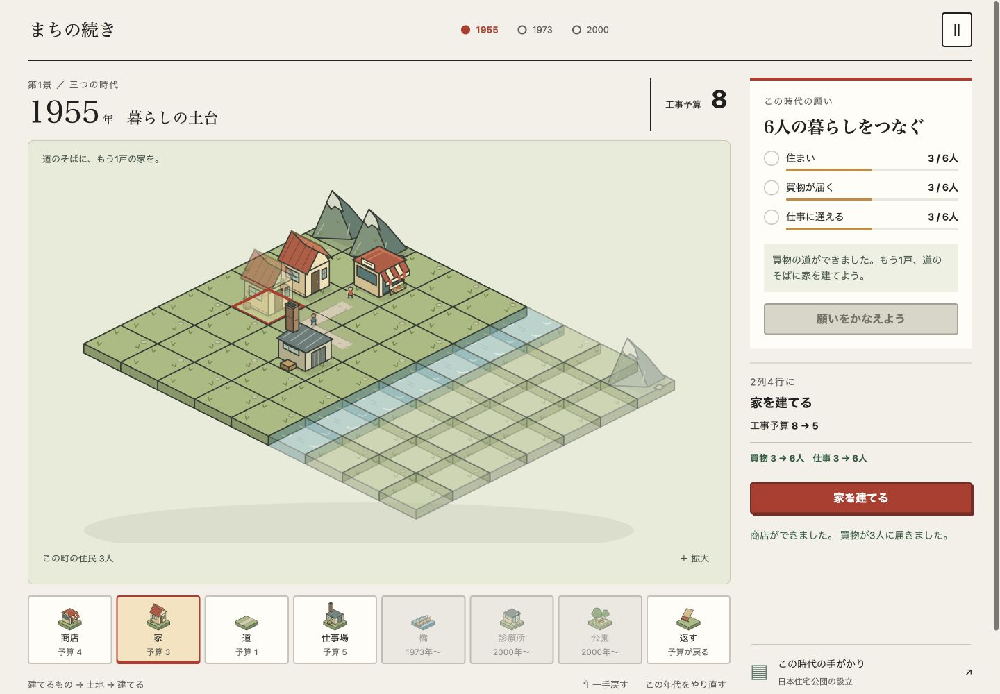
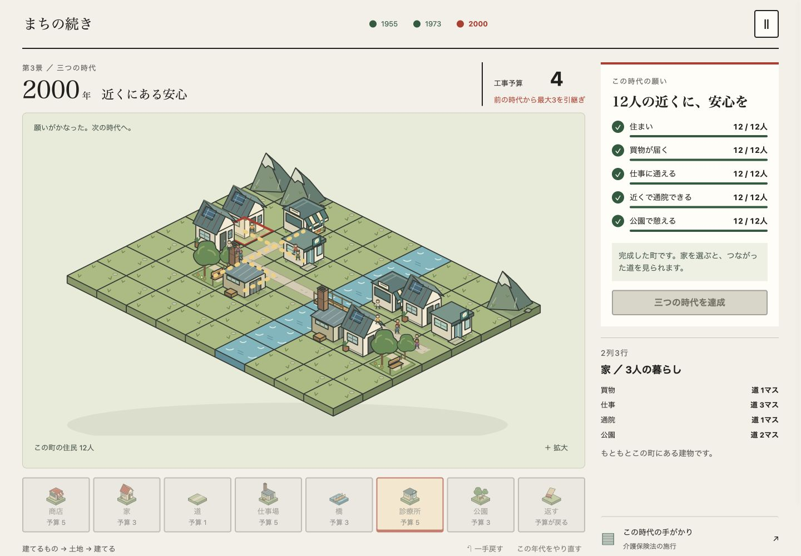
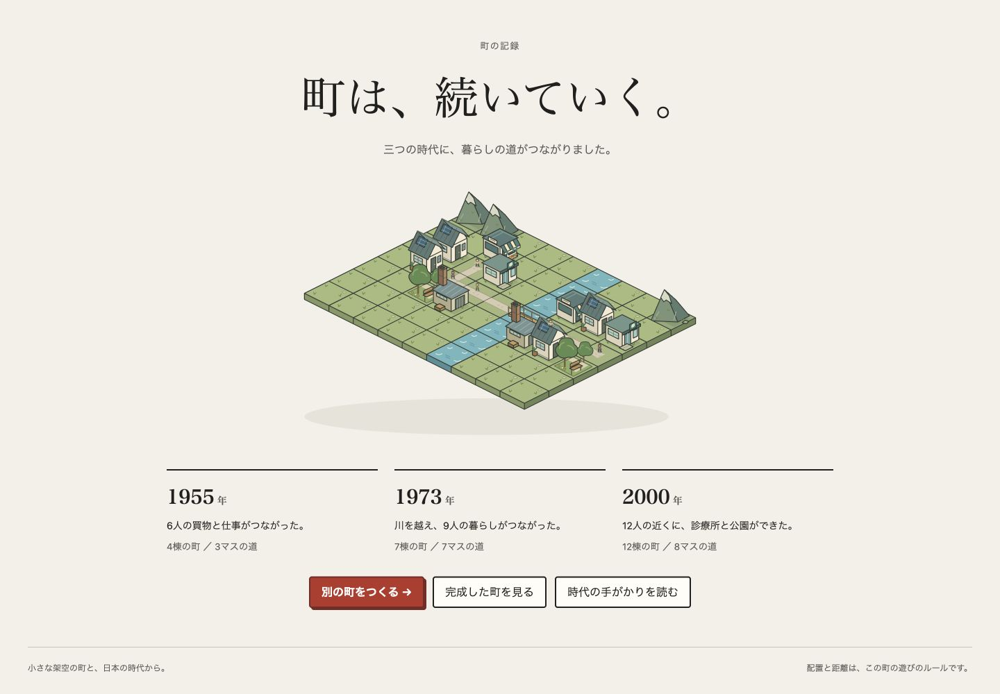
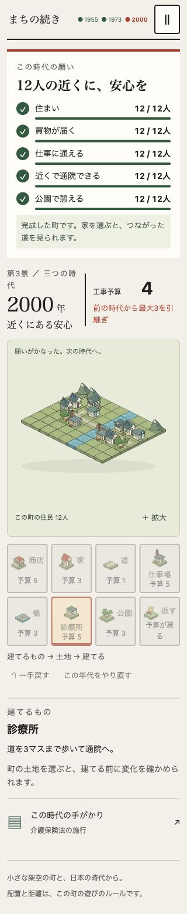

# 最初の遊べる版の検証

2026-10-16、macOS / Codex内ブラウザ、Node.js 24.14.1。新作「まちの続き」の1955 / 1973 / 2000年を対象とする。

## 自動検証

`npm run check`：14テスト、構文/ローカル資産/UI文言の点検、静的buildが成功。研究正本なしの独立checkoutでも14件すべて実行・成功。リポジトリ共通 `npm test` は38件成功。配布対象は8ファイル、156,697 bytes（別にハッシュmanifest）。

- 3年代を予算内で完走する配置を実行。各年代の残りは5 → 4 → 4、次の年代の開始予算は12 → 20 → 21。
- 配置前の費用・達成人数が確定結果に一致し、元の状態を変更しない。
- 四近傍の最短経路、道のマス数による距離、建物を道として通れないこと、届く距離の境界、仕事場の最大割当を確認。
- 予算不足/山/川/時代未解放/重複/将来の家の予定地への配置を拒否。失敗時は状態を変更しない。
- 建物の返却は購入時の予算を返し、価格上昇による利益を作らない。持ち越し上限3と予算総額の保存を確認。
- 不正な保存、固定建物の欠落、重複、負額、未達成での完了等を拒否。
- 3組のestat原出力と取得receiptのSHA-256を照合。表示する5値を、表・分類・年・単位・全次元を固定して原出力へ直接照合。1955年の旧分類/対象範囲の留保とCPIの接続条件を検査。

追加npm依存、専用lint、TypeScript型チェック設定はない。JavaScriptはNodeの構文検査を行う。

## 実画面の操作

| 操作 | 確認した結果 |
| --- | --- |
| 最初の一手 | 商店を選択済み、既存の道のそばの候補が光る。商店を置く前に予算12→8、買物0→3人を表示し、建築後も同じ値になり住民が歩く |
| 不適切な配置 | 山は具体的な理由を表示。孤立した家を建てても住まいだけ増え、買物/仕事は3人のまま。家の場所と道に意味がある |
| 予算不足と戻す | 一時的な仕事場追加で予算3にし、商店の建築を拒否。一手戻して予算を復元。孤立した家も戻せる |
| 1955年の達成 | 道のそばに家を置き、住まい/買物/仕事を6人に。年代の達成を開き、残5から次へ3だけ持越すことを表示 |
| 川の向こう | 1973年は初期予算20、住民9人。橋だけでは達成せず、両岸の道がつながると接続目標が変化。東の店と仕事場を加え9人の買物/仕事を達成 |
| 将来の住宅予定地 | 1973年に2000年の家の予定地へ置けず、理由が読める |
| 保存と再開 | 1973年の町・予算4・達成状態を再読み込み後「つづきから」で復元。完了後の再読み込みは結果を復元 |
| 2000年の達成 | 開始予算21、住民12人。375pxで診療所を矢印キー/Enter二度で建築し6人に通院が届く。公園/東の道/診療所/公園を加えて全12人の5目標を達成 |
| 結果・再挑戦 | 三つの年代と町の記録、完成した町への戻り、新しい町への置換を確認。この年代をやり直すと初期配置・予算12・最初の建物選択へ戻す |
| 統計と出典 | 1973年のCPI34.5/28.4、全国・暦年平均・2025=100、史実の出典位置、工事予算4→5は作者設定と説明。Escapeで閉じて町に戻る |
| 動きと音 | ポーズと再開、音のオン/オフを操作。動きを減らすと移動アニメーション0、12人の静止した姿を残す。音はブラウザで操作確認、実機での聴感は未確認 |
| 資料の読み込み | 検証proxyで5秒遅延し「ひらいています」を確認。503でも町づくりは開始でき、応答を戻して再試行すると資料/757万人の出典が復帰。原資料は改変しない |

通常のゲームタブでconsole error/warnは0。意図的な503は検証proxyだけで発生させた。配置・人数・出典の確認記録はローカル `evidence/browser-cases.json`。

## グラフィックと画面幅

1440 / 1024 / 736 / 375 / 320pxで実画面を確認。bodyと本文・見出し・ボタンの横はみ出しは0。375pxでは目標を先に表示し、拡大で836pxの町を左右へスクロールして配置できる。店の庇、家、仕事場、診療所、公園、橋を別の絵で示す。人は達成判定と同じ経路を通る。

これらは実際に操作した画面。先に作ったアート一覧の静止確認とは分ける。画面案と実画面の双方で、文字/ボタン/達成条件まで確認する。

## レビューと未確認

モデル担当による読取レビューで保存失敗時のセッション内再開を指摘。永続保存の成否に関係なく現在の町をメモリに残すよう修正した。年代のやり直しも最初の建物選択とフォーカス位置へ戻す。

実タッチ端末、他ブラウザ、OSのreduced-motion設定変更、永続保存禁止環境の実ブラウザ操作、Finderからの起動ファイルのダブルクリックは未確認。UIの動きを減らす設定は実操作した。モデルの不正保存は自動テスト済みだが、ブラウザの保存領域を壊す操作は行っていない。

これは短い一周の機能・配置の因果の確認。初見の人が説明なしに楽しめるか、別の配置を自分から試したくなるか、5〜10分という想定時間は人間のプレイテストが必要。操作完走を面白さの実証とはしない。現在は架空の一つの町・3年代で、1900年以降の全歴史や無限のまちづくりを実装したものではない。

原台帳・閲覧アプリ・他アプリの作業は保持。公開・配備・リリースタグ・マージは行わない。
