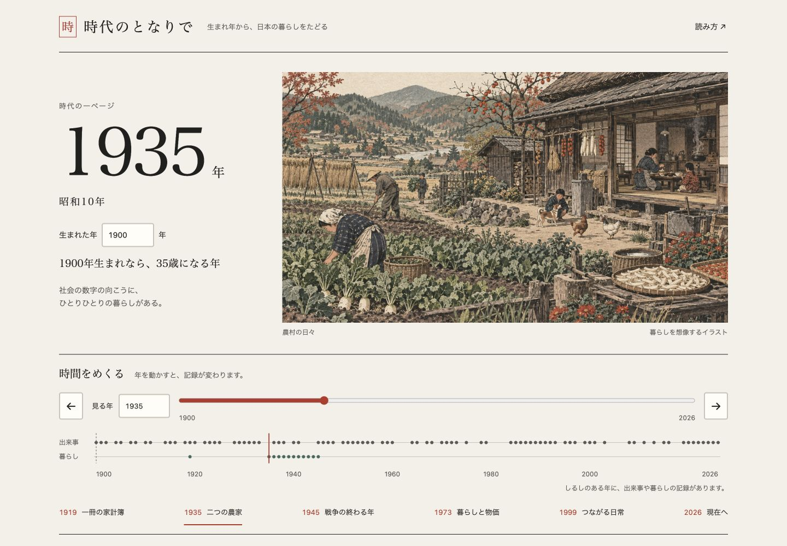
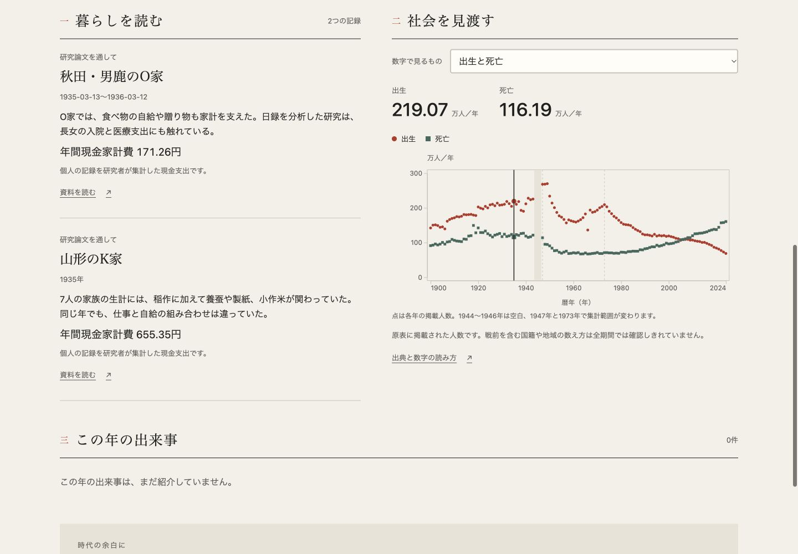
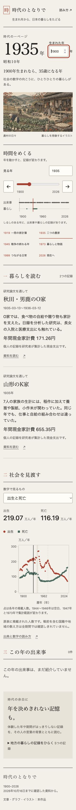

# ローカル作品版の検証

2026-10-16、macOS / Codex内ブラウザ、Node.js 24.14.1。対象は独立したHTML作品「時代のとなりで」。変更前の会話内試作を起動して確認してから実装した。この記録は作品版の実画面の確認であり、元試作の検証とは分ける。

## 自動検証

`npm run check` が成功。12テスト、データ契約・由来ハッシュ・構文・ローカル資産とD3ライセンスの検査、静的buildを実行した。生成物は14ファイル、約12.2MB。

- 同梱した3つのestat原出力と取得receiptのSHA-256が一致する。政府統計382セルを、年・表・分類・対象・原値・単位まで原出力と直接照合した。この照合は調査正本なしでも必ず実行する。
- 元の研究正本があるローカルでは、正本の観測値とも382セルを追加照合した。レビュー用の独立checkoutには正本全体を同梱しないため、この追加検査だけをskipする。
- 欠測を0にする、不正な年・単位・観測数を受け入れる、別年を代入するデータを拒否する。
- 期間の分かる生活記録だけを各年へ結びつける。終期不明の回想は独立した棚に置く。
- 177出来事の読者向け説明と出典内位置を検査し、既存の留保117件をすべて残す。期間を明示した出来事は期間内の年から読め、単日の出来事の仮の終了年は表示期間へ広げない。
- URL・保存状態・年齢・元号・原値の表示換算・安全な出典URLを確認する。

型チェック専用・lint専用の設定はない。ES modulesの構文検査を `check` に含める。追加npm依存はない。

研究正本を含まない独立checkoutでも `npm ci --ignore-scripts` と `npm run check` が成功（11 pass / 1 skip、382セルの原出力照合は実行済み）。カタログ追加に合わせ既存の件数と末尾の期待値を更新し、リポジトリ共通の `npm test` は38件すべて成功した。

## 実ブラウザで操作した範囲

| 操作・状態 | 確認結果 |
| --- | --- |
| 生まれ年・見る年 | 1935年/1900年生まれは35歳になる年、1980年生まれなら生まれる45年前。1899年入力は説明を出し、修正すると解除 |
| 年の移動 | 前後ボタン、数値入力、スライダー、章のボタン、統計図、二段の年表が連動。図の中央を押して1998年、年表から1963年へ移動 |
| キーボード | スライダーのHomeと右矢印、凡例のEnter、出典のEscapeを操作。出典を閉じると開いたボタンへフォーカスが戻る |
| 戦前の暮らし | 1935年のO家/K家と期間・私的家計の説明、1919年の教員原簿の出典ページと購入量不明の留保を確認 |
| 欠測と範囲 | 1945年に欠測理由を表示し0を出さない。1972/73年の沖縄の範囲変化、家計1980年の収録前・1999年の原記号・2000年の原値317,328円を確認 |
| 現在と統計 | 2025年CPI総合/食料100、2026年は3指標とも別年の値で埋めない。1935年CPIは収録前と説明 |
| 期間のある出来事 | 1987年にも1986〜1991年のバブル景気を表示。2020年の催しは7月18日〜8月23日と表示 |
| 記録の空白 | 暮らし・出来事が未掲載の年を説明し、別年の記録へ移る入口を確認。終期不明など5件の地方の記憶は別棚から読む |
| 図の凡例 | 総合/食料を非表示にし、戻す操作を確認。全系列を隠すと図内に戻す案内を表示 |
| 絵 | 教員の机・農村・街の3点が実際に読み込まれ切り替わる。イラストであることと史料との違いを表示 |
| 保存とURL | `?y=1999&b=1950&m=cpi` を再読み込みし、1999年・1950年生まれ・CPIと年齢49、87.5/70.8を復元 |
| 読込・失敗・再試行 | 検証専用のローカルproxyでJSONを5秒遅延してloadingを確認。503で説明と再試行ボタン、応答を戻して再試行すると作品が復帰。原データを改変せず確認 |

通常の作品タブでconsole error/warnは0。検証proxyで意図的に発生させた503は通常利用のエラーに数えない。外部API/CDNの読込を必要とせず、出典リンクだけが外部サイトへ移る。

## 画面と画像

実際の画面を1440 / 1024 / 736 / 375 / 320px幅で確認。bodyと操作・本文・見出しの横はみ出しは0、画像の読み込み成功。最小320pxの出典dialogは幅282px、左19px、内部の横スクロールなし。主操作は44px、フォーカスは3pxで表示する。

これらは操作した画面のスクリーンショット。生成モックではない。元の操作記録はローカル `evidence/local-app/browser-cases.json` に保存。3点のAIイラストとプロンプトは `ART_ASSETS.md` を参照する。

## 未確認・継続範囲

実タッチ端末、他のブラウザ、動きを減らすOS設定での実操作、macOS Finderからのダブルクリック起動は未確認。起動コマンド・Nodeサーバー、launcherのzsh構文は確認した。CSSと図にはreduced-motionへの対応を実装しているが、実操作済みとはしない。

元台帳の未解決88件、戦前を含む人口動態の国籍・領域の全期対応、地方史の空白は解決扱いにしていない。全史料の通読・悉皆調査完了を意味しない。原史料画像・全文・大型PDF・Excelは作品buildへ同梱しない。

ゲームの分岐や家族の世代交代は設計段階で、現在の版では遊べない。公開・配備・タグ作成は行わない。
