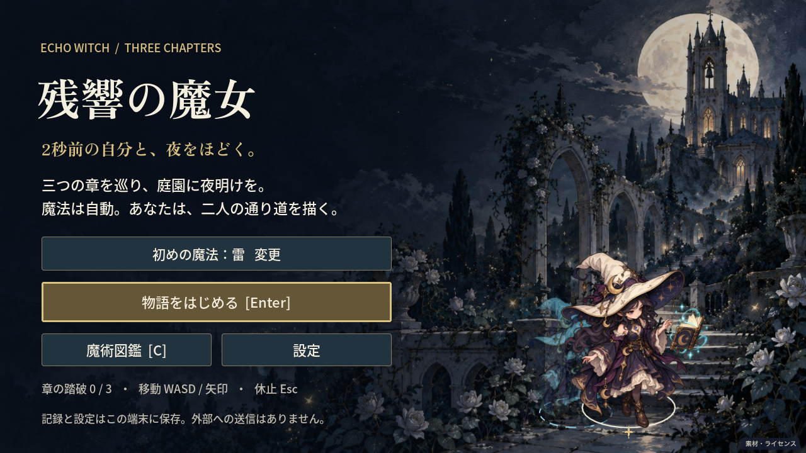
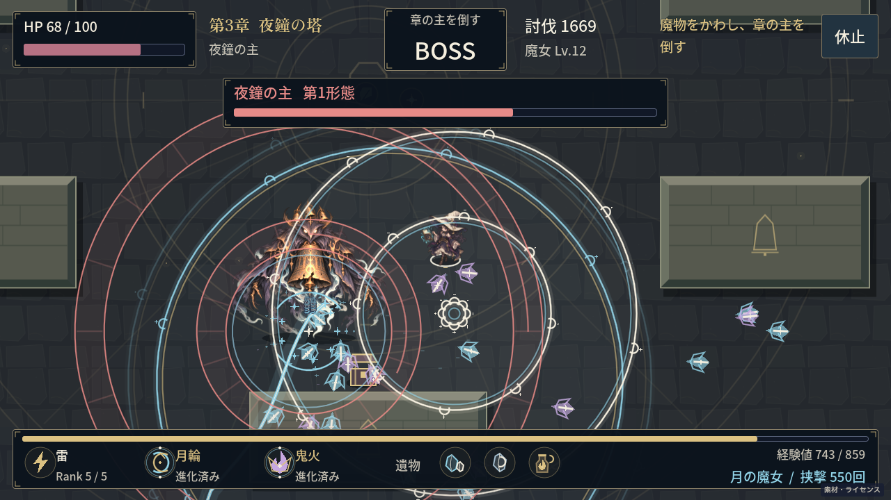
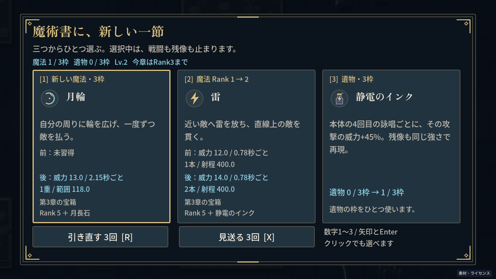

# 残響の魔女 本編の検証

状態: 実装・ローカル検証・Astraレビューを完了。CIの結果は該当PRに記録する。

実施日: 2026-10-22（Asia/Tokyo）。対象は`2026-10-19/`、継続課題は[Issue #196](https://github.com/hayatok/100challenge/issues/196)。公開済み3分版をもとに、三章の攻略、装備と進化、図鑑と保存、GUI・絵・音を実装した。

## 目的と範囲

- 目的: 2秒前の位置と魔法を再現する残像を残し、地形と装備の組み合わせで三章を攻略できる本編にする。
- 参照: 承認されたIssueの計画、既存の戦闘モデル、現在の[本編仕様](../CAMPAIGN.md)と[画面の方針](../ART_DIRECTION.md)。
- 制約: Godot 4.7.2、PCのキーボード・マウス、外部サービスへの送信なし。開始時から存在した別アプリの変更は保持し、専用worktreeで作業した。
- 今回の完了条件: 三章とボス、装備の引き継ぎ、成長・進化、敗北・再挑戦、停止、保存と解放を検証し、日本語の検査、Astraレビュー、PRとCIの記録をそろえる。

庭園・鏡の書庫・夜鐘の塔は、それぞれ異なる障害物と固有ボスを持つ。魔法6種・遺物12種から各3枠を選び、魔法ごとの進化とLv.4の専門化を組み合わせる。成長上限は章ごとにRank 3、4、5とし、進化は第3章の宝箱に限定した。開始武器の解放、発見、踏破、設定はブラウザ内に保存する。計画の候補だった紋章パズル、方向限定のボス弱点、恒久能力強化は実装していない。

## ルールと出力の検査

`npm run check`はインポート、検査、Web出力を完了した。[実行ログ](campaign/check.log)を保存した。

| 対象 | 結果と確認した内容 |
| --- | --- |
| 戦闘・成長 | 2,887件。2秒の残像、発射時の補正、停止、交換、6魔法と進化、遺物・ドロップ、地形経路、ボス・章遷移 |
| 保存 | 29件。版・識別子・数値の検査、破損・拒否、明示的な退避と初期化 |
| GUI | 1,240件。全画面、長い文言、文字拡大、選択と交換、結果の装備、専門化の引き直し無効化 |
| 音 | 24件。章とボスの切り替え、停止、音量、再挑戦時の開始管理 |
| 素材 | 113件。日本語・数字・記号の字形、ライセンス、画像の透過とサイズ |
| 星の描画 | 3,970条件。原点で図形を作り、0.5px未満は描かない。除外した136条件も記録 |
| 描画キャッシュ | 397件。120フレームの移動中に追加buildなし。三章、タイトル、再挑戦、画面幅変更後も同じリソースを利用。幾何とアトラスの領域・寸法を検査 |
| 状態の読み取り | 実際の埋め込みコードでJSONの引用符・Unicode・不正値、再帰freeze、置換、一時変数の削除を検査 |
| カタログ | ルート`npm test`の38件。変更対象の選択と配信構成 |

Godotは`4.7.2.stable.official.ed1daf0bf`、Compatibility描画、単一スレッドのWeb出力。ローカルのファイルとソースのSHA-256は[build.json](campaign/build.json)、素材のSHA-256は[assets-manifest.json](../assets-manifest.json)に記録した。ローカルmacOS出力とCIのLinux出力は区別する。

## 通常ルールでの複数ビルド

通常の`reset`、`tick`、候補選択、章移動APIだけを使うシミュレーションで3周完走した。HP、時刻、敵、経験値を書き換えず、接触と攻撃予告を見て移動を選ぶ。結果は[model-campaigns.json](campaign/model-campaigns.json)、実行は[model-campaigns.log](campaign/model-campaigns.log)。

| 開始武器・専門化 | seed | 勝利までの戦闘時間 | 終了HP | 最後の進化から勝利まで |
| --- | --- | --- | --- | --- |
| 雷・雷 | 731 | 674.83秒 | 100 | 98.03秒 |
| 月輪・月 | 2026 | 651.13秒 | 82 | 88.77秒 |
| 茨針・残響 | 196 | 680.37秒 | 68 | 115.60秒 |

全てLv.12で勝利した。3章の主要な選択数は11/6/5、11/5/5、12/3/5。各周に魔法の取得・成長14回、進化2回があり、回復選択は1/2/3回だった。序盤で全て成長しきる配分を改め、章ごとの上限と経験値を調整した。最後の主要強化を使う時間の目安90〜120秒に対し、月の例は88.77秒で少し短い。1周の自動入力だけで最適戦略や人間の面白さを証明するものではない。

モデルを3周続け、結果を解放した後のGodot静的メモリは各回25,164,813bytes、objects 1,487、resources 7で同じだった。[model-memory.log](campaign/model-memory.log)。これは描画とWeb音声を含まない検査である。

## 実際のWeb操作

独立した検証用ブラウザを使い、通常速度のキーとマウスで操作した。`window.echoWitchSnapshot`は状態の読み取りだけに使い、ゲームのHPや時刻を変更する機能は設けていない。検証用ブラウザはソフトウェア描画を使う場合があり、物理GPUの性能試験ではない。

初回の全編は619.70秒で最終ボスを倒し、HP48、Lv.12、1,673体撃破で勝利した。同じページで35秒再挑戦し、章・装備・レベルの初期化と音の開始を確認した。リロード後も三章の踏破と開始武器6種の解放が残った。17項目を通過し、予期しないconsole/page errorと外部リクエストは0件。[初回の記録](campaign/browser-eval-baseline/results.json)。この版には状態配信とHUD縁取りの最終修正は含まない。

描画キャッシュを入れる前の版も621.28秒で最終ボスを倒し、HP40、Lv.12、1,671体撃破で勝利した。同ページの35秒再挑戦と解放の再読込を含む18項目が通過し、予期しないエラーと外部リクエストは0件。配信開始前と終了後のPCKのSHA-256も同じだった。[キャッシュ導入前の通し記録](campaign/browser-before-cache/results.json)。

[Chromeの記録](campaign/edge-chrome-release/results.json)では敗北、結果から装備を確認して戻る操作、再挑戦、フォーカス喪失、960×540・1920×1080の停止、WASM読込失敗からの再読込まで9項目を通過した。[WebKitの記録](campaign/edge-webkit-release/results.json)は同じ主要操作の8項目を通過した。WebKitは検証用エンジンであり、実機Safariの確認としては扱わない。

[保存の記録](campaign/storage-release/results.json)は6つの独立した環境で86項目を通過した。設定の変更と再読込、未解放の開始武器、破損JSON、空データ、未知の版、読み取り拒否、書き込み拒否を確認した。異常系では意図してSecurityErrorとQuotaExceededErrorを発生させ、予期しないエラーと分けて記録した。データの退避・初期化を選ぶまで元データを保ち、保存できない状態でも操作できた。

実画面では1280×720、960×540、1920×1080、文字拡大、390pxの縦画面案内を確認した。タイトル、装備三択、交換、宝箱、章間、ボス、結果、図鑑、設定、保存の案内に実際の値を入れて操作した。初回に見つかったカードの折り返し、不要なボス枠、画面端の装飾、塔でのHUDのコントラストを修正した。アプリ内ブラウザでも開始、移動、強化選択、休止を操作した。

## 通し確認で見つけた問題

鬼火が消える直前の星で`Invalid polygon data, triangulation failed`が出た。寿命の端に小さな星を画面座標で組み立てると、浮動小数点の精度で面積を失うことを同じ条件で再現した。原点で組み立ててから移動し、見えない大きさは描かないようにした。[修正前](campaign/echo-polygon-before.log)と[修正後](campaign/echo-polygon-fixed.log)、[条件の検査](campaign/echo-star-geometry-check.log)を残した。

状態の配信は、更新ごとにJSONを含む新しいJavaScriptプログラムを`eval`する処理から、一度だけ初期化したprivate publisherへJSON文字列を渡す処理に変更した。外部に残すのは再帰freezeした読み取り専用の状態だけである。GodotのJavaScriptObjectは`call`をJavaScript側のメソッド名として扱うため、実Webで呼び出しを確認して`publish`を直接呼ぶ形に修正した。ルール検査だけでWeb連携の成功とは扱わない。

キャッシュ導入前は全編の最終ボス付近でJS heap約1,507MiB、同ページの再挑戦35秒でも約1,243MiB、renderer RSS約2,604MiBになった。固定publisherだけでこの増加が解消したとは扱わない。音を切った185秒の別実行でも約418MiBだった。

独立した60秒のallocation samplingでは、約198MiBの保持の大半がGLのvertex array、buffer、syncの管理表に割り当てられていた。検証用ブラウザだけでWebGLの生成・削除を数えると、60秒までにbuffer約589万個とvertex array約363万個を作り、大半を削除していた。30秒の休止中は両者の生成数が止まった。[割り当ての要約](campaign/performance/allocation-before-summary.json)と[生成数の記録](campaign/performance/gpu-before.json)。

同梱されたEmscriptenの`GL.getNewId`は共通の連番まで管理配列をnullで埋める実装で、[上流のIssue #22425](https://github.com/emscripten-core/emscripten/issues/22425)と同じ処理がある。今回の計測から、毎フレームの一時図形の生成が配列の増大を促すと判断した。エンジンのID割り当ては変更せず、静的な床・境界・障害物を保持し、小さい円を共有テクスチャで描く変更を検証する。

キャッシュ後の同じ検証手順による60秒比較では、bufferの生成が5,894,576から363,409（約94%減）、vertex arrayが3,626,155から312,674へ下がった。休止して明示的に回収した後のJS heapは約151MiBから約20MiBへ下がった。[変更後の生成数とメモリ](campaign/performance/gpu-after.json)。独立した通常プレイの比較であり、同一フレームを再生したGPUベンチマークではない。

Nativeの同じ配置見本では、旧新の三章の平均差は0.20〜0.31/255だった。主にテクスチャの再サンプルと円の縁の描画の差で、地形と予告の位置、前後関係は目視でも確認した。[比較の記録](campaign/echo-cache-native-compare.json)。移動中は保持した床とアトラスを再構築せず、再表示・画面幅変更の通常の再通知では描画回数が増える。同じ章のリソースは再利用され、保持する章は最大3件だった。[保持と再利用の検査](campaign/echo-cache-state-headless.log)。

キャッシュ後も通常速度で629.70秒の三章を完走し、HP52、Lv.12、1,676体撃破で勝利した。同ページの35秒再挑戦、解放の再読込を含む18項目が通過し、予期しないconsole/page errorと外部リクエストは0件。開始前後でPCKのSHA-256は同じだった。[最終版の全編記録](campaign/browser-final/results.json)。

全編の30秒間隔の計測ではJS heapの最大が約365MiB、再挑戦35秒では約391MiB、記録したrenderer RSSの最大が約1,260MiBだった。導入前の再挑戦35秒の約1,243MiB / RSS約2,604MiBから減った。初期の30秒休止では戦闘時刻と位置が変わらず、同ページの再挑戦でもキャッシュ数を増やす実装はない。通常戦の観測は主に60FPSで、初期化中にはそれを下回る値もあった。物理GPUの性能や全端末での60FPSを保証する値ではない。

メモリの増加がゼロになったとは扱わない。上流の連番管理は変更しておらず、無制限の連続周回は未検証である。今回確認した範囲は通常速度の全三章と、同じページの再挑戦35秒。複数ビルドの長さと成長配分は前述のモデル検証と分けて評価する。通常の全編ではGCを強制していない。回収後の保持を調べる別の診断だけで明示的にGCを呼び、通常の計測と分けた。Godot release版で静的メモリの値が0の項目は取得不可として扱い、使用量ゼロとは解釈しない。

キャッシュ後の初回全編は、章移行後0.05秒に新しい月輪の詠唱が1件記録された状態を「待機中の攻撃0件」と比較して停止した。残像は未出現、位置履歴は4件、直前の残像攻撃は空で、前章の残留を示す状態ではなかった。同期的なモデル検査ではリセット直後にキューが空になることを検査し、非同期のWeb検査では新しい章の経過時間、短い位置履歴、未出現の残像と空の残像攻撃を照合する形に直した。[誤判定の記録](campaign/performance/scene-observation-assertion.json)。ゲームのルールは変更していない。

## レビューと確認限界

実装は6.1 Sol、独立レビューは`ai_slop_reviewer` / `gpt-6-astra`。初回の指摘だった「進化が通常の強化にも出る」「専門化の引き直しが操作できるが変わらない」「結果から最終装備を確認できない」を修正し、再確認を受けた。ドロップの説明も実際の周囲攻撃と敵弾消去に合わせた。固定publisher、HUD縁取り、星の描画、回帰検査の差分にも追加の指摘はなかった。描画キャッシュ、回帰検査、最新の全編証拠、この記録とPR本文の再確認にも追加の指摘はなかった。確認範囲と残るメモリ使用量を明記したうえで、実装・ローカル検証・PR提出を妨げる重大未解決事項はないという判断となった。レビュー担当自身は実画面操作や再実行をしておらず、親が実行した記録とソースを確認した。

日本語は原文を保存して候補と読み比べ、`yomiyasu_check.py run`と実ファイルの`verify`で照合した。数値、装備名、進化条件、保存と未確認範囲を維持した。コードの句読点や表の列挙は文章の誤りと扱わず、ゲームの見出しは作品の文言として残した。検出件数を品質の点数には使っていない。

Firefoxの検証用バイナリはOSのsandbox extensionとSWGL初期化で終了し、ゲームの読み込みまで到達しなかった。[起動失敗の記録](campaign/edge-firefox-final/launch-failure.json)。セキュリティ設定は弱めていない。Firefox、実機Safari、タッチ操作、低性能PCでの性能、人間の初見試遊は未確認。遊びの理解や難易度は、人間の試遊で引き続き確認する必要がある。

今回の作業はローカル実装とPRまで。CIの結果は該当PRのチェック欄を正とし、ローカルの成功と区別する。新しい本編の公開環境での確認は未実施。

差分の空白検査では、公式配布の`ZEN-OFL.txt`に含まれる末尾空白1か所を原文とSHA-256の保持のため残した。それ以外の今回の差分を検査した。
