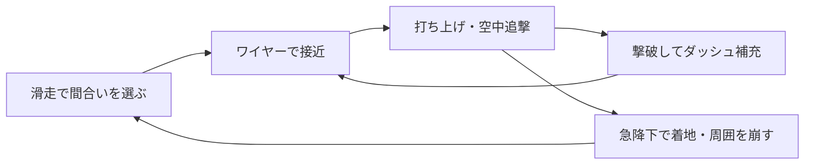

# 天砕 — TENSAI 制作計画

作成日：2026-10-24（Asia/Tokyo）。状態：設計案。ゲーム実装・素材制作・実機検証は未着手。

## 1. 目的と確定した条件

剣とワイヤーで戦場を横断し、自分の判断で連続技をつなぐ三人称3Dアクションを作る。操作への反応、キャラクターの動き、カメラ、命中の音と映像を揃え、繰り返し遊ぶほど上達が分かる作品にする。

ユーザーが指定した条件は次のとおり。

- macOSアプリを中心に制作し、ブラウザ版も用意する。
- ブラウザ用にアプリ版の品質を妥協しない。
- 不要なセカンダリラベルや説明文を避け、レイアウトに説明させる。
- 今回は最高品質を目指すためのプランニングを行う。

ここでの完成条件は、起動から導入、戦闘、ボス、決着、再挑戦まで通して遊べ、実Macで操作・絵・音・速度を評価できること。機能の種類や自動検査の件数だけでは完成を判断しない。

以降の操作割当、数値、敵の数、所要時間、性能値は初期案。実装済みの仕様や達成済みの測定値ではない。

## 2. 作品の核と全体規模

舞台は雲海の上に崩れかけた巨大な円環遺跡。朱色の剣士が、崩落を止めるために中心の機構へ向かう。青空、白い石、暗い藍の敵、細い金色の接続点で、速く動いても進路を読み取れる画面を作る。

中心となる行動は、滑走、ワイヤー接近、打ち上げ、空中追撃、急降下。敵の位置を次の移動先として使い、地上へ戻るか空中を渡るかを選ぶ。

最初の完成版は、初見30〜45分程度を仮の目安とする。三つの連続区画、通常敵5系統、既存の技を発展させた強敵2体、最終ボス1体を候補にする。所要時間を延ばすための通路や敵の反復は足さず、試遊で区画の密度と長さを決める。

武器は剣とワイヤーの一組。基本技は導入で使えるようにし、成長は進路の選択、技の組み合わせ、敵への対応で感じられるようにする。区画選択、自己ベスト、戦闘評価で再挑戦を支える。装備抽選、素材集め、オンライン対戦、オープンワールドは初回の範囲に含めない。

## 3. 操作、移動、戦闘

### 入力と行動

| 行動 | キーボード・マウスの初期案 | パッドの初期案（Xbox表記） |
| --- | --- | --- |
| 移動／視点 | WASD／マウス | 左／右スティック |
| 通常斬り／強攻撃 | 左／右クリック | RB／RT |
| ジャンプ | Space | A |
| ダッシュ、地上で長押しすると滑走 | Shift | B |
| ワイヤー | E | LT |
| ロック切替／対象変更 | Q／ホイール | R3／ロック中の右スティック短入力 |
| ポーズ | Esc | Menu |

攻撃を肩ボタンに割り当て、攻撃中も右スティックで視点を操作できるようにする。キー変更、感度、上下反転、スティックのデッドゾーンを用意し、接続した機器に合う表記へ切り替える。Macのキーボードと実際のパッドで同時入力を確認する。

- 通常斬りは地上・空中それぞれ三段。方向入力とダッシュで、定めたタイミングから次の動作へ移れる。
- 地上の強攻撃は軽い敵を打ち上げ、空中の強攻撃は急降下する。急降下の着地点は序盤だけ調整でき、直前に予告位置が大きく変わらないようにする。
- 空中ダッシュは2回。撃破1体につき1回補充し、上限2回。安定した足場に着くと全回復する。
- ダッシュは入力時に始め、地上で押し続けた場合に滑走へ移る。長押し判定のために初動を遅らせない。
- ワイヤーは主人公を対象へ運ぶ。移動用の固定アンカーと攻撃対象の敵を形で区別する。
- 同じ敵への空中ワイヤー接続は一度までとし、着地で履歴を戻す。空中三段後は落下を進め、敵を替えるか着地する判断を作る。
- 重い敵は通常攻撃で浮かず、盾兵は正面の連打を止める。敵ごとに崩れる条件を設け、連打だけで拘束し続けられないようにする。

初期調整の候補は、先行入力100〜150ms、足場を離れた直後のジャンプ猶予80〜120ms、軽打の停止30〜50ms、強打60〜90ms、接続距離12〜18m。値は操作録画と試遊で決め、全攻撃に一律適用しない。

### 移動を途切れさせない条件

敵を全滅させた後も進める固定アンカーと足場を置く。敵の生存を必須の渡り手段にしない。必須ルートは通常の操作で往復・復帰でき、隠し経路だけに高度な連係を要求する。

落下時は直前の安全な足場へ戻し、少量の体力損失と連続評価の終了を初期案とする。長い読み込みや同じ導入の強制反復を避ける。戦闘区画の入口とボス前にチェックポイントを置く。

### 対象選択とカメラ

自由視点では、画面中央に近く、視線が通り、到達可能な対象を候補にする。小さな輪で示した相手に入力どおり接続する。入力した瞬間に別の敵へ飛ぶような選び直しをしない。

ロック中は選択を維持し、死亡・範囲外・継続した遮蔽で解除する。候補の死亡と同時に入力した場合は別の敵へ飛ばず、不成立を短い音と表示で返す。アンカーとの優先順位は最初の上下移動試験で確定する。

通常は少し引いた後方視点。主人公、足元、次の接続先を同時に見せる。ロック中は敵の構えを、打ち上げでは空中の進路を、急降下では着地点を確保する。接続時の強制反転を避け、壁際では球状の衝突検査と必要な遮蔽物の透過を使う。

画面外の敵は接近・位置取りを続けるが、予告なく新しい近接攻撃や射撃を始めない。視界内で始まった攻撃は、外へ出た後も方向音と端の合図で伝える。敵が攻撃を始める人数を制限する。カメラを背けて攻撃を止め続ける行動も試し、位置取りの設計と合わせて調整する。

## 4. 敵、区画、ボス

| 敵の役割 | 見分け方とプレイヤーの判断 |
| --- | --- |
| 軽兵 | 細い体と短い剣。打ち上げ、追撃、次の敵への移動を学ぶ |
| 盾兵 | 幅のある盾。正面を避け、背後への回り込みか急降下を選ぶ |
| 射手 | 肩の弓と照準の予告。先に接近するか、遮蔽物へ退く |
| 重兵 | 太い脚と大きな武器。攻撃後の隙に地上から崩す |
| 浮遊哨戒 | 輪状の翼。空中で渡る経路と、優先して倒す対象を作る |

| 区画 | 遊びと景色の変化 | 完了の判断 |
| --- | --- | --- |
| 風の参道 | 広い足場、途切れた橋、少数の敵。移動→接続→打ち上げを順に体験する | 基本の連係を使って門衛を倒す |
| 砕けた回廊 | 円環の内外を上下移動。盾兵、射手、浮遊敵を組み合わせる | 安全な遠回りと短い空中経路を選んで中心へ届く |
| 天の炉 | 雲が開ける高所。地上と空中を交互に使う戦闘、静かな接近、最終ボス | 巨像の核を砕き、遺跡の崩落を止める |

強敵は通常敵の技を理解したかを確かめる中継点にする。最初の門衛は盾と大振りを使い、空中追撃と着地の両方を試せる短い一戦として仕上げる。

最終ボスは白石の巨像「天守」。前腕の薙ぎ払いを回避して地上反撃、床の衝撃波を跳び、大技後に露出する肩の接続点へ登り、核を斬って急降下で帰還する。後半は既習攻撃の組み合わせと足場変化を使う。登った直後の不可避攻撃、理由の読めない無敵、初見だけが避けられない即死は作らない。

結果画面では所要時間、被弾、連係の変化を別々に示す。時間に恣意的な得点補正を掛けず、評価の計算と同じ敵への反復対策は試作で検証して仕様化する。難易度補助や描画設定によって記録の比較条件が変わる場合は区別する。

## 5. アート、モーション、音

### 画面の約束

「大きく残した青空を、朱の剣士が縫う」を一枚の画面で伝える。欠けた円を遺跡、刀の鍔、射出器、UIの端部に使う。作品の形を揃え、背景の細部が攻撃予告と競わないようにする。

- 主人公：短い朱の上衣、濃紺の脚、白い片肩、二股の腰布、片腕の射出器。後方から向きと姿勢が読める全身モデル。
- 遺跡：温かい白石の上面、青灰の影、割れ目の暗い芯。足場の端と背景の浮島を明度・厚み・形でも分ける。
- 敵：暗い藍と割れた白殻。武器と体格で役割を示す。金色は接続点と成功反応へ絞る。
- 光：macOS版で柔らかな陰影、雲の奥行き、金属の反射を作る。移動先の見え方を天候や露出変化で壊さない。

### 実際の3D素材を完成させる工程

コンセプトと三面図→Blenderのモデル・UV・材質→リグと動作→Godotの実カメラ→通常操作の録画、の順で確認する。原本、書き出し設定、素材の出典と加工履歴を保存する。既製素材を使う場合も、画風、骨格、配布条件を確認してから採用する。

主人公と敵一体を先に完成見本へ進める。待機、走行、滑走、ジャンプ、空中旋回、ワイヤー射出・牽引、地上・空中の三段、強攻撃、回避、被弾、着地、敗北の接続を揃える。刀と手の接触、足滑り、腰の向き、布と体の貫通を実際の速度で確認する。布はまず骨で制御し、技の輪郭を守る。

外見の仮素材を完成扱いにしない。コンセプトだけが完成している状態や、単体レンダーだけが美しい状態で量産へ進めない。見本に必要な造形やモーションが不足した場合は、その制作方法・手修正・素材選定を見直す。

### 命中と音楽

斬撃の弧、接触点の火花、敵の姿勢変化、短い停止、金属音を同じ命中イベントへ同期する。通常命中、強打、鎧破壊、撃破で形・長さ・音の重さを変える。全画面の閃光を常用せず、破片と残像が予告を覆う場合は減衰させる。

ワイヤーには射出・接続・張力・解除の音を用意する。危険音を音楽や撃破音より優先し、音声数と音量に上限を設ける。実際のスピーカーとヘッドホンで聞き、割れ、疲労、予告の埋没を確認する。

音楽は透明感のあるシンセ、乾いた打楽器、短い弦の動機で統一する。探索、交戦、空中連係、ボス後半の層を小節境界で切り替える。技が続くと音楽も高まるが、評価が一瞬切れるたびに曲を急変させない。

## 6. UIと導入

画面の中心はプレイと進路に使う。情報を説明札で囲まず、位置、大小、間隔、選択状態で役割を伝える。タイトル、HUD、結果、休止・設定まで、最初の画面案に実際の文言と値を入れる。

| 画面 | 初期の構成 |
| --- | --- |
| タイトル | 左に「天砕」、右に剣士と遠景。「はじめる」「つづける」「設定」。保存がなければ「つづける」は出さない |
| 読み込み | 遠景と進捗線。取得できる実進捗だけを示し、架空の百分率を作らない |
| 通常プレイ | 左下に体力とダッシュ2回分。接続先には小さな輪。常設の操作一覧や目的説明で画面を埋めない |
| ボス | 上端に「天守」と体力線。段階変化は姿勢・装甲・音楽でも知らせる |
| ポーズ・設定 | 「つづける」「やり直す」「設定」「タイトルへ」。設定は操作、カメラ、音、表示を直接選ぶ |
| 結果 | 「踏破」、仮表示例「03:42.81」、必要な評価内訳。「再挑戦」を主操作にする |

導入は、跳べる小さな段差→固定アンカー→軽兵一体→複数敵の順に配置する。初めて必要になる操作だけを短く提示し、成功後は消す。操作が分からなくなった場合はポーズから確認できる。

ロゴは独自の造形、本文は日本語の読みやすい書体、数字は等幅を基本にする。作品用の紙白・藍・朱・金の役割を、実装時のアプリ固有トークンへ記録する。共通指針の入力名、フォーカス、44px相当以上の操作面は維持する。

文字拡大、字幕、独立した音量、カメラ揺れ・点滅・速度による視野角変化の軽減、再割当を用意する。軽減しても敵の攻撃時間や当たり判定を変えず、色以外の形と動作で危険を伝える。macOSの16:10と16:9を確認し、文字や設定が狭い画面でも欠けないようにする。

## 7. 技術と二つの配布版

Godot／GDScriptとBlenderを第一候補とする。既存作のGodot 4.7.2固定手順を調査材料にするが、採用版はmacOSとWebの初期試験後に確定する。

| 項目 | macOSアプリ | ブラウザ版 |
| --- | --- | --- |
| 位置付け | 作品全体の完成品質の基準 | 同じ本編をURLから遊ぶ配布版 |
| 描画の第一候補 | Forward+。選定版のMetalまたはVulkan／MoltenVK対応を実Macで確認 | Compatibility／WebGL 2。単一スレッドを初期候補とする |
| 共通部分 | 操作、移動、衝突、敵AI、レベル、モデル原本、リグ、アニメーション、攻撃イベント | 左記と同じ。描画差が戦闘の時間やルールへ波及しないようにする |
| 個別に仕上げる部分 | 光、影、雲、反射、粒子、ポスト処理を主基準で制作 | 光や霧の代替方式、粒子、テクスチャ配信、解像度設定を別に調整 |
| 保存 | 端末内の設定、チェックポイント、記録 | ブラウザ内保存。利用不可・容量不足と再読込後の復元を確認 |
| 配布と起動 | `.app` のパッケージ、署名、公証、ダウンロード後の起動 | 読み込み、音声開始、ポインターロック、タブ復帰、キャッシュ更新 |

同一素材から各版に必要な派生データを作り、元の高品質素材を維持する。別シェーダーや雲の代替が必要でも、ネイティブの表現を削って共通化しない。Webで制約が見つかった場合は描画・出力方法を再検討し、両版で同じ画質を実現できたと未確認のまま扱わない。ブラウザ版を無断で体験版へ縮小しない。

CharacterBody3Dによる移動と明示した行動状態を軸にする。移動は入力と衝突から決定し、アニメーションはAnimationTreeで追従・混合する。短い技に必要なroot motionだけを衝突側へ渡し、長いモーションが操作を拘束しないようにする。

ワイヤーは制御可能な加速・接近・解除を設計し、完全な物理ロープを必須にしない。物理60Hzと補間を出発点に、移動経路と剣先を連続的に検査して高速時の抜けを防ぐ。両出力で同じ物理設定を試すが、完全なビット単位の一致は前提にしない。

コードはプレイヤー、カメラ、対象選択、戦闘、敵、遭遇管理、表示・音、保存、描画プロファイルに責務を分ける。ヒットストップとポーズを区別し、フォーカス喪失では戦闘・演出・入力を一緒に止める。再開時に押しっぱなしの攻撃を持ち越さず、再挑戦で敵・接続履歴・粒子・音・記録を初期化する。

ネイティブとWebの設定はビルド時に生成し、手動の設定差し替えに依存しない。エンジン・テンプレート・素材一覧・コミットを記録し、同じ入力から再生成できるようにする。

macOSはApple Siliconを最初の基準候補とする。Intel対応は実機を用意して別に判断する。一般配布はDeveloper ID署名と公証を計画に含める。必要なApple開発者アカウントと署名環境の有無はG0で確認し、個人試遊用のアドホック署名と区別する。

## 8. 制作順と次へ進む条件

| 工程 | 作るもの・確認すること | 次へ進む条件 |
| --- | --- | --- |
| G0 基盤と品質見本の設計 | 基準Mac・OS・入力機器・エンジンを決める。macOS／Webの最小出力、描画差、保存、配布の準備を確認。全画面の構図と主人公の輪郭を設計 | 実Macで両版を起動でき、未対応の描画機能と配布上の依存が分かる |
| G1 操作と素材の試作 | 仮の足場で滑走→接近→打ち上げ→急降下をつなぐ。巨像相当の仮形状と動く肩の接続点で、登攀→攻撃→帰還も試す。並行して主人公・敵一体・遺跡一区画の完成見本を作る | 自分で対象と着地点を選べる。壁際・上下移動・巨像への接近でカメラと衝突が両版とも成立する。完成素材を実カメラへ入れて評価できる |
| G2 完成品質の一区画 | 8〜12分を仮目安に、移動区間、軽兵・盾兵・射手、門衛戦を一続きに仕上げる。タイトル、音、HUD、設定、敗北、再挑戦も含む | 通常操作の通し録画と初見試遊で、操作・アート・音の基準を満たす。Webでも同じ内容を操作できる |
| G3 本編の展開 | 回廊と天の炉、残りの敵、強敵、天守、区画選択と保存を作る | 三区画に異なる判断があり、同じ敵配置の繰り返しにならない。両版で全編を完走できる |
| G4 配布物の仕上げ | 難度とカメラの最終調整、実Mac性能、Safari／Chrome、長時間プレイ、署名済み配布物、操作と音の確認 | 下記の完成基準を満たし、配布物から開始・完走・再起動・再挑戦できる |

進行の軸は「移動とカメラ」→「実際の素材と動作の接続」→「一区画の完成」→「本編の拡張」。モデル・背景・音は並行して制作するが、G1の見本を確認してから量産する。Webの描画差はG0から扱い、終盤へ先送りしない。

実装開始時はG0〜G1を最初の作業単位にする。G1で移動・動作・素材一式に必要な制作量を測り、その結果から後続の工数を見積もる。品質条件を満たさない場合は、その箇所を直して同じ条件で再確認する。

## 9. 完成品質の確認方法

### 実際に遊んで確かめること

- 初見の試遊を5人程度の小さな組で行い、まず4人が5分以内にワイヤー→空中攻撃→着地を自力で成功することを目安にする。統計的な証明にはせず、失敗した理由を観察する。
- 狙った敵、着地する位置、被弾した理由を説明できるかを聞く。説明文を増やす前に、対象選択・配置・予告を見直す。
- 地上で攻める人、空中をつなぐ人の双方が混成戦を攻略できるかを確認する。連打や同じ敵の拘束だけが最適にならないようにする。
- 上下に敵がいる、壁に背を向ける、対象が直前に死ぬ、資源を使い切る、敵が全滅する、着地直前に再入力する場面を試す。
- 自然な通しプレイで、最初の移動から決着・再挑戦まで確認する。人工配置や状態を変更した検証は別に記録する。

人の試遊を実施できていない段階では、面白さ・酔いにくさ・聴感を確認済みとしない。ユーザーによる試遊も、端末と操作条件を記録してこの工程へ取り込む。

### 絵と音

通常の操作距離で、剣士の向き、次の接続先、敵の構え、足場の端が読めること。足滑り、刀と手の離れ、体や布の大きな貫通を残さない。最激戦でも予告とHUDを読めること。コンセプト・実画面の同じ構図を比較し、静止画と動作中の両方を評価する。

メニューから通常戦、ボス、結果まで、書体・枠・光・音に一貫性があること。実音声で予告が聞こえ、連続戦闘でも音が割れず、音楽と命中が干渉しないこと。

### 性能と動作

初期目標は次のとおり。基準Macの型番・メモリ・OS・電源状態・描画API・表示解像度をG0で固定してから測る。

| 項目 | 初期目標と測定方法 |
| --- | --- |
| macOSの描画 | 1920×1080相当・60fps。M2／16GB級を基準候補とし、機体確定後に目標を再確認。最も重い戦闘5分でフレーム時間p95 ≤16.7ms、p99 ≤25msを目安に調整 |
| Webの描画 | 同じMacのSafari／Chromeで別に測定。1280×720・60fpsを初期目標にし、実解像度と品質設定を明記。アプリ側の品質を下げて達成しない |
| 応答 | 通常状態の移動・回避は受理した物理フレームで処理。入力から画面までの遅れは実機録画で確認し、コード上の処理だけで低遅延を主張しない |
| 起動・再挑戦 | コールド起動、保存からの再開、読み込み完了後のリトライを分けて計測。再挑戦は操作可能まで2秒以内を初期目標にする |
| 継続プレイ | 全編と再挑戦を含む60分程度でメモリ推移、音声・粒子・ノードの残留を確認。GCによる一時変動と継続的な増加を分ける |
| 保存・復帰 | 途中保存、設定変更、アプリ再起動、ブラウザ再読込、保存不可、ウィンドウ切替、スリープ、パッドの接続解除を確認 |
| 配布 | 署名・公証した配布物を実Macに新規取得して起動。Webは公開用と同じ出力で内容とキャッシュ更新を確認 |

自動検査は、撃破時の回復上限、同一敵の接続履歴、連続衝突、攻撃の重複判定、保存復元、ポーズと初期化など、壊れると遊べなくなる規則へ集中する。実装をなぞるだけの大量テストは作らない。

## 10. 主要な不確実性と早期の対処

| 不確実性 | 最初に確かめること | 判断と対処 |
| --- | --- | --- |
| 高速移動で見失う・酔う | 上下移動と壁際をG1で連続操作 | 追従、対象選択、余白、速度変化を修正。演出の追加で補わない |
| 空中連係が単調になる | 地上／空中の複数方針で混成戦を比較 | 敵の役割、接続履歴、崩れ方、着地の利点を調整 |
| 絵と動作が完成水準に届かない | 主人公・敵一体を実カメラで動かす | 造形・リグ・クリップ接続を直す。見本の品質が揃うまで量産しない |
| macOSとWebで描画機能が違う | 同じ場面を両プロファイルで出力 | Webの代替表現・素材処理を分ける。ネイティブ品質を共通の低い設定へ寄せない |
| 基準Macと署名環境が未確定 | G0で機体・OS・Apple開発者アカウントの利用可否を確認 | 実機試験と配布工程の担当・環境を確保。一般配布準備と個人試遊を混同しない |
| 開発環境だけでは品質を評価できない | 実Macへ渡せる最小出力を早期に作る | Linuxでの検査とMacでの描画・音・操作の評価を別に記録 |

Windows、Intel Mac、タッチ操作は初回の確定対象にしない。将来の対応を妨げない構造を使うが、未試験の環境を対応済みと表示しない。

## 11. 調査根拠と今回の検証範囲

既存作の調査から、版固定、出力、ライセンス記録、検証方法を再利用候補とした。

- [BLACK RELAYの出力スクリプト](../../2026-10-02/scripts/godot.mjs)：Godot 4.7.2の確認、WebとmacOS等の出力、Macパッケージ処理。
- [同作の出力設定](../../2026-10-02/game/export_presets.cfg)：Webの単一スレッド、macOSのUniversal出力とアドホック署名。これだけでは正式配布やIntel動作を保証しない。
- [全力退勤の移動](../../2026-10-14/game/scripts/player.gd)と[カメラ](../../2026-10-14/game/scripts/main.gd)：床面移動と固定方向の追従。今回の自由な空中戦は専用設計が必要。
- [BLACK RELAYの検証記録](../../2026-10-02/docs/URBAN_QA.md)：ソフトウェア描画、実音声・実OSの確認範囲、仮配置と通常プレイの違い。
- [共通デザイン指針](../../docs/DESIGN.md)：レイアウトで伝えること、必要なラベルとフォーカス、作品ごとの表現。

今回行う確認は、これらの資料と計画の整合、文書のリンク、差分、独立した設計レビュー。コードやモデルを作らず、性能・実画面・音・面白さの検証は今後の工程に置く。

日本語は追加文書の全文を目視で確認する。`yomiyasu` は利用可能なクラウド／実行環境の一覧と標準スキル配置に見つからず、専用のlint・run・verifyは未実施。最終のAI Slopレビュー結果は完了報告に記録する。
