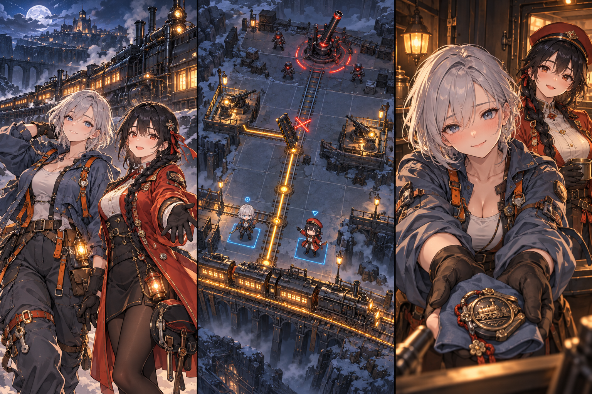

# 線路の砦
物流シミュレーション × ターン制戦術

開発前の企画案です。画像は完成後の画面を想像するためのもので、ゲームはまだ実装していません。プレイ時間と開発期間は目標です。

プレイヤーは列車と砲台を守る指揮官となり、敵が襲う峡谷を抜けることを目指す。この世界の可動式レールは、跳ね上げると敵弾を防ぐ壁になる。ただし、防壁にした区間は列車が通れず、前線の砲台に弾薬が届かなくなる。プレイヤーは敵の攻撃予告と列車の到着予定を見て、どのレールをいつ防壁にするかを決める。防衛を終えたら、設計士セナと機関士ヒナと作戦を振り返り、残った資材と車両の損傷を次の区間へ持ち越す。

## 1. プレイヤーは何を目指すのか

列車を守って峡谷を抜けるために、レールを輸送路として残すか、防壁にするかを判断する。

### 可動式レールで砲台を守る

プレイヤーは指揮官として線路を敷き、列車で砲台へ弾薬を届ける。敵の攻撃が迫ったときは、レールを跳ね上げて防壁にできる。ただし、その場所で列車が止まるため、防壁で砲台を守ったあとに弾薬不足になる場合がある。1回10〜20分の防衛区間で、攻撃を防ぐ場所と補給を通す場所を選ぶ。

### 作戦のあとに二人と話す

設計士セナは防壁がどこまで攻撃に耐えられるかを示し、機関士ヒナは列車がいつ到着するかを伝える。プレイヤーは二人の情報を基に作戦を決める。防衛を終えると車庫へ戻り、被害の理由や翌日の仕事を話し合う。登場するヒロインは全員成人で、全年齢向けとする。掲載画像は企画のイメージであり、ゲーム画面はまだ実装していない。

## 2. 各ターンに何を選び、何が起こるのか

工事を仮に配置すると、列車の停止位置や砲台の残弾がどう変わるかを確認できる。

### 工事に使う点数と処理の順序

戦場は縦7×横5マスで構成する。プレイヤーは各ターンに工事点3を受け取り、その範囲で工事を選ぶ。線路の敷設、レールの防壁化、防壁を戻して再開通する操作には各1点、損傷の修理には2点を使う。工事は確定するまで仮の配置なので、何度でも取り消せる。確定すると未使用の点数は失われ、列車が最大2マス進んで接続先へ荷物を渡す。その後に敵が予告した移動と攻撃を行い、生き残った砲台が弾薬1を使って反撃する。防壁になったマスでは列車が止まり、荷物は列車に積んだままになる。

### 確定する前に結果を確認する

画面には敵の次の移動先と攻撃の通り道、列車の停止予定位置、補給先の弾薬数を表示する。プレイヤーが工事を仮に配置すると、届く荷物は実線で、途中で止まる荷物は点線で示され、砲台の次ターンの残弾も更新される。増援の敵は、出現する場所と種類を2ターン前に知らせる。未探索の区間の情報は隠すが、既に表示した攻撃は理由なく変更せず、乱数によって予測と結果を食い違わせない。

### 同じ状況で防壁と修理を比べる

耐久が最大3のうち1、残弾が1の砲台を考える。弾薬2を積んだ列車が砲台の一つ手前におり、敵は次に砲台の耐久を1減らす攻撃をする。レールを防壁にする案では、工事点1で攻撃を防げるため、残り2点をほかの工事に使える。ただし列車も止まり、砲台が反撃したあとの残弾は0になる。レールを開けたまま修理する案では、2点を使って耐久を2回復する。列車が弾薬を渡してから攻撃と反撃が起こるため、砲台には耐久2と残弾2が残る。プレイヤーは、今使える工事点と次のターンの備えを比べて決める。

### 防壁を出したままにできない理由

防壁にも耐久があり、敵弾を受け続けると壊れる。また、列車の迂回路を敷くには資材と工事点が必要なので、全ての線路に別の道を用意することはできない。開閉の操作に説明のない追加費用は設けず、補給が止まることと工事点を消費することを負担にする。正面から撃つ敵、側面へ回る敵、線路を狙う敵の3種を配置し、区間ごとに必要な対応を変える。特定の区間では閉じ続ける作戦も認めるが、その作戦だけで全区間を突破できる配置にはしない。

## 3. 本編を進めると判断がどう変わるのか

序盤は一本の線路で開閉を覚え、中盤では二つの補給先のどちらを優先するか考える。

### 最初の15分で覚えること

導入区間では線路1本、列車1両、砲台1門、敵2種だけを扱う。最初の3ターンで、弾薬を届ける、レールを防壁にする、防壁を戻して列車を通す、という順に操作する。その後は到着まで2ターンかかる列車を待つか、手元の弾薬だけで戦うかを自分で決める。区間を終えたら車庫で車両の損傷と残った荷物を確認し、二人との会話を選ぶ。初回は次の区間を選ぶところまで進め、操作説明を読むだけで15分を使わない構成を目指す。

### 中盤の15分で迷うこと

中盤の線路は住民の避難駅と修理工場へ分かれる。最初の3分で列車の到着予定と両方の物資需要を調べ、次の7分で補給先と防壁の位置を切り替え、最後の5分で撤収する列車を通す構成を想定する。避難駅を先に支援すると住民を運びやすくなる一方、修理工場に回す在庫は減る。同じ開閉操作を使いながら、二つの拠点へどの順番で物資を渡すかが新しい判断になる。区間の途中でも保存できるため、15分間続けて遊ぶ必要はない。

### 次の区間へ残るものと終盤の目標

共通資材、車両の損傷、救援の結果、二人との会話記録は次の区間へ引き継ぐ。砲台の残弾は区間の終了時に精算し、細かな在庫を延々と管理させない。車両の損傷が重い場合は、次の区間へ進む前に基本修理を受けられるようにし、敗北の累積で進めなくなる事態を防ぐ。終盤では最後の列車を通したあとにレールを防壁に変え、追撃を止める。誰を救援できたかは後日談に反映するが、恋愛の選択を理由に戦術に必要な設備を使えなくすることはない。

### 本編の量をどこまで作るか

本編の長さは3〜6時間を設計目標とする。実際に遊んで測った時間ではない。防衛12区間、任意に選べる小目標4件、敵3種、列車2種、防衛設備3種を仮の上限とし、ヒロインごとに個別の話を4話作る。個別の話は車庫で進み、共通の防衛区間で起きた結果に合わせて短い反応を変える。制作量が膨らんだ場合は、小目標、別の攻略法を増やす配置、環境の変種の順に減らす。レールの開閉と補給、二人との最終話、結果を正しく示す予測表示は残す。

## 4. セナとヒナとの関係はどう深まるのか

作戦で異なる意見を聞き、撤収後には仕事から離れた会話を重ねる。

### セナ（24歳）

セナは銀髪のボブで、灰青の作業服を着ている。耳に細い鉛筆を差して作業する。
設計士として地形と設備の損傷を調べ、少ない資材で攻撃に耐えられる防壁を設計する。危険だと考えた作戦には、理由を示して反対する。
設計図は几帳面に描くが、余白には丸い列車の落書きを隠している。作戦の判断は早いのに、夜食を何にするかは決められない。
「その線を残すの、怖いよ。……でも、あなたが守るなら、私が持たせる」

### ヒナ（22歳）

ヒナは黒髪を三つ編みにし、赤橙の運転服を着ている。仕事中は袖をまくって列車を整備する。
機関士として燃料、荷の重量、線路の勾配を確かめて列車を走らせる。時刻を守ることより、人と荷物を無事に届けることを優先する。
普段は威勢よく話すが、感謝を真正面から伝えられると返事に困る。照れた顔を見られないよう、汽笛の点検を始める。
「帰りの席、空けといた。指揮官だからじゃないよ。隣にいてほしいだけ」

### 作戦で意見が分かれる場面

セナは砲台を守るためにレールを防壁にする案を出し、ヒナはその前に補給列車を一便通す案を出す。二人はそれぞれ、設計と運行の仕事に責任を持って提案する。プレイヤーが提案を採用しなくても、二人が不機嫌になって仕事の能力を下げることはない。作戦後に選択の理由を話すと、二人が互いの仕事を理解する会話の内容が変わる。

### 車庫で聞く仕事以外の話

セナとの個別の話は、設計図に描いた落書きを見つけるところから始まる。会話を重ねると、失敗した計画を人に見せられない彼女の癖を知る。ヒナとの話では、毎晩空席を点検しながら、誰を待っているのか言えずにいる姿を見る。交流は任務の合間に1〜3分ずつ進む。プレイヤーは慰める、黙って隣に座る、明日の作業を一緒に組むといった行動を選び、それぞれへの接し方を示す。

### 失敗後の交流と恋愛の選択

補給列車を止めてしまった夜は、セナが損傷箇所を説明し、ヒナが冷めた夜食を温め直す。三人は被害をなかったことにせず、翌日に何をやり直すか話し合う。設備は本編の進行に応じて使えるようになるので、能力を得るために好感度を稼ぐ必要はない。各4話の個別の話も、出撃を繰り返して回数を稼ぐ方式にはせず、章の進行と話す相手の選択で読める。最終話では、一人と恋人として付き合うか、仕事仲間として関係を続けるかを選べる。

## 5. スマホでの操作と画面の設計

縦持ちで片手操作する想定を示す。図版は設計案であり、実機の操作性と性能は未確認。

### マスを選んでからターンを進めるまで

主な設計サイズは390×844とし、360×800でも操作できるか確認する。画面上部には残弾と列車の時刻、中央には戦場のマス、下部には工事の選択と確定ボタンを置く。プレイヤーがマスを触ると、そこで行える工事が下部に表示される。工事を仮に配置し、列車の停止位置と被害の予測を確認してから、下端の「ターン確定」を押す。敵の処理が終わったら、変わった在庫を短時間だけ強調する。

### 押し間違いを取り消す方法

マスに触っただけでは工事を実行しない。仮の工事には常に取消ボタンを用意し、別のマスへ選び直しても工事点を失わないようにする。ターンを確定したあとの経過は、一つずつ表示を送って確認できる。主要ボタンの高さは48px以上とし、隣り合う操作との間に余白を設ける。小さい画面では詳細説明を下から開き、戦場と長文を同時に詰め込まない。

### 開始、保存、結果の画面

タイトル画面には「つづきから」と章の選択を置く。最初の読込中は進捗を表示し、素材を読めなかった場合は再読込を案内する。ターンの終了時と車庫への到着時に端末へ保存し、保存に失敗した場合は再試行と保存データの書き出しを案内する。結果画面では被害と次に選べる行き先を確認できる。設定では音量、文字サイズ、演出量を変えられ、空の記録欄には何をすると記録が増えるかを示す。

### 文字、色、演出で状態を伝える

見出しには太い角ゴシック、本文には読みやすい日本語サンセリフ、残弾には幅のそろった数字の書体を候補とする。採用前に必要な字形と配布条件を確認する。補給は青緑、防壁化は橙、被害は赤で示し、色を判別しにくい場合にも線の形とアイコンで区別できるようにする。ポーズ中、会話中、画面からフォーカスが外れた間は戦場の演出を止める。再挑戦では強調表示を最初の状態に戻し、動きを減らす設定では振動を使わない。

## 6. 制作量と、制作前に確かめること

制作期間と面白さはまだ実証していない。まず一つの区間で、補給を止める判断が成立するか試す。

### 仮見積に含む素材と分岐

制作期間は4〜6か月規模の仮見積とする。実装を1人が担当し、イラストと音を一部外注する想定であり、実測に基づく納期の確約ではない。比較用の素材量はヒロイン2人それぞれに2衣装×6表情、イベントCGを全体で4点、個別の話を1人4話とする。人物の立ち絵は表情などの差分で動きを見せ、会話の分岐は選択後の2〜3行と後日談に絞る。別々の本編を分岐の数だけ作ることは想定しない。列車の走行、レールの開閉、砲撃には短い共通動作を用意し、フルボイスとオンライン機能は含めない。

### 最初の試作で判断すること

一番の懸念は、補給を止める不利益が伝わらず、プレイヤーが全てのレールを防壁にしてしまうことだ。まず5×7マスの戦場一つで6ターンを遊べる紙面か簡易試作を作り、敵の配置を3通り変えて試す。初めて触る5人のうち4人以上が、予測表示を見て輸送が止まる理由と不利益を説明できることを、暫定的な採用条件とする。全配置で同じ開閉順が有効なら、区間を増やす前に物資の需要と敵の射線を直す。この試験も、面白さの評価もまだ実施していない。

### 使う素材と費用を確認する方法

Kenney Train KitとNature Kitは、公式ページでCC0の素材だと確認している。無料で入手できる素材を仮の場面に使い、列車の大きさや上から見た角度をそろえる。防壁へ変形するレールとヒロインは専用に制作し、背景も同じ色調へ調整する。キャラクターの外注、音源、画面の調整にかかる費用は、必要数を示して別途見積もる。今回は素材の購入もゲーム用素材の生成も行わない。比較資料のMindustryは物流と防衛を組み合わせた作品だが、本案の開閉式レールは本案で提案する仕組みである。

### 実機で未確認のことと次の判断

各区間を何で勝利と判定するかは、まだ決めていない。スマホWebでの読込容量、遅い端末での描画、保存失敗からの復旧、片手でマスを選ぶ操作は未確認である。先に実機で1区間を動かし、表示した予測と実際の結果が一致するか、360×800で確定と取消を押し分けられるかを確かめる。防壁と輸送の関係を説明するために長い解説が必要なら、線路の種類を減らす。3〜6時間の本編を作る判断は、同じ基本操作を使う三つの局面で、状況に応じて異なる選択が生まれることを確認してから行う。

## 素材・比較作の出典

- Kenney Train Kit / CC0（公式ページで確認） / 列車と線路を仮に配置してゲームを試すために使う。防壁へ変形するレールは専用に制作する。
  https://kenney.nl/assets/train-kit
- Kenney Nature Kit / CC0（公式ページで確認） / 峡谷の岩や低木の候補にする。採用する素材は色調と大きさをそろえる。
  https://kenney.nl/assets/nature-kit
- 比較作：Mindustry。Mindustryは物資の供給網を作りながら敵から設備を守る作品。本案ではレール自体を防壁へ変えるため、攻撃を防ぐと列車も止まる。プレイヤーはターンごとに、補給を通すか攻撃を防ぐかを決める。
  https://anuke.itch.io/mindustry

確認日：2026-10-25。素材本体の同梱ライセンスは採用時に再照合する。
