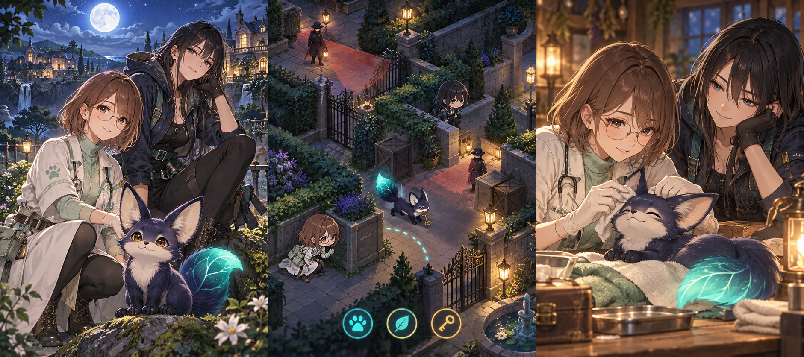

# 忍び獣の飼い方
相棒育成 × ターン制ステルス

企画イメージ・未実装。設計目標と見積は実測ではない。

保護した小さな忍び獣と、密猟団の施設から仲間を救い出す。プレイヤーが教えるのは攻撃力ではなく、「狭い穴を抜ける」「高所で待つ」といった潜入の癖だ。任務で成功した方法から次に残す習慣を選ぶと、獣は同じ状況で自分から動く。便利になった習慣が別の現場では足音や寄り道の原因にもなる。獣医ミオと追跡員レイの異なる見方を頼りに、命令しすぎず放任もせず、一緒に帰れる関係を育てる。

## 1. 教えた癖が、次の道をつくる。

便利な命令より、「この子なら、こう動く」を育てる。

### 体験の中心

柵の隙間を見つけた忍び獣が、こちらを見てから自分でくぐる。先の任務で教えた方法を、今度は相棒が使う。うれしさのあとに「その出口は見張られている」と気づく。癖を消すか、環境を整えて生かすか。その判断が育成と潜入を一つにする。

### 安心して帰るための物語

目的は密猟施設からの救出と帰還。獣医ミオと追跡員レイも成人の仕事仲間として加わる。休息所では手当て、食事、短い個別会話を選ぶ。全年齢で痛々しい描写は抑える。図版は企画イメージで、ゲームは未実装。

## 2. ルールと、最初の30秒

獣の次の一歩を見て、環境か命令を変える。

### 一手の値段と処理順

施設は縦8×横5マス。主人公は毎ターン行動点2で移動1、誘導餌の設置1、直接命令2を選ぶ。餌は任務ごとに3個、直接命令は落ち着きゲージ3回分を使う。確定後は主人公の行動、獣の1行動、見張りの移動と視認判定の順で処理する。直接命令はそのターンの習慣を上書きし、獣を一歩移動か待機させる。命令回数を使い切っても通常移動と撤退はできる。

### 自律行動を曖昧にしない

習慣は条件と行動を一組にし、装備枠は3つ。上から最初に条件を満たした一つだけを実行し、なければ主人公の隣へ寄る。例は「隣に穴があれば抜ける」「隣に高所があれば登る」。獣の次の位置、そこで発生する音、見張りの次の視界を仮操作に合わせて表示する。巡回の未観測部分は不明と明記し、見えている範囲の予測を気まぐれで外さない。

### 30秒の具体例と二つの結果

穴の向こうに救出用の鍵があり、出口は次のターンに見張りが通る。獣には穴抜けの習慣がある。Aは主人公が移動を控え、直接命令2で待機させる。命令を1回使うが、見張りが過ぎてから安全に抜けられる。Bは1点で餌を高所の下に置き、残り1点で主人公を陰へ移す。2マス以内の餌へ向かう行動が習慣より優先され、獣は穴を避けるが餌を1個失う。二つの未来を指で比べて確定する。

### 習慣の更新と繰り返し対策

任務後、見張りに気づかれず成功した移動手段だけが習慣候補になる。自動で性格は変わらず、採用、枠の置換、今回は覚えないを選べる。餌へは1マスずつ近づき、到達した餌を消費する。餌への誘導は習慣より、直接命令は餌より優先する。同じ穴抜けも、出口の照明や音に敏感な見張りがあれば不利になる。高所待機だけでは鍵と救出地点に届かない。能力値を上げる反復より、3枠の条件と優先順位を組み替える。

## 3. 「待てる」相棒が、「任せられる」相棒へ

数値を増やす育成より、使い道を覚える本編。

### 最初の15分

最初は隣へ寄るだけの獣と、巡回する見張り1人を扱う。穴の手前で直接命令を使い、鍵を回収して二人で脱出する。休息所では穴抜けを習慣候補として採用し、次の小区画で獣が自分から穴へ向かう姿を確かめる。最初の到達点は「覚えたら何が変わったか」を自分の言葉で言えること。獣の姿だけを見せる導入ではなく、成功と学習を一度つなぐ15分を目標にする。

### 中盤の15分

中盤では高所待機、穴抜け、物陰追従の3枠を持ち込む。序盤3分で出口と巡回を観察し、中央の8分で餌と命令を配分しながら救出地点へ進み、終盤4分で同じ道か荷物用の通路を選んで帰る。帰路では救出相手が加わり、狭い穴を全員で使えない。獣だけを先行させて門を開くか、安全な遠回りを一緒に歩くか。往路の成功が、そのまま帰路の最短解にはならない。

### 持ち越すものと本編の結末

持ち越す状態は採用した習慣、習慣候補の記録、救出済みの仲間、二人との会話。餌と命令回数は任務開始時に戻り、失敗した初心者ほど資源不足になる構造は避ける。発見されると警戒が上がり、逃走地点へ戻れば任務をやり直せる。捕まった場合も章の出発時点へ戻す。終盤は獣に任せる箇所と直接守る箇所を切り替え、救出した仲間を全員退避させる。獣の永久喪失は設けない。

### 量の仮上限と削る順番

本編3〜6時間は設計目標で、遊んだ結果の時間ではない。任務12件、施設3系統、習慣6候補、見張り3種、相棒獣1体を仮上限とする。個別話は各ヒロイン4話とし、救出後の短い掛け合いで本編と接続する。制作が膨らんだら任務の追加目標、施設の装飾、習慣候補の順に削る。先に獣の種類を増やさず、1体の癖が局面で変わる面白さへ集中する。終盤まで基本の操作数は増やさない。

## 4. 獣の世話から、二人の本音へ。

守れる人にも、誰かに任せたい夜がある。

### ミオ（25歳）

茶色のボブ、丸眼鏡、白と薄緑の獣医服。穏やかな獣医。
呼吸と足運びから疲労を見つけ、習慣の負担を具体的に説明する。
診察では落ち着いているのに、獣が自分の膝で寝ると動けず、助けを小声で呼ぶ。
「もう少し、ここにいて。……この子のため、だけじゃないんです」

### レイ（23歳）

長い黒髪、紺のアウトドア服。身軽な追跡員。
巡回の足跡と風向きを読み、安全に待つ場所を先に確保する。
現場では無口だが、手帳の獣の似顔絵には一枚ずつ名前を付けている。
「背中は見張る。だから今日は、先に眠って。……手は、離さなくていい」

### 有能さを、違う仕事で見せる

ミオは獣の疲れを読み、レイは見張りの死角を読む。ミオが休ませたい場面でレイが急行を提案しても、相手の仕事を軽んじない。プレイヤーは疲労の原因を調べるか、別の道を探すかで返す。二人が単に解答を教える案内役にならないよう、判断に必要な事実と本人の願いを分けて話す。

### 私生活の隙を、繰り返しで近づける

ミオの個別話では、獣の寝床を整える手が止まった理由を少しずつ聞く。レイとは無口な夜番を重ね、手帳の似顔絵を見せてもらう。会話は1〜3分ずつ。食事を代わる、一緒に見張る、今夜は一人にするなど、相手の状態に合わせた態度を選ぶ。甘さは露出より、声を落とす距離と仕事道具を預ける仕草で表す。

### 失敗を、好感度の罰にしない

救出を断念した夜、ミオは足の傷を、レイは帰路の痕跡を確認する。その後に誰と何を話すかを選べ、失敗しても個別話は進む。習慣の取得は潜入の成功記録、本編の便利機能は章進行で開き、恋愛の選択を能力獲得の条件にしない。個別4話は反復周回を要求せず、最後に恋人として寄り添うか、信頼する仲間でいるかを明示して選べる。

## 5. 獣を見ながら、片手で決める

生成した画面案と、実機で確認した操作は区別する。

### 盤面から予測、確定へ

390×844を主設計、360×800でも確認する。上部に目的と警戒、中央に盤面、下部に移動、餌、命令を配置する。マスを触ると予定の足跡が出る。獣の次の行動を一行で読み、下端の「一手進む」で確定する。見張りの処理後は発見の原因となった位置を線で結ぶ。

### 誤操作と読みにくさを減らす

習慣の並べ替えは任務前だけ行い、潜入中に小さな項目をドラッグさせない。仮行動は常設の取消で戻せる。直接命令は対象を選ぶまで資源を消費しない。主要操作は48px以上。小画面は習慣一覧を引き出しにし、獣の予測一行は隠さない。長押しだけに説明を割り当てない。

### 画面と保存の一式

タイトルは継続と任務選択、結果は発見原因と習慣候補を示す。習慣が空なら初回の覚え方を表示。読込中は進捗、失敗時は再試行を用意する。ターン後と習慣更新後に端末保存し、保存失敗を通知して書き出しを案内する。設定は文字、音、演出、利き手の配置切替を候補とする。

### 柔らかくても、情報は明瞭に

本文は日本語サンセリフ、見出しは角を丸めた太字を候補とし、採用時に字形と利用条件を確認する。安全は青緑、予測上の危険は琥珀、発見は赤。色と足跡の形を併用する。ポーズ、会話、フォーカス喪失で獣の待機演出も停止し、再挑戦で予測と警戒表示を初期化。動きを減らす設定では跳ねる通知を静止表示に替える。

## 6. 自律性は、最初の試作で確かめる

獣を増やす前に、一体に任せる気持ちよさを判断する。

### 制作量と仮見積の前提

4〜6か月規模は、実装1人と外注イラスト・音を想定する仮見積で、実測に基づく納期ではない。各2人×2衣装×6表情、イベントCG4点、個別4話／人を比較基準とする。分岐は潜入結果への短い反応と最終話に絞り、別任務を大量に作らない。獣は歩く、忍ぶ、穴抜け、待つ、喜ぶの共通動作を用意し、ヒロインは立ち絵差分中心。多種の獣、成長形態、フルボイスは含めない。

### 最大リスクと試作の採否

最大リスクは、自律行動がかわいさより命令不足の苛立ちになること。習慣2つ、見張り1種、8ターンの区画で、同じ状況から次の一歩を予想してもらう。初見5人中4人以上が予測を読め、少なくとも二つの局面で命令以外の解決を選べることを暫定条件とする。意図不明の失敗が多ければ習慣の条件数を減らし、偶発的な気まぐれは追加しない。試験は未実施で、かわいさや面白さを保証する条件ではない。

### 背景と獣で素材方法を分ける

背景候補はCC0のKenney Nature KitとKayKit Dungeon Pack（旧Dungeon Remastered）。公式配布ページで無料版とCC0を確認した。忍び獣だけはTripoブラウザで生成し、Blenderで輪郭と骨を直し、固定視点の2Dスプライトへ焼く案を検討する。今回は生成も購入もしない。利用規約、出力の扱い、必要な契約と費用は実行時に確認し、修正と動作調整の手間も見積に含める。

### 未確認事項と比較資料の扱い

スプライト化で獣の表情が読めるか、端末の画像メモリ、巡回予測の計算、保存復旧は未確認。無料背景も色と視点の合わせ込みが必要で、その工数は別途測る。公式のThe Last Guardianは人と獣の信頼を比較する資料。本案が提案する習慣の採用とターン予測を同作の機能とは扱わない。見た目を仕上げる前に、任せた一歩を納得して見守れるかを試し、本編制作の採否を決める。

## 素材・比較作の出典

- Kenney Nature Kit / CC0（公式ページで確認） / 保護区の樹木、岩、低木の仮素材。
  https://kenney.nl/assets/nature-kit
- KayKit Dungeon Pack（旧Dungeon Remastered） / CC0、無料版あり（公式配布ページで確認） / 施設の床、柵、扉の仮組み候補。採用時に必要部品を確認。
  https://kaylousberg.itch.io/kaykit-dungeon-pack
- 比較作：The Last Guardian。公式が描く人と獣の信頼を比較。本案は成功手段を選んで習慣にする育成と、可視予測のあるターン制潜入を提案する。
  https://www.playstation.com/en-us/games/the-last-guardian/

確認日：2026-10-25。素材本体の同梱ライセンスは採用時に再照合する。
