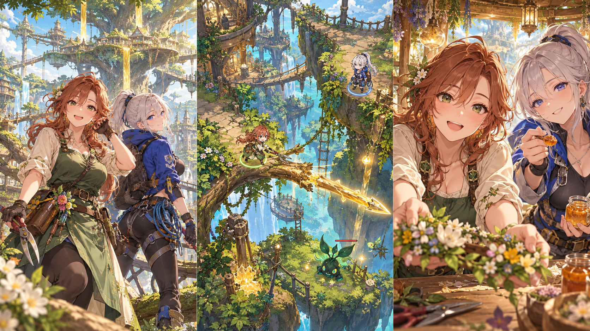

# 枝を刈る冒険者
片手探索アクションRPG × 園芸

企画イメージ・未実装。設計目標と見積は実測ではない。

巨大な樹の上で暮らす街を、病枝が包み始めた。枝は歩く道であり、装備を作る材料でもある。剪定すれば木材が手に入るが、その先の足場は消える。残せば高い花や裏道へ届く。片手で移動し、戦い、剪定を選ぶ間だけ時間を止めて、いま必要な道を考える。樹医コトネと探索士リッカとともに、刈り跡の残る樹冠を登る。全てを回収する旅ではなく、何を残して頂へ届いたかが、自分たちの冒険になる。

## 1. 道を残すか、刃に変えるか。

刈った枝の向こうに、行かなかった景色が残る。

### 体験の中心

巨大樹の枝を渡り、病気を追って樹冠へ登る。目の前の枝は、敵を避ける足場にも、装備を作る木材にもなる。一度に両方は取れない。移動と戦闘の流れの中で剪定だけ時間を止め、先を見比べてから自分の道を選ぶ。

### 戻れる道は、必ず一本

主経路の幹道は刈れず、帰れなくなる詰みを防ぐ。樹医コトネと探索士リッカは技術で旅を支え、休憩では互いの弱さを少しずつ見せる。全員成人、全年齢。図版は企画イメージで、操作と画面は未実装。

## 2. ルールと、最初の30秒

移動は親指、剪定は停止して選ぶ。

### 動くときと、考えるときの費用

移動と戦闘はリアルタイム。下半分をドラッグして進み、接続した枝へは自動で乗り移る。近距離の通常攻撃は自動とし、道具技と剪定だけボタンで選ぶ。樹液は最大3、道具技と剪定に各1を使い、休憩所で補充する。剪定対象を選んでいる間は敵、落下、樹液の処理を全て止める。対象の根元に安全な足場がある場合だけ切断でき、足元を切って落ちる操作にはしない。

### 切る前に失うものを見る

枝は主経路の「幹道」と、刈れる「横枝」に分かれる。剪定を仮選択すると、落ちる枝全体を斜線で示し、失う足場、未回収の花、得る木材を一覧にする。木材は横枝1本で2、作業台で装備1個を作るのに2を使う。装備枠は2つで、滑り止め、衝撃ガード、遠切りの3種から組む。敵の予備動作は見せるが、通常移動中まで未来を完全予測する戦術ゲームにはしない。

### 30秒の具体例と二つの結果

幹道の先に突進する虫がいて、脇の横枝は虫の背後と樹液の花へつながる。Aは横枝を刈り、樹液1で木材2を得る。直前の作業台で衝撃ガードを作れば正面を進みやすいが、花と背後への道は失う。Bは枝を残して花へ回り、樹液1を回復して背後から抜ける。木材は得られず、次の区画で使う装備も増えない。剪定の停止画面で両案を読み、取消か「この枝を刈る」を選ぶ。

### 全刈りと放置が最適にならない理由

切った枝はその章では戻らず、同じ枝から素材を稼ぎ直せない。枝を全部刈ると回復花と回避ルートを失い、全部残すと道具の選択肢が乏しくなる。病枝を残すと隣の休憩所が使えない局面、健康な枝を残すと敵を避けられる局面を交互に置く。幹道と基本攻撃だけでも本編を進められ、装備は楽になる方法を変える。全回収を必須にせず、切らない選択にも明確な見返りを与える。

## 3. 一本の枝から、樹全体の手入れへ

前へ進んだ距離だけでなく、残した道が旅の記録になる。

### 最初の15分

最初は幹道と横枝1本、虫1種、作業台1台で始める。歩く、自動で攻撃する、停止して枝を比べる順に覚え、横枝を残せば背後へ回れ、刈ればガードを作れる状況を置く。最初の到達点は見晴らし台の休憩所。コトネが断面を診て、リッカが次の足場を指す短い交流へつなぐ。チュートリアル中にも一つの枝を自分で決め、その結果が画面へ残る構成を目標にする。

### 中盤の15分

中盤は一つの庭区画を一回10〜20分で探索する。序盤3分で病気の広がりと作業台の位置を見て、中央の8分で枝と敵を越え、終盤4分で区画の病巣を刈って安全な幹道へ戻る。高所の枝を残せば雨粒の回復を使えるが、木材が足りず遠切り装備は作れない。病枝の剪定を先に行うと休憩所が開く一方、近道を失う。移動の巧さとルートを残す判断が、別々の解決を生むようにする。

### 持ち越す状態と最後の目的地

持ち越すのは章内の刈り跡、木材、装備、採取した標本、二人との交流記録。休憩所で体力と樹液を戻し、途中終了も保存できる。倒れたら直前の休憩所へ戻り、刈り跡と作成済み装備は保持する。幹道は常に通れ、素材を使い切っても基本攻撃と安全な足場で再挑戦できる。終盤は樹冠の病巣を治し、残した横枝から見える街の姿を二人と眺める。標本の全回収は結末の必須条件にしない。

### 量の仮上限と削る順番

本編3〜6時間は設計目標で、実測済みの長さではない。庭区画12、景観3系統、通常敵3種、大型病巣2種、装備3種を仮上限とする。各ヒロイン個別4話を休憩所へ置き、標本には短いコメントを付ける。制作が膨らんだら標本の種類、任意の横枝、大型病巣の変種の順に削る。地形を大きくするより、同じ枝に移動と素材の二つの意味がある配置を優先する。中心の剪定予測と幹道の安全性は残す。

## 4. 木を診る人と、空へ導く人。

現場の手つきから、休憩の小さなためらいへ。

### コトネ（23歳）

赤茶のくせ毛、緑の剪定エプロン。道具の手入れを欠かさない樹医。
葉と断面から病気を見分け、刈ってよい枝と支えるべき枝を説明する。
普段は手際がよいのに、自分の髪を整えるのは苦手。小さな花をもらうと押し葉にする。
「大事なものほど、近すぎると見えないんだね。……あなたは、ちゃんと見ていたい」

### リッカ（24歳）

白金のポニーテール、青い登攀服。空を見上げる探索士。
足場と風を読み、確実に戻れる経路を先に確保する。危険な近道を無理に勧めない。
高い場所では平然としているが、休憩の誘い方だけは何度も練習する。
「次の景色、二人分で覚えたい。……一緒に来て、って言えばよかったか」

### 二人の仕事が、選択の見方を変える

コトネは病気を止めるための剪定を提案し、リッカは帰路の足場を残したいと言う。どちらかを選ぶと片方が役立たなくなる構造にはしない。切る理由、残す理由を二人が別々に言葉にし、最終判断はプレイヤーへ渡す。仕事で信頼を重ねたあとだから、休憩で見せる不器用さが意味を持つ。

### 髪と休憩で近づく個別話

コトネは自分のくせ毛を直せず、リッカは休憩に誘う一言を言えない。道具を磨きながら話す、髪の葉を取ってよいか尋ねる、景色の感想を待つなど、互いの許可と間を大切にする交流にする。個別話は1〜3分ずつ。押し葉や地図の余白が増えることで、同じ作業場所に二人の思い出が残る。

### 失敗した枝も、会話の理由になる

敵に負けた休憩所では、コトネが刈り跡を確認し、リッカが別の登り方を図にする。失った横枝は都合よく戻さず、今ある道で再出発する会話を用意する。装備と技の解放は本編進行で行い、能力のために好感度を稼がせない。個別4話の最後では、隣を歩く関係を恋人にしたいか、信頼する相棒のままでいたいかを選べる。

## 5. 止まる操作を、迷わず届く場所へ

企画の画面案。片手アクションの実機検証はこれから。

### 親指の操作を一本にまとめる

390×844を主設計、360×800を最低確認幅とする。中央上部へ進行方向、下半分へ移動領域を置き、利き手側の下端に道具技と剪定を配置する。剪定を押すと停止し、枝を選んで損失予測を読み、同じ下部で確定する。切断後は得た木材と消えた道だけを短く示す。

### 誤タップから戻る

移動中に枝へ触れても刈れない。剪定画面は取消を常設し、確定まで樹液を消費しない。対象は大きな番号札でも選べ、細い枝の直接タップを必須にしない。主ボタンは48px以上とし、360幅では詳細を下から開く。停止中に画面を動かして失う枝の先まで確認できるようにする。

### 保存と画面の一式

タイトルに継続と章選択、結果に治した区画と標本を置く。標本が空なら採取場所の例を示す。読込中は進捗、素材失敗は再試行。剪定確定と休憩所到着で端末保存し、失敗時は再試行と書き出しを案内する。設定は文字、音量、利き手、移動感度、演出量を備える。

### 葉の中でも読める文字と枠

見出しは太い日本語ゴシック、本文はサンセリフ、体力などは形の異なる記号を併用する。採用フォントの字形と条件は制作時に確認。幹道は白い縁、切る枝は橙、病気は紫と斜線で示す。剪定選択、ポーズ、会話、フォーカス喪失で演出も停止。再挑戦では入力を解除し、動きを減らす設定では揺れと葉の飛散を省く。

## 6. 枝を切る判断を、まず一つの庭で試す

広さや素材数より、失う道が選択になるかを先に確かめる。

### 制作量と仮見積の前提

4〜6か月規模は、実装1人を中心にイラストと音を一部外注する仮見積で、実測や納期の確約ではない。各2人×2衣装×6表情、イベントCG4点、個別4話／人を共通比較基準とする。分岐は刈り跡への短い反応と最終話へ限定し、別々の章を作らない。主人公の移動、攻撃、剪定、被弾は短い共通動作、ヒロインは立ち絵差分中心。自由な樹木生成、フルボイス、多数の装備は含めない。

### 最大リスクと試作の採否

最大リスクは、片手操作で枝の接続を読み違え、剪定が探索を邪魔すること。幹道1本と横枝3本、虫1種だけの庭を実機試作する。初見5人中4人以上が切断前に失う道を説明でき、全員が幹道だけで帰還できることを暫定条件にする。残す理由が毎回弱ければ装備の種類を増やさず、花と回避路の配置を見直す。アクションの手触りと選択の面白さは別に評価し、現時点ではいずれも未検証。

### 素材方法と条件、費用

Kenney Nature Kitは公式ページでCC0を確認済み。岩や低木の仮素材に使い、巨大樹の接続枝は切断範囲を制御する必要があるため専用制作する。ヒロインは絵柄をそろえた立ち絵を発注候補とし、主人公の動作と背景の色調も同じ仕様へ寄せる。CC0素材自体は無料でも加工と統合作業は必要。立ち絵、CG4点、音源の費用は数量を示して別途見積もる。今回購入もゲーム用アセットの生成も行わない。

### 未確認事項と比較資料

スマホでの移動感度、枝の見分け、カメラ追従、切断時の描画負荷、保存後の地形復元は未確認。静止画の印象と操作の成立は分けて記録する。Grow Home公式ストアは植物を経路にする探索の比較資料だが、本案は成長させる代わりに切断で道と材料を選ぶ提案。実機の一庭で違う二通りの進み方が成立し、取消と確定を押し分けられることを確かめてから、12区画の本編制作へ進む。

## 素材・比較作の出典

- Kenney Nature Kit / CC0（公式ページで確認） / 岩や低木の仮素材。切断する巨大樹は専用制作。
  https://kenney.nl/assets/nature-kit
- KayKit Dungeon Pack（旧Dungeon Remastered） / CC0、無料版あり（公式配布ページで確認） / 作業台周辺の箱や道具置きの候補。自然物との色調調整が必要。
  https://kaylousberg.itch.io/kaykit-dungeon-pack
- 比較作：Grow Home。公式が紹介する植物を育て経路にする探索を比較。本案は枝を切り、移動経路と装備材料を交換する判断へ置き換える。
  https://store.steampowered.com/app/323320/Grow_Home/

確認日：2026-10-25。素材本体の同梱ライセンスは採用時に再照合する。
