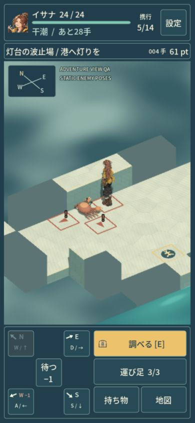
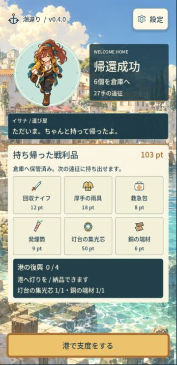

# v0.5 character and adventure-view comparison

This is a development checkpoint on 2026-10-29 JST. Production remains the reviewed UI checkpoint at `4fb1c60`, with runtime/package version `0.4.0`; the public game remains v0.3. None of the experimental models or the shared-world candidate described here is adopted by production. The next publication still requires completion of v0.4 + v0.5 and the existing reviewed Pages procedure.

## One corrected source before the other workers

The first source had an obscured eye/forehead region at the game camera. The retained figure study rejected enlarging the entire head to 1.20/1.30 and lifting it by 12 degrees as sufficient fixes: these also enlarged the hair. The original references, models, motion exports, failed comparisons and current R1 runtime remain preserved.

The revised Isana source follows a brief written before generation: an adult recovery worker with an exposed forehead and brows, chestnut ponytail, amber eyes, ochre coat, teal scarf, charcoal trousers and an anatomical-left brown satchel. Five GPT outputs were retained, including the rejected taller front. Four selected views fed one private H3.1 highest-quality Ultra generation through the user's logged-in Chrome Studio subscription. The front is approximately five head heights rather than the brief's 4.5-head hypothesis; differences between the reference views are recorded. Neither the references nor an enlarged face render establishes field-scale animation quality.

The outer 8K control opened a subscription-upgrade screen. It was closed without a purchase or subscription change. The submitted current-plan settings used a 2,000,000-triangle target, 4K textures, PBR and removal of baked lighting. Generation displayed 55 credits. One later humanoid Mixamo auto-rig request displayed 20 credits. Preset preview/export showed no further observed balance decrease. Exact balances and private Chrome screenshots stay in the ignored provenance; no separate billing receipt was inspected. No Tripo API or CLI was used.

## Preserved source and bounded rig input

| File | Bytes | SHA-256 |
| --- | ---: | --- |
| `source-r2/tripo/isana-source-original.glb` | 64,257,940 | `696bd4d07a62f81e1a4bc507c111fd213d60c527cc62b675ddce7c8cb1c5039b` |
| `source-r2/deliverables/02-rig-input/CH_Isana_R2_RigInput.glb` | 12,568,804 | `890aeda3e2edb08ea378938d4c7b57579aa5b1fa504c532f9c508fc8a857437b` |
| `source-r2/tripo/isana-rigged-original-2k.glb` | 14,450,752 | `dcb00751e33124844b6152cd77d4588f90b24f3ff42d59d42e1e3494b6dd1b14` |
| `source-r2/tripo/isana-motion-original-8.glb` | 8,857,428 | `5aaeabeba9b443ce30f4240cd155cdf466a1702370bf09d64404f8828a12e6c3` |
| `source-r2/deliverables/04-motion-audit/CH_Isana_R2_Motion65_Original4K.glb` | 15,555,020 | `399fd2455cce62b0035b1bd03a5d3f049e86505cb9d62e0c5e1412d21c85ffe8` |

Paths in this table are relative to `.scratch/versions/v05/prototype/`. These ignored originals and editable masters must remain in the active worktree through asset adoption; they are not distributable game bundles.

The original has 1,921,679 triangles, one material and three actual 4096-square maps. The provider's auto-rig polygon cap is the reason for the separate 99,999-triangle input. All three compressed maps remain byte-identical in that derivative. Fifteen matched-camera comparisons report silhouette intersection-over-union from 0.99732 to 0.99954. The exported LOW model matches all 299,997 master corners, with zero unmatched corners, position error zero and maximum UV error about 2.98e-8. Those checks cover the documented reduction/export comparison, not every possible deformation or view.

The parent inspected all four native source-axis views and selected Blender -Y / glTF +Z as the observed front. Studio's imported model was visibly side-on at Y=0 and frontal at Y=90, with original UV enabled. The rig-only export contains 54 joints and no clips. Although its filename and Studio selector say 2K, its three embedded maps are the original 4K buffers. No texture restoration was needed for that file.

The provider did change the rig geometry representation: UVs are quantized to a 1/4096 grid, with a maximum source-to-rig difference of half a 4K texel. Matching in that explicit domain accounts for all 77,371 rig vertices and 99,999 triangles; geometry correspondence uses a measured scale/translation and a residual up to about 5.65e-5 rig units. This is not exact float preservation. The skin audit found no nonfinite, negative, invalid-index or unweighted records; the largest weight-sum deviation is about 9.78e-8. Matched bind/default-pose silhouettes range from 0.99910 to 1.0. Bind-pose agreement does not establish action quality.

The later motion export has its own 65-joint skin, eight clips and actual 2048-square maps. Keep its skin and clips together; neither the R2 54-joint rig nor the older R1 55/66-joint files is a substitute. Preserve the untouched motion original before any verified map-only derivative or separately justified skin/clip correction.

A separate map-only derivative restores the three original 4K compressed images. The actual motion and rig surfaces pair at all 77,371 vertices, with equal 99,999-triangle multisets, UV error zero and a maximum measured position residual of about 2.66e-6 after a near-identity comparison. Its 1,482 nonimage bufferViews remain byte-identical, and the mesh, joints, weights, transforms and all eight clips retain their original structures. This operation changes maps, not the skin or animation.

## Actual isolated Godot trial

Godot 4.7.2 Compatibility imported the R2 65-joint model, 99,999 triangles and all eight actual source clips. The raw motion maps import at 2048-square resolution; the map-only derivative imports at 4096-square resolution. Source/copy hashes and all nine emitted map images across the R1, raw R2 and 4K R2 comparison match their respective embedded bytes.

The isolated hidden GPU fixture uses the same camera, light and sample for each worker: yaw -35, pitch 35, baseline orthographic width 8.3, bind height 2.1, plus a bounded width-7 phone comparison. The actual field renders are 374x530 and 344x426. Larger 390x844 and 360x740 PNGs place those unchanged field pixels on a plain matte; they are not gameplay HUD screenshots. Separate enlarged face renders are diagnostics.

The R2 body and exposed face patch improve over R1, but a long central fringe still crosses the eye region in the unanimated bind pose. Both sources' idle preset adds the same measured 6.702-degree downward head pitch. The persistent hair obstruction and preset tilt are separate causes; an axis correction or higher-resolution map does not resolve them. No head scaling or forced head yaw was adopted, and the character family is not accepted by this checkpoint.

All 135 sampled skins were finite across the R1 seven and R2 eight source timelines. That does not establish contact or cloth quality. Raw R2 walk samples penetrate the bind floor by about 0.022-0.036 tile; run spans about -0.027 to +0.027 tile, and the start of the lifting preset reaches about -0.076 tile. Fresh contact/stop calibration, useful action windows and a source-fringe decision remain necessary. Full raw presets were not compressed into one game turn.

The frozen entry is `r2-engine/RESULTS.md`, with `source-manifest.json`, `frozen-manifest.json`, actual native images and preserved failed attempts. This is source/engine evidence; it is not a live expedition, Web test, human playtest or commercial acceptance.

A separate native material control reproduces the upper-coat openings in one lowered-arm walk pose. Changing only culling from BACK to DISABLED fills the inspected slits, with identical texture objects, vertices and bone poses. Coincident-vertex measurements do not show a large weight-seam split. This supports thin back-facing cloth as the cause in that pose. It is a diagnostic runtime override, not an edited/adopted GLB or general cloth fix; the shared material also covers hair, and shadows, other poses and Web cost need a separate policy check.

## Operable coastal view and actual exported Web

The separate adventure candidate combines real resolved Rules data with a shared 3D view, frozen R1v3 actual66 actor and the reviewed `4fb1c60` harbor/result UI snapshot. It does not use R2. Visible floor/actor/enemy/cargo rays drive reversible known-wall cutaways and matching pick envelopes. Unknown content stays hidden. Cardinal actions retain their logical directions; buttons and a compass show their actual oblique projection. Phone framing starts at width 7 and fits currently visible tactical information; a distant currently visible exit gets an edge cue rather than shrinking the actor to fit the entire route. The worker's 15 later-route samples measured widths 7-7.70.

Compatible opaque static geometry is batched without changing its eligible triangles/materials. The actual turn-4 native draw count falls from 1020 to 458 and turn-8 from 915 to 329. Actors, enemies, effects and unsupported materials are excluded. These are draw-submission comparisons, not FPS or phone-performance measurements. The frozen candidate passes 84 scene/batch, 18 isolated native input/focus, 13 Rules contracts and 15 current-UI compatibility checks. Seven rebased UI snapshot files match their reviewed Japanese wording and final run/verify records. One native capture made after OS minimize/restore cuts off the upper/lower HUD; it is retained as a limitation and excluded from full-HUD success evidence.

Root then operated the actual combined Web export through normal canvas keys and taps at DOM sizes 390x844, 360x740 and 1280x900. The returned JPEGs are respectively 390x844, 360x739 and 1281x901; the small rounding differences are preserved in the manifest. The live HUD, directional controls and primary actions fit these Web layouts. No engine/state/storage injection or read of the non-DOM diagnostic object was used.

The first run used five real loadout items, a floor tap, two crew techniques, a real bomb breach, a tap on the newly opened floor and cargo inspection. The second technique took four damage while crossing the charge; it is not reported as a successful evasion. An initial off-center floor tap spent no turn; the corrected visible center moved normally. The actual return result is 27 turns, six items and 103 points, with all six receipt items visible. Delivering the core and scrap advances reconstruction to 1/4 and awards 20G.

The second run starts with another five real items. With Reduce motion enabled, deliberate turns still resolve and two later full-field captures are byte-identical. Deliberately waiting beside the crab produces the actual 28-turn loss result: five items, including knife/coat, worth 61 points are lost. Harbor still shows carry 0, stash 2 and reconstruction 1/4; exchange retains 20G. A third empty-loadout departure provides one equipped loan knife. Returning immediately produces a zero-turn, zero-item, zero-point receipt, and leaves the two stored supplies available. This checks repeated board/UI lifecycle and post-loss recovery through actual operation.

The [breached-floor view](method-web/pilot-breach-360.jpg), [desktop loss](method-web/pilot-loss-desktop.jpg) and [post-loss harbor](method-web/pilot-harbor-afterloss-desktop.jpg) are also preserved. [The public proof manifest](method-web/manifest.json) records exact original bytes, codecs and dimensions. The fuller input/outcome/failure record and 37 unmodified screenshots remain in `adventure-web/OBSERVATIONS.md` and its manifest under the ignored prototype directory.

The crew-modal A/B screenshots are byte-identical. A separate blank-tab attempt left the game DOM visible, so it proves no Web focus/visibility pause. Resource timing was unavailable in the browser's read-only scope. The local broad QA payload is a 168,204,900-byte PCK plus 39,514,754-byte WASM; no initial-load, FPS or physical-phone pass is claimed. All nine local export hashes match the frozen combined export. Browser warning/error collection returned an empty list. The temporary viewport and Reduce motion setting were restored, and the temporary blank tab was closed. These QA sessions reset on reload and do not demonstrate save persistence or replace the earlier production-store verification.

## Evidence and open gates

Detailed reproducible source, reduction and rig records live under `source-r2/processing/` and `source-r2/deliverables/`. Astra reviewed the frozen reference/static-processing scope without findings: five generated originals and 53 processing/deliverable hashes matched. Subsequent read-only Astra reviews covered the frozen rig/motion/engine/material diagnostics and adventure implementation, also without required fixes. The cropped native HUD frame remains an explicit evidence limitation. Root's final prose, private provenance and actual Web evidence require their own closure review; review scopes do not establish commercial acceptance.

The next R2 gate is a bounded source-fringe decision and fresh 65-joint contact/stop/action calibration, followed by an actual R2 world/Web comparison. The culling diagnosis needs a deliberate runtime material policy. The existing R1v3 contact/turn improvements and operated Web build remain a preserved comparison; no R1 skin/weights are a shortcut for the R2 source. Field identity, natural held-tool motion, finished enemy art/poses, richer town dressing, the other three workers, all-district adoption and result/conversation staging remain open. Physical devices, Safari, Web focus/visibility, listening, endurance, human enjoyment and commercial acceptance remain unverified. v0.5 is still in progress and Pages remains unchanged.
