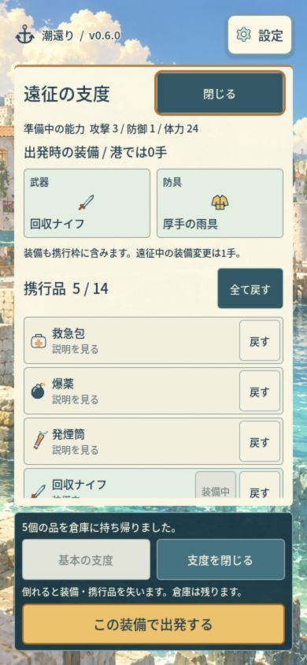
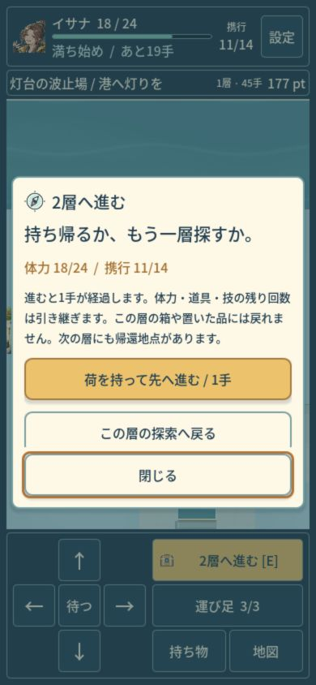
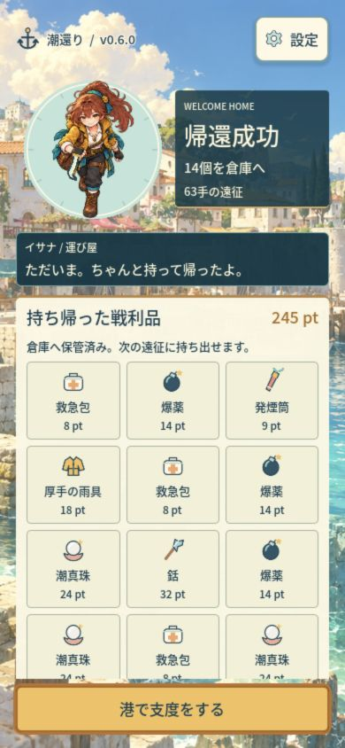

# v0.6 verification

Scope: Issue #220, baseline0827c289, branch codex/shio-v06-expeditions. The user explicitly reopened development to rebuild inventory operation, quest purpose and replayability. No new 3D asset, dependency, provider request, automation, release tag or Pages deployment belongs to this version.

## Implemented behavior

New expeditions generate different room geometry and connections, caches, goal locations and guards across seeds in four districts. Up to three sectors preserve HP, equipment, items, crew uses and the total turn/tide clock. Each sector offers extraction. Previously abandoned ground items cannot be revisited. The full map is saved.

Inspecting a cache costs one turn; reading/choosing costs zero. Selected take, take-what-fits and exact-UID swaps cost one turn and leave overflow intact. After actions the cargo view stays usable. Starting a swap brings a carried candidate into view; the final exchange still requires confirmation. Explicit preparation gear references the same carried UIDs and remains separate from transfer buttons. Companion jobs grant real discounts/map knowledge; repeat salvage commissions consume stored items and produce actual rewards.

## Automated checks

The complete app check passed import, all registered suites and Web export. After the final swap guidance/comparison changes, the corresponding suites and export passed again. Logs are retained in `.scratch/versions/v06/`.

| Suite | Result |
| --- | --- |
| Frozen v0.3 rules |5328 passed /0 failed|
| Frozen v0.4-v0.5 tactics and migration |3907 /0|
| Generated worlds |437955 /0;32 seeds by4 districts by3 depths, plus boundary inputs|
| v0.6 rules, migration and ownership |235 /0|
| Presentation components |1217 /0|
| Explicit preparation |168 /0|
| Cargo/sector UI |77 /0 across390x844,360x740 and1280x800|
| Main UI and storage |771 /0|
| Root Node tests |38 /0|

Checks cover deterministic replay and actual collision-topology variation, dry connectivity, safe arrivals, objective/stair/cache reachability, ownership and schema validation, old-run future-action equivalence, backup failure protection, cache fog access, partial take, swaps, enemy-phase death, depth/tide boundaries, repeated deliveries and one-time extraction. Saleable caches must lie at least8 Manhattan cells away and outside the protected landing square. This prevents the guaranteed supply crate inside the protected arrival room; it does not promise an enemy on every route to every cache.

## Actual exported browser operation

The parent operated the normal production export with keyboard and pointer at a new local origin, without state injection. Existing public player storage was preserved. A v0.5 expedition created before the update resumed with its original map, HP24 and5 items, then extracted those same5 items at turn0. Returning adopted schema4.

A new v0.6 expedition then reached63 turns: two crabs were fought, a bomb opened a flooded shortcut, a found harpoon was equipped, and the player chose to enter sector2 at turn45. Sector2 began at turn46 with HP18,11 items and all3 remaining crew uses, rather than healing or refilling the player. The new map and fog replaced sector1. Its first visited cache was beyond the protected landing. Reading an opened box was free; taking what fit filled the14-slot bag. The parent exchanged the unused knife for a pearl and left the exact knife in the box. The harpoon remained equipped at attack5. Returning from sector2 produced a14-item/245-point receipt after63 turns. Reload/Continue retained that receipt; returning to harbor showed stash17 and carry0, without another transfer.

The first sector of this test had been generated by an earlier v0.6 preview before the supply-placement correction. It was intentionally preserved in the existing resolved save. Sector2 was generated after that correction in the updated build. UI-only swap guidance and equipment-comparison wording were subsequently improved and checked through the focused77-case suite. These are separate evidence scopes, not a claim that every turn ran from one final artifact. A fresh final-build origin was then started and operated through preparation, departure and inventory/map/settings/reduced-motion changes at390x844,360x740 and default1280x720, with no turn advancement during reading.

Actual390x844 and360x740 passes checked preparation, the new help, cache selection, scroll, fixed close action, confirmation and saved results. Desktop inspection and final smoke evidence are retained in the private browser folder. The normal63-turn route did **not** complete the lighthouse job, reach sector3, or die. Delivery/repeating-order and death invariants are covered by the rule/UI fixtures; they are not described as an additional normal browser playthrough.

## Findings and review boundaries

Actual Web operation exposed a zero-width wrapping label in the cache heading and selected-item title. The shared label expansion was corrected, and the three-size cargo suite now checks heading width/line count and action height. An earlier data-only suite could not establish text layout. Actual operation also exposed unclear swap navigation; the carried candidate now receives focus, and equipment comparisons are explicitly hypothetical and omitted during a swap.

The final browser pass also found attempts to resume already finished tweens. Main and Board now exclude tweens with zero loops remaining; a regression calls their real synchronization during the engine frame where a tween is finished but still valid. The pre-fix console errors are preserved in warnings-errors-before-fix.json. A fresh final-build browser pass recorded no warnings/errors. It also measured document/canvas dimensions without overflow; prior desktop harbor inspection used1280x900. See the official [Tween lifecycle documentation](https://docs.godotengine.org/en/4.7/classes/class_tween.html#class-tween-method-get-loops-left).

The required ai_slop_reviewer / gpt-6-astra first pass identified two P2 findings: saleable guaranteed supplies inside the protected landing, and help that still directed players to fixed v0.4 rooms. Supplies were moved outside the arrival area with a seed-sweep regression; help now explains selection, generated rooms, three sectors, extraction and the actual first job. Old in-flight help retains its own rules. Final Astra and current-head CI outcomes are recorded on Issue #220 and its linked PR, rather than inferred from this source snapshot.

Japanese UI/manual text was compared with preserved originals, then checked through direct yomiyasu CLI run/verify. The hash/run summaries are in japanese-review.json; full candidate and diff records remain in the app's ignored scratch directory. Code identifiers and existing text can produce lint candidates; their counts are not a readability score. Only the changed user-facing wording was edited.

Physical iPhone/Android, Safari, listening quality, long sessions and human evaluation of fun remain unverified. Four-district normal Web campaigns and full normal sector3/death/repeating-order routes were not replayed in this task. Commercial quality remains a target, not an achieved test result. The prior public v0.5 remains unchanged; this bounded v0.6 does not restart indefinite development.
