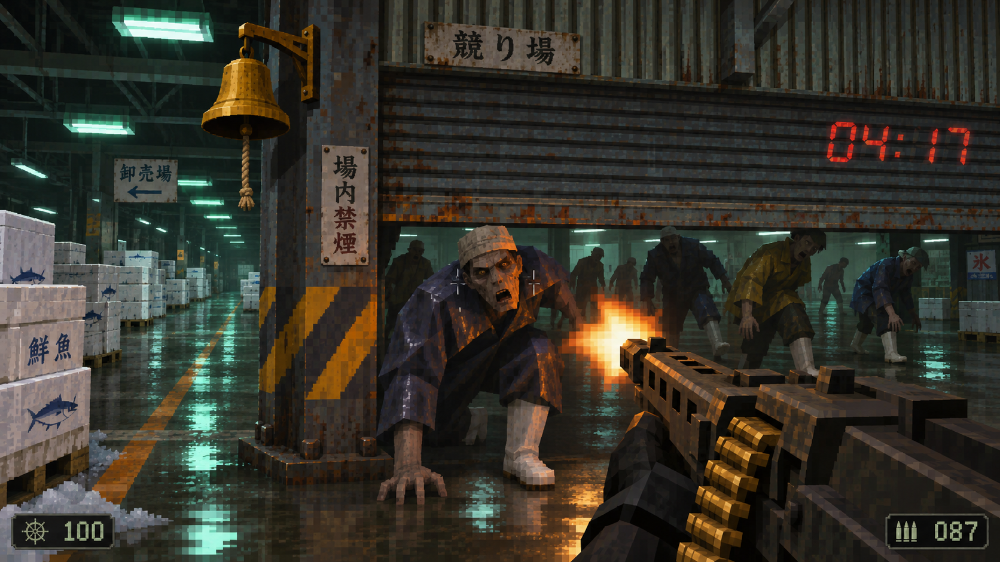

# 屍港最終便

午前4時17分、魚市場のシャッターが開く。荷役鐘を撃ってゾンビの群れを誘い、冷凍倉庫を抜けて最終フェリーを出す、一人用のホラーFPS。



## 遊び方

PCはWASDで移動し、マウスで狙って左クリックで撃つ。数字の1〜3かホイールで入手済みの武器を切り替える。Escで一時停止する。

スマホは横向きにして、左のスティックで移動する。右側をなぞると周囲を見渡せる。射撃ボタンを押したまま指を滑らせると、撃ちながら狙いを変えられる。

黄色い鐘を撃つと、作業員と走者は音のする方へ向かう。その隙に道を空けるか、集まったところへ散弾を撃ち込む。冷凍倉庫では、赤い金具を撃つと吊り荷が落ちる。機関銃は弾帯を使い切ると、引き金を引いたまま給弾できる。

章や区画の入口で進行を保存する。同じブラウザで「続きから」を選ぶと再開できる。

## 終鈴ラッシュ（v1.1）

タイトルで「終鈴ラッシュ」を選ぶと、機関銃と二連散弾銃を持って魚市場の90秒戦に入る。2基ある鐘のどちらかを撃つと、作業員と走者が寄ってくる。床の輪が明るくなったら、引き金をいったん離して同じ鐘をもう一度撃つ。輪の中にいる敵を放電でまとめて倒せる。使った鐘は8秒で再び鳴らせる。

撃破は1体100点。1回の放電で2体以上倒すと、2体目から1体につき150点のボーナスが付く。30秒、60秒の節目には体力と弾薬が補給され、増援の人数や顔ぶれが変わる。時間切れか体力が尽きると結果票が出る。本編の進行はそのままで、自己ベストは同じブラウザに残る。

[原画と開発ロードマップ](docs/rush-roadmap.md)・[戦闘画面と検証記録](docs/verification.md)

## 起動

Godot 4.7.2とWeb書き出し用テンプレートを使う。このフォルダで次を実行する。

```sh
npm ci
npm run setup
npm run check
npm run preview
```

PCでは `http://localhost:4187/` を開く。スマホでは同じネットワークに接続し、パソコンのLANアドレスにポート4187を付けて開く。Godotエディターでは `game/project.godot` を開く。

## 制作資料

- [敵の設定画](art/cast.png)・[一人称武器の設定画](art/weapons.png)・[3章の色と構図](art/chapters.png)
- [Blenderモデルの再生成手順](modeling/README.md)
- [音楽と素材のクレジット](docs/credits.md)
- [操作映像と検証結果](docs/verification.md)
