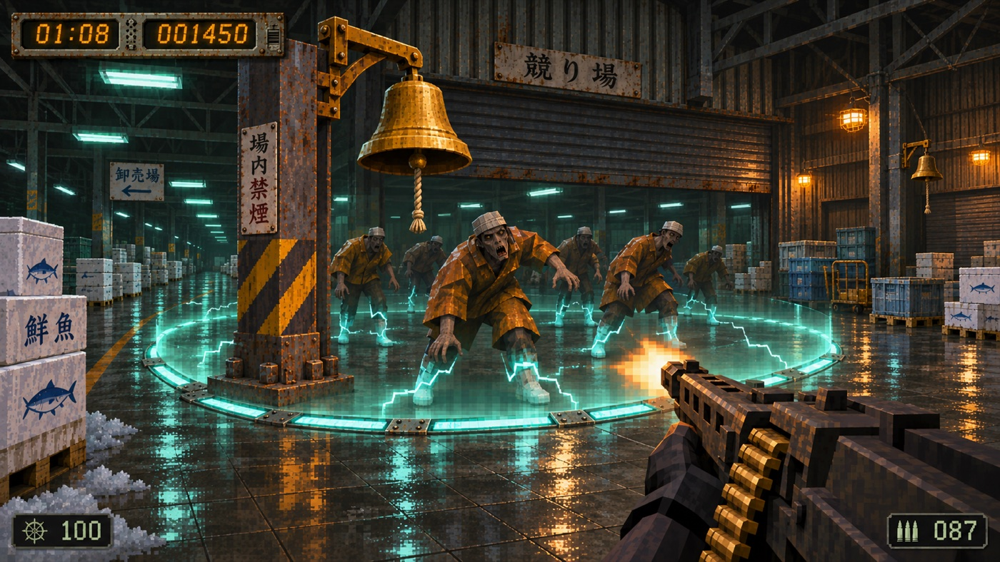
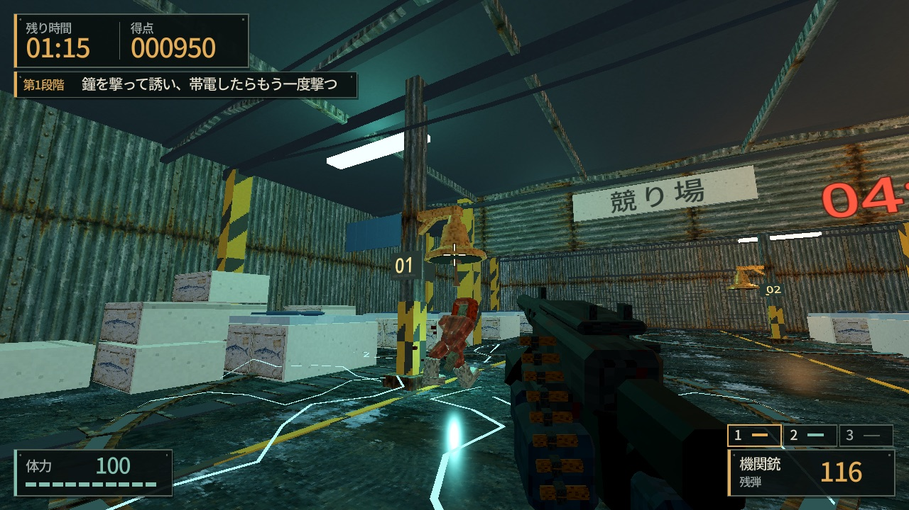
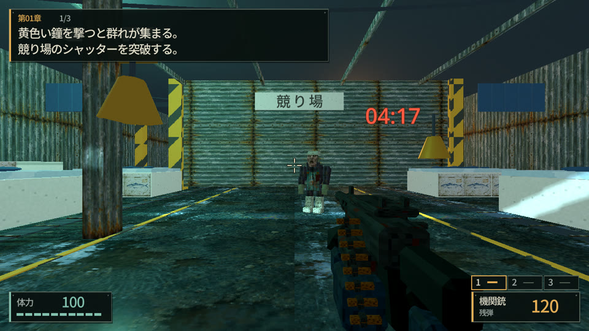

# 操作映像と検証結果

## v1.1 終鈴ラッシュ

| 実装前に描いた原画 | Chromeで鐘を放電させた瞬間 |
| --- | --- |
|  |  |

- PCのChrome（1280×720）でタイトルからラッシュに入り、マウスで奥の鐘を狙って2回撃った。1回の放電で4体を倒し、撃破400点とボーナス450点で得点が850になった。続けて手前の鐘でも1体を倒し、二連散弾銃に持ち替えて横移動した。自動操作して実際のゲーム画面と音を記録した。[19秒の戦闘映像](evidence/rush-web.mp4)
- Chromeのタッチエミュレーション（844×390 CSS px、DPR 3）では、移動しながら照準を変えて射撃し、2体を倒した。縦向きで停止し、横向きに戻して再開できた。敗北後に再挑戦すると体力・得点・残り時間が戻り、再読み込み後も自己ベスト200点が残った。別の試行では左スティックで中央通路を周回し、射撃せず3段階を90秒間生き延びた。[生還時の結果票](evidence/rush-touch-result.jpg)
- iPhone 17 ProのiOS 26.5シミュレーターでは、Safariの横画面でラッシュの開始、敗北後の結果票と再挑戦を確認した。スマホ実機での熱や持ちやすさ、初めて遊ぶ人が鐘を使いこなすまでの時間は未測定。
- Godotの自動試験では、同時出現数の上限（6・9・12体）、段階ごとの補給、放電範囲内外の判定、90秒経過後の得点固定を確認した。v1.0形式のチェックポイントを読み、ラッシュ終了後に旧版の章・区画・撃破数と設定が戻ることも検査した。画面用フォントには、ゲームで使う日本語・全角記号317字がそろっている。

## v1.0 キャンペーンの記録

| 最初に描いた市場 | 同じ場所のWeb版 |
| --- | --- |
|  |  |

市場では、実際のWeb版で銃を撃ち、照準を左の鐘まで振って録画した。銃声、鐘、戦闘曲はゲームの音声出力を収録した。[市場の戦闘映像](evidence/market-web.mp4)

冷凍倉庫・フェリー・船長戦の抜粋はGodotのネイティブ版で、自動入力による通しプレイから記録した。毎秒6コマの無音映像。[冷凍倉庫](evidence/cold-store.mp4)・[フェリー](evidence/ferry.mp4)・[船長戦](evidence/captain.mp4)

## 戦闘と進行

- Godot 4.7.2の戦闘テスト40項目で、銃弾と壁・敵の衝突、機関銃の自動給弾、武器の切替、船長の攻撃と弱点などを確認した。船長の薙ぎ払いは予告の弧に合わせて前方だけに当たる。「閃光」を切ると3種類の銃の発砲光が消え、信号砲の着弾地点には弱い赤い光がゆっくり灯る。
- 進行テストでは3章・9区画・30波の進行、荷役鐘、吊り荷、3か所の寄り道、死亡・再挑戦、保存からの再開、ランプを上げて出航するまでを確認した。判定を短時間で調べるため、このテストでは位置やダメージを直接指定する。
- ネイティブ版では、移動・照準・射撃のタッチイベントを自動で送る別の試験を行った。ゲーム内の敵と地形を参照して狙いを定め、体力・敵・扉・進行の値を変更せずに263体を倒して出航した。最終試験は301.20秒、死亡0回。初めて遊ぶ人の15〜20分という制作目標は未確認。[入力ドライバーと試験記録](../modeling/QA.md)

## ブラウザでの操作

- PCのChromeでタイトルから開始し、マウスの捕捉、WASD移動、射撃、一時停止を確認した。別の通し試験では計測用のコピーを開き、実際に開始ボタンをクリックした。ポインターを捕捉した後、本番の入力処理へキーとマウスのイベントを送り、3章を通して263体を撃破。死亡・再挑戦は0回で、ランプを上げた後の結果画面は05:00だった。[出航時の実画面](evidence/departure-web.jpg)
- iPhone 17 ProのiOS 26.5シミュレーターのSafariで、左のスティックでの移動と右指の照準・射撃、縦向きでの自動停止、横向きに戻した後の再開を確認した。再読み込み後も設定とチェックポイントが残った。[Safariの戦闘画面](evidence/safari-deck.jpg)
- MacのChromeでスマホ相当の画面サイズとタッチ入力を設定し、二本指で移動しながら狙って撃てること、右側の空き領域では照準だけが動くこと、死亡後にチェックポイントへ戻ることを確認した。音声は開始操作の後に再生を開始した。

## 描画負荷

PCのChrome 157では、最終甲板のチェックポイントから移動と射撃を行った。MacBook Air M5、1280×720で、描画があった368フレームを6.12秒間で記録した。平均60.0 fps、フレーム間隔の95パーセンタイルは16.7 msだった。

スマホ向けには船長を含む14体を同じ位置に置き、各環境で約12秒間、Godotが報告するfpsを記録した。画面は874×292 CSS px、DPR 3。3Dの長辺を720 pxにし、HUDは画面解像度で描画した。

| 環境 | 中央値 | 下位10%点 | 最低 | 最初の1秒を除く最低 |
| --- | ---: | ---: | ---: | ---: |
| iOS Safariシミュレーター | 32 fps | 26 fps | 2 fps | 26 fps |
| MacのChromeでタッチ入力をエミュレート | 60 fps | 25 fps | 23 fps | 25 fps |

Safariシミュレーターでは戦闘開始直後に大きな低下があり、開始後も30 fpsを下回る場面があった。スマホ実機での性能、発熱、長時間遊んだときの指の疲れは未確認。[計測データ](evidence/performance.json)

## 日本語の確認

画面に使う日本語259字をフォントの収録字形と照合した。画面文言・説明文・PR本文の推敲記録は制作環境の `.scratch/jp/` に保存する。
