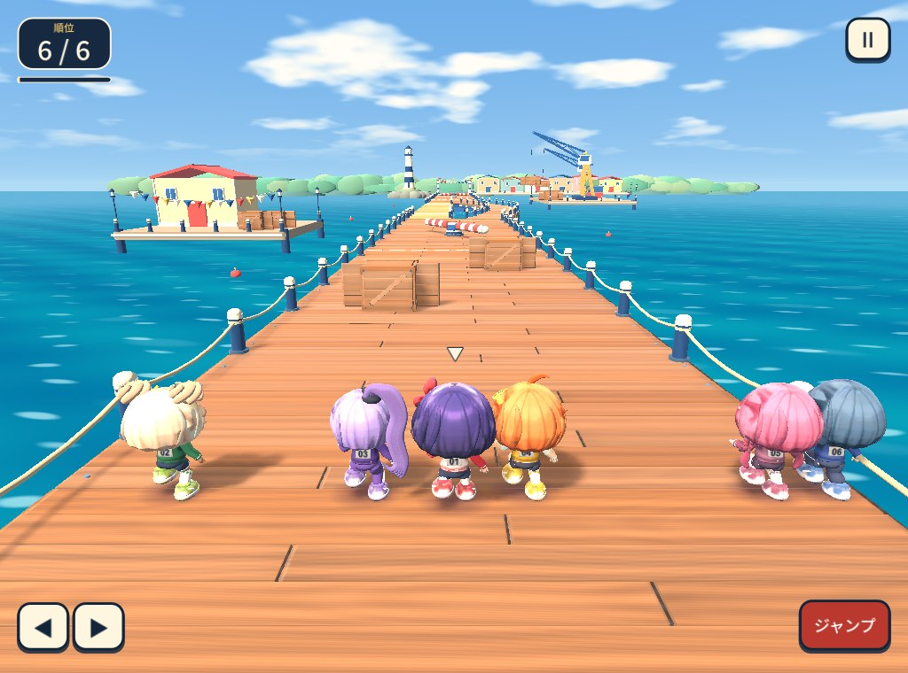

# リボンラリー！

港の桟橋を舞台にした、スマホ縦持ちの3D障害物レース。赤いリボンのナギを操作して、5人のライバルと灯台を目指す。内側の浮き橋には選手の重みがかかる。橋の先端が沈んだら早めに跳ぶか、外の桟橋を走ろう。

[ブラウザで遊ぶ](https://hayatok.github.io/100challenge/2026-11-18/) · [実際のプレイ映像（18秒・音声あり）](docs/verification/gameplay.mp4)



## 操作

| 操作 | スマートフォン | キーボード |
| --- | --- | --- |
| 左右に移動 | コースを左右にドラッグ、または下の矢印を長押し | ← → または A・D |
| ジャンプ | コースを短くタップ、または「ジャンプ」 | スペースまたは ↑ |
| ポーズ・再開 | 右上のポーズボタン、続けるときは「再開」 | Esc または P |

走者は自動で前進する。バーに触れるとよろけ、海に落ちると桟橋に戻る。ポーズ画面で音楽、効果音、カメラなどの動きを調整できる。

## シーンとモデルを開く

Godot 4.7.2のシーンエディタで `game/project.godot` を開く。メインシーンは `game/HarborRace.tscn`。追走カメラとその注視点を編集できる。桟橋や回転バーの配置は `game/course/Course.tscn` にある。6人の衣装、骨格、動きは [Blenderの原本](modeling/ribbon-rally.blend) に収録した。

このフォルダで次のコマンドを使える。Linux x86-64では `setup` がエディタも取得する。macOSとWindowsではGodot 4.7.2をインストールしてから実行する。

```sh
npm ci
npm run setup
npm run dev
```

`npm run check` は素材を読み込み、レースのテストを実行し、Web版を `dist/` に書き出す。`npm run preview` で書き出したゲームを起動できる。

## 原画との比較・試遊記録

- [ナギの原画とモデルの三面比較](modeling/review/nagi-turnaround.webp)と[6人の正面・背面](modeling/review/cast.webp)。ライバル5人の後ろ姿は正面の設定画から補った。
- [ジャンプと着地のポーズ比較](modeling/review/motion.webp)と[モデルの計測記録](modeling/README.md)。ナギは横から見たリボンと靴の後端に原画との差がある。
- Godot版は縦390×800と横1024×760でスタートから再挑戦まで操作した。浮き橋を跳び越える走行で優勝タイムは38.51秒。[ゴール画面](docs/verification/finish.jpg)
- iPhone 17eのiOS 26.5シミュレーターでは、Safariでドラッグとタップ、ポーズと再開、浮き橋からの落水と復帰、完走と再挑戦を確認した。iPhone・Androidの実機での描画速度は未計測。[Safariのジャンプ画面](docs/verification/ios-safari.jpg)
- [企画時の原画とゲーム仕様](docs/game-design.md)。ゲーム内の音楽・効果音の生成元は `scripts/make_audio.py`。GodotとフォントのライセンスはWeb版に同梱する。
