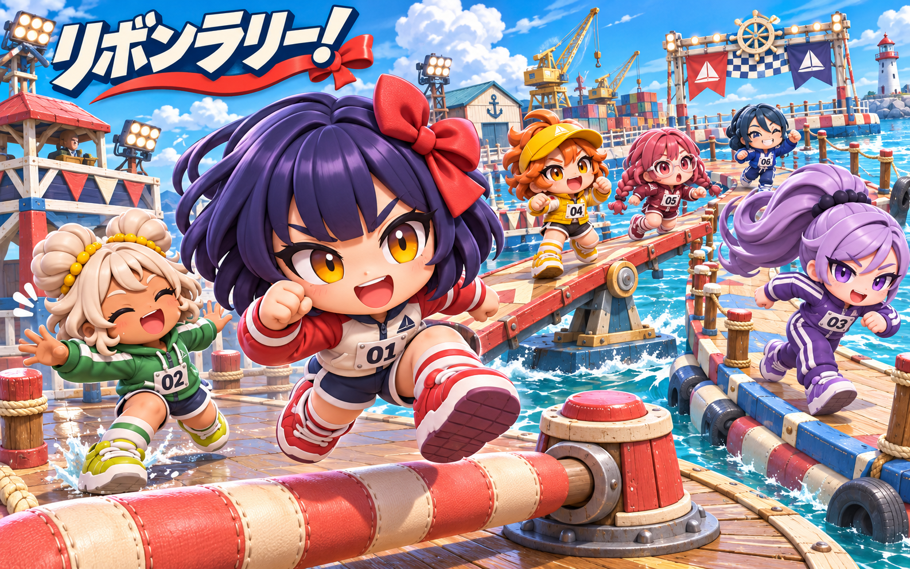
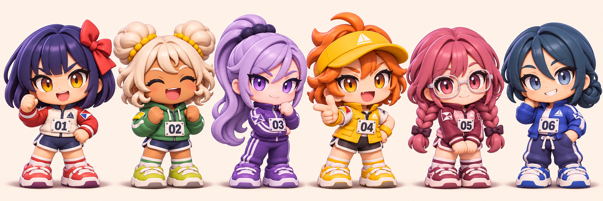

# リボンラリー！　港の障害物レース

海に浮かぶ桟橋を、ナギと5人のライバルが駆け抜ける。目の前で2人が近道に飛び乗ると、橋の片側が沈む。その後を追うか、外側の桟橋からまとめて抜くか。走りながら相手を見て進路を決める、スマホ縦持ちの1人用3Dレースを目指す。

以下は初版「潮風ふ頭」の仕様。追加コースと新操作については[v0.2の計画](v0.2-plan.md)と[試遊記録](verification/v0.2.md)を参照。

## 1レースの遊び方

最初のコースは「潮風ふ頭」。6人が同じスタートラインに横並びで立つ。プレイヤーはゼッケン01のナギを操作する。目標タイムは約40秒。最初にフィニッシュラインを越えた選手が優勝する。転倒や落水からはそのレース中に復帰でき、どの順位でも完走できる。

- **移動**　全員が自動で前進する。画面を左右にドラッグすると、指の移動量に応じて桟橋の幅の中を横移動する。指を離すと横位置を保つ。画面左下の矢印を押し続ける操作も選べる。
- **ジャンプ**　コース上を短くタップするか、右下のジャンプボタンを押す。横ドラッグを終えて指を離したときには跳ばない。空中でも少しだけ左右に寄れる。キーボードは左右キーとスペースを使う。
- **失敗と復帰**　バーに触れると、よろけて数歩減速する。海に落ちたら直前に通過した目印のある桟橋から走り直す。復帰地点は障害物の可動範囲の外に置く。通常の走者同士は肩を引いてすれ違える。集団に挟まれて操作できなくなる状況は作らない。
- **順位**　走行中はコースの進み具合で表示する。分岐では入口から出口までの進捗を各ルートで換算する。ゴール順位はライン通過時刻で確定し、同タイムは同順位とする。「もう一度」で同じ配置からすぐ走れる。

## 潮風ふ頭の3区間

| 区間 | 選手が見るもの | 遊び方 |
| --- | --- | --- |
| 1　出発桟橋 | 荷箱の間の広い通路。その先で縞模様の低いバーが一方から回ってくる。 | 最初に一度横へ動き、次に一度跳ぶ。バーの柱と先端が両方見え、回転方向を読める距離を取る。 |
| 2　傾く浮き橋 | 内側に短いシーソー橋、外側に長くて平らな桟橋。橋板の下から軸と海面が見える。 | 橋は軸の手前と先にいる走者の重みで前後に傾く。出口側に人が集まるとその端が沈み、岸との段差が広がる。早めに跳び移るか、手前で外側の桟橋を選ぶ。全員の体重は同じ。 |
| 3　灯台前ストレート | 再合流した先で2本の腕が回る。外端には少し遠い回避路があり、その先にゴール旗が見える。 | バーの後ろを走り抜けるか、正面から跳び越えて距離を稼ぐ。ゴールを越えたら減速し、カメラが正面に回って、遅れて到着する選手も映す。 |

近道が空いているときは、踏み切りに成功すれば外側より速い。集団が橋を沈めたときは外側からでも先に出られるように距離と傾きを調整する。橋の傾きは全員で共有し、プレイヤーとNPCのどちらが乗っても同じように変化する。

## 6人の選手

| ゼッケン | 選手 | 集団の中での目印 | 動きと走り方 |
| --- | --- | --- | --- |
| 01 | ナギ | 紺のボブ、本人の左の赤いリボン、赤袖の白ジャケット | プレイヤー。着地で片足を踏み込み、リボンの先が一拍遅れて戻る。 |
| 02 | スズ | クリーム色のお団子ふたつと緑のパーカ | 先に橋へ飛び込む。着地では腕を広げてバランスを取る。 |
| 03 | リッカ | 高い薄紫のポニーテールと紫のジャージ | 最短距離を狙い、バーの通過直後に内側を抜ける。 |
| 04 | アン | オレンジの髪と黄色いサンバイザー | 前の選手を追って近道を選びやすい。スタート前にひさしを押さえる。 |
| 05 | ネネ | ピンクの三つ編みと眼鏡 | 傾きの大きい橋を避け、外側を安定して走る。完走後に眼鏡を直す。 |
| 06 | ミオ | 青緑の髪を低く結び、青い上着に太いパンツ | 空いた側へ早めに進路を変える。後ろの選手にゴールで小さく手を振る。 |

NPCは自分から見える橋の傾き、前の選手の進路、回転バーの位置から操作を決める。全員に同じ走力、ジャンプ、接触、復帰の規則を使う。NPCも跳び損ねれば順位を落とす。順位で走力に補正はかけず、同じ条件で再挑戦すると自分の進路変更が勝負にどう響いたか分かるようにする。

## スマホ画面と演出

[縦画面のプレイイメージ](../art/portrait-race.png) では、白い印のナギの前方に5人がいて、表示は6/6。絵は浮き橋と迂回路が見える瞬間を描いた。走行中は追走カメラを保ち、ナギの足、次に避ける物、分岐の入口を同時に画面へ収める。バーを越えた直後に視点を切り替えると次の進路を見失うため、顔のアップは操作の前後で使う。

| 画面 | 表示と反応 |
| --- | --- |
| タイトル・スタート | 海上競技会の旗をかたどったタイトルと「レース開始」。笛の前に6人を正面から映す。カウント終了時には追走視点に入る。 |
| 走行中 | 左上に現在順位、右上にポーズ、下端に左右とジャンプ。紺地に生成りの太い数字と枠を使う。順位が上がると数字が一度だけ弾み、着地は靴音と足元の小さなしぶきで伝える。 |
| ポーズ | 「再開」「最初から」「動きを減らす」「効果音」。画面を離れたら橋、全選手、時計を止め、戻ったら再開操作を待つ。動きを減らすと数字の弾みやカメラの旋回を省く。 |
| 結果 | ナギの着順とタイムを掲示し、「もう一度」で再出走する。後続の到着を待たずに押せる。再出走では姿勢、橋の傾き、バーの位相、時計、順位を初期化する。 |

数字は太めの等幅数字、日本語の操作表示は端末のゴシック体を使う。小さい縦画面でも操作部を44 CSS px以上取り、縁の安全領域を空ける。矢印のボタンには読み上げ用の名前を付ける。音を切っても、バーの縞、橋の輪郭、接地影から跳ぶ時機が読めるようにする。

## 原画から3Dへ移す順序

1. [衣装原案](../art/costumes.png) から頭部を大きく、手足を短くしたものが6人の設定画。ゲーム用の体形は設定画を使う。最初にナギ1人を作り、[三面図](../art/nagi-turnaround.png) と同じ高さ・向きで正面、横、背面を撮る。目と前髪の間隔、頬の輪郭、リボンの左右、背番号、靴底の厚みを並べて見る。
2. [ジャンプのポーズ原案](../art/nagi-jump.png) をもとに、予備動作、空中、着地、走り出しを一続きにする。横から録画し、靴底が桟橋に着く位置と接地判定を見比べる。接地中の足の滑り、腕と大きい頭の重なり、方向転換時の髪や袖のめり込みも確認する。
3. ナギが走れるようになったら5人を加える。通常のカメラ距離で名前を隠しても髪型と服装から追えるか、全員を同じ実機に表示して検証する。スタートとゴールの顔は、設定画と同じ角度の映像も残す。
4. 試遊では「内側に2人が乗るのを見て外を選ぶ」「バーに当たった後に抜き返す」を試す。小型のiPhoneで、指が進路を隠さずにドラッグとタップを続けられるか、6人が密集したときにも障害物が読めるかを記録する。性能目標は6人表示で毎秒30フレーム以上とし、実機名と計測区間を残す。

この段階の成果は生成した原画と仕様案。体形の一致、連続した動き、操作感、端末での描画速度は、3Dモデルと試作コースができた段階で確認する。
