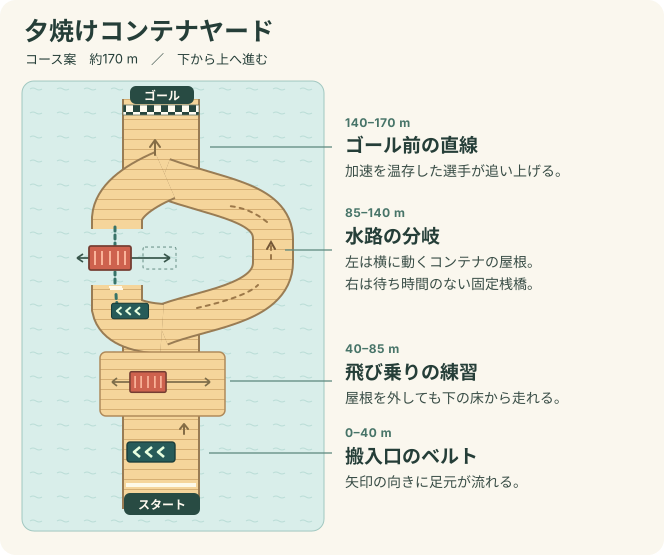

# リボンラリー！ v0.2 アップデート案

クレーンが吊ったコンテナが、こちらの桟橋へ寄ってくる。リッカは加速してその屋根に飛び乗る。ナギも続くか、外側を走るネネと並んで、最後の直線まで加速を取っておくか。新コース「夕焼けコンテナヤード」で作りたいのは、この分かれ道だ。

v0.2では現行の「潮風ふ頭」を残し、選べるコースを2本にする。6人の自動走行、横移動、ジャンプは共通。どちらも基本操作だけで完走できるようにし、加速とダイブで抜ける場所を増やす。以下の距離、秒数、速度は試作用の初期値・目標で、実測は最初の試遊で行う。

## 親指で使い分ける2つの技

| 操作 | スマホ・キーボード | 狙いどころと代償 |
| --- | --- | --- |
| 加速 | 地上で「加速」をタップ。キーボードは Shift。1レース2回 | 1.2秒間、前進速度を約1.3倍にする。横に切り返す速さは通常の7割。動く足場に間に合わせるか、合流後に前の選手を抜くために使う。 |
| ダイブ | ジャンプ後に指を離し、空中でコースか同じボタンをもう一度タップ。キーボードはスペースか↑をもう一度押す。1ジャンプ1回 | 両手を伸ばして前方へ飛び込む。上昇はそこで終わり、頂点付近なら普通のジャンプより0.5〜0.8 m先を狙える。早出しすると高さが足りない。着地後は約0.35秒お腹で滑り、減速して立ち上がる。 |

今の左右ドラッグと左下の矢印を残す。右下の「ジャンプ」は空中で「ダイブ」に切り替わり、その上の「加速」には残り回数を2枚の小旗で示す。ドラッグを終えた指やボタンの長押しで技が出ないようにする。加速して踏み切ってもダイブ中の前進速度は通常の1.5倍まで。バーや荷物に触れればよろける。

落水すると加速は終わり、使った回数は戻らない。一時停止やタブ移動ではタイマーを止め、復帰時に保留中の押下を捨てる。「もう一度」で加速2回、ダイブ、障害物の位置をスタート時の状態に戻す。

## コースとギミック

### 新コース「夕焼けコンテナヤード」

海沿いの荷役場を約170 m、40〜50秒で走る。床に埋めた荷送りベルトと、クレーンに吊られて左右に往復する足場が登場する。どちらに乗っても体が横へ運ばれ、跳ぶと離れられる。

| 区間 | 走って見えるものと選べる進路 |
| --- | --- |
| 0〜40 m　搬入口 | 広い床の一部に、左向きの矢印が流れるベルトを敷く。乗れば内側へ運ばれる。横に避けても、ジャンプで途中から降りてもよい。 |
| 40〜85 m　練習用の荷台 | 低い吊り足場が広い受け床の上を往復する。屋根に飛び移って、端からダイブしてみる。届かなくても下の床からそのまま走れる。 |
| 85〜140 m　水路の分岐 | 内側はベルトから踏み切り、海の上を横切る吊り足場の屋根を渡る近道。外側は固定された桟橋が水路を回り込む。クレーンのレール、動く影、外側の曲がり角を分岐の手前から同時に見せる。内側で落水したら分岐直前の床から復帰する。 |
| 140〜170 m　ゴール前 | 2人が並べる幅を残して合流し、最後は見通しのよい直線にする。ここまで加速を残した選手は、外側からでも追いつく機会がある。 |

分岐に同じ速さ・残り回数で入り、同じ時刻に走り出して比べる。近道をきれいに渡ると外側より0.5〜1.0秒先に出られ、飛び乗りを失敗すれば外側が先に出られるのを目標にする。外側の所要時間は桟橋を回り込む実際の道のりで決まる。リッカは届くタイミングなら内側へ、ネネは足場が遠ければ外へ向かう。5人のライバルにも同じ加速回数、ダイブ、着地の隙、落水の規則を使う。

### 既存コース「潮風ふ頭」

150 mの桟橋、回転バー、6人の重みで傾く浮き橋を生かす。浮き橋の手前で加速して先に渡るか、先行集団で橋が沈んだら外側に回るか。頂点からのダイブで岸に手が届いても、滑った先が回転バーの進路なら順位を落とす。旧コースでも、これまでの跳び方で全区間を通れるようにする。

次のマップ候補は「夜市の屋根わたり」。提灯の下を走る軒道と、屋台の天幕で高く弾んで次の屋根へダイブする近道を対にする。こちらはv0.2の試遊後に検討する。

## 原画の姿をレース画面に残す

| 対象 | 制作と見比べ方 |
| --- | --- |
| ナギと5人のライバル | ナギは斜め後ろから頬にかかるボブ、本人の左側の赤いリボン、横から見た靴の厚みをBlenderで原画に合わせる。6人を同じ光・同じ縮尺で並べ、実際の追走距離でも髪形と服の色で見分けられるかを見る。 |
| 加速とダイブ | 加速では腰から前に乗り、左右の膝を交互に高く引く。ダイブは両手が先、胸が水平、靴が最後に浮く横姿にする。着地は手と前腕で受け、腹で滑り、片足をついて走りに戻る。リボンと髪は体より少し遅れて返る。横から撮ったモデルを原画と同じ大きさで並べ、追走カメラでも加速・飛び込み・立ち上がりの違いが見えるかを録画で確かめる。 |
| 港の光・進路 | 夕日はコンテナの縁を照らし、走者の顔と背中には空から青い光を足す。矢印はベルトと同じ向きに流す。クレーンの影で今の位置を、レール両端の塗装で移動範囲を示す。遠景の荷物は彩度を落とし、踏み切り線と着地面を手前に浮かせる。 |
| レース中の画面 | タイトルには同じ画角で撮った2コースの入口を並べる。レース中は足元と次の着地点を空け、結果から「もう一度」「コース選択」へ進める。動きを減らす設定では加速の残像を省き、ベルトの矢印と足場の位置は読み取れるようにする。 |

造形の基準は[ナギの三面図](../art/nagi-turnaround.png)と[ジャンプ原画](../art/nagi-jump.png)。現行版の比較元として、[モデルの三面図](../modeling/review/nagi-turnaround.webp)、[動きの見本](../modeling/review/motion.webp)、[縦画面のレース](verification/ios-safari.jpg)を使う。

## 作る順番と試遊で決めること

1. **短い区間で操作を試す。** 現行ふ頭の通常ジャンプと完走を記録してから、平地、隙間、分かれ道だけの仮コースを作る。ナギとライバルが、通常走行・ダイブ連打・着地点を狙ったダイブで同じ区間を走る。平地で連打が常に勝つなら着地の減速を、狙っても届く場所が変わらなければ飛距離を調整する。
2. **2コースを最初から最後まで走る。** 全長、走れる床、分岐、復帰地点、カメラの注目位置をコースごとに持たせる。Godotのシーンエディタで足場・衝突面・カメラを重ねて調整する。吊り足場が左端・中央・右端にある3条件で、外側は待たずに通れるか、内外どちらも合流時に先頭になれるかを試す。6人で順位、ゴール、再挑戦まで確認する。
3. **6人の動きと縦画面を仕上げる。** 共通の骨格と既存のテクスチャを使い、選んだコースだけを読み込む。初めて遊ぶ人に1回走ってもらい、2回目に自分で加速の使いどころやルートを変えられるかを見る。390 × 800と320 × 568の画面で、親指が進路を隠さず、各ボタンに44 CSS px四方以上の押せる範囲があるか確かめる。
4. **公開前に端末で確かめる。** 自動テストとWeb書き出しを通し、GitHub Pagesと同じ配信条件で読み込み、フォーカス喪失、復帰、再挑戦を確認する。iPhoneのSafariとAndroidのChromeで機種を記録して各コース3レースを走る。6人が集まるスタートとゴール、浮き橋や吊り足場の通過時に描画時間を測る。各場面でフレームの95%が33.3 ms以内に収まることを目標にする。超えたら遠景の荷物、影、粒子の順に軽くし、足場の位置を知らせる影は簡易表示でも残す。
