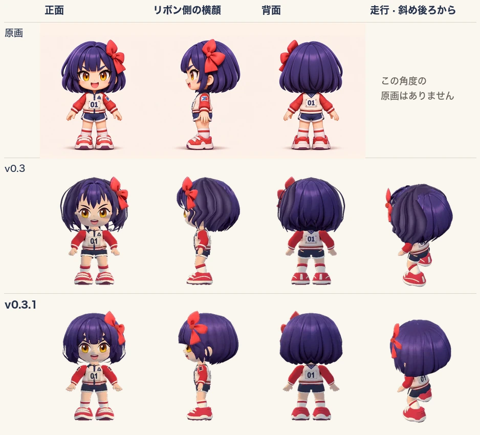
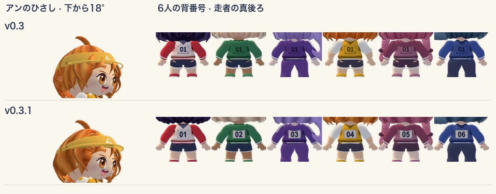

# v0.3.1 選手の多視点比較

[選手の回転台](https://hayatok.github.io/100challenge/2026-11-18/model-review/)では、選手を左右にドラッグすると修正前後のモデルが同じ角度へ回る。6人ともv0.3と比べられる。ナギは修正前の版をv0.2にも切り替えられる。

## 原画と見比べた箇所

- ナギはv0.3で中央の前髪が尖り、左右の横顔では耳が髪に隠れていた。中央の房に幅を持たせ、耳の前と後ろで毛先の高さを変えた。真横でも鼻先と開いた口を見分けられる。ゴールで頭を傾けると赤いリボンの縁に黒い横縞が出ていたため、側面に映る布の色も直した。
- 走る選手を後ろ斜めから見ると、ショーツの中に脚の肌色がのぞいていた。ショーツから脚へ続く面を一緒に曲げ、肘を曲げても袖口が腕についていくようにした。背番号の布を裏返しに描画していたため全員が「01」に見えた問題も修正した。真後ろで01から06までを読める。
- アンのサンバイザーは、低い位置から見るとつばの縁だけが残った。表と裏を縫い合わせる形で厚みを付けた。準備中に手を上げると指先がつばに届く。ライバル5人の原画は正面だけなので、後ろ姿とつばの裏側の形は正面から補った。

## 撮影条件

各版のモデルをGodotに読み込み、潮風ふ頭の昼の光を使用。水平と28°上から、22.5°刻みで各16方向を撮影した。カメラに収まる縦の長さはすべて1.86 mで、ポーズは待機の始点と、走りの1周期の19%の時点にそろえた。比較画面にはナギのv0.2、全員のv0.3とv0.3.1を収録した。

ナギの待機姿勢は三面図と重ねても比べた。下の値は身長と横の中心を合わせた後、二つの輪郭が重なる面積を、少なくとも一方が占める面積で割ったもの。輪郭の内側にある瞳や布の色はこの値に表れない。

| ゲーム内のモデル | 正面 | 本人の左横 | 背面 |
| --- | ---: | ---: | ---: |
| v0.2 | 0.874 | 0.887 | 0.888 |
| v0.3 | 0.828 | 0.846 | 0.843 |
| v0.3.1 | 0.856 | 0.879 | 0.891 |

v0.3からは3方向とも原画に近づいた。正面と左横はv0.2の方が近い。特に正面で、頬から襟の横へ広がる毛先は原画より早く内側へすぼむ。アンのつばも正面の原画より短めに見える。

## レースと操作

夕焼けコンテナヤードをv0.3とv0.3.1で走った。縦画面に同じタイミングで左右のドラッグ、ジャンプ、空中でのダイブ、加速を入力し、どちらも吊り足場を渡って43.31秒で2位になった。[レースの修正前後の映像（7.6秒、音声あり）](v031-race.mp4) · [スタート・加速・ダイブ・ゴール](v031-race.webp)

iPhone 17e・iOS 26.5のシミュレーターのSafariでは、夕焼けコンテナヤードで2回ダイブし、45.29秒で6位になった。ナギがゴールで顔を傾けても、リボンの側面に赤い布が続いて見える。回転台では背面から一つ角度を送り、正面へ戻ってから写真をドラッグして、左右のモデルが一緒に45°回ることを確かめた。実物のiPhoneでの見え方と描画速度は未確認。[Safariで撮ったゴール画面](v031-safari.webp)

`npm run check`で走行の107項目、コースと画面遷移の101項目、全員の19本の骨、13アクション、6種類の表情変形を検査し、Web版を書き出した。
