# 避難指令

現代日本を舞台にした、一人用のゾンビサバイバルゲーム。商店街から車両基地までの4地区で、部隊を指揮して住民を避難させます。名簿から兵士を一人選ぶと、その場で本人の目線に入れます。直接操作している間も、ほかの班は受け取った命令を続けます。

## 遊び始める

ブラウザではインストールせずに遊べます。[ブラウザ版「避難指令」を起動](https://hayatok.github.io/100challenge/2026-11-19-2/)

Windows版は[0.5の配布ページ](https://github.com/hayatok/100challenge/releases/tag/release-evac-20261119-preview5)から入手できます。「Assets」の `EvacuationControl-Windows-x64.zip` を展開し、`EvacuationControl.exe` を起動してください。Web版は横持ちのスマホとPC向けです。リポジトリから遊ぶ場合は、このフォルダで次のコマンドを実行して、表示されたアドレスを開きます。Python 3が必要です。

```sh
python scripts/play.py
```

同じWi-Fiに接続したスマホで遊ぶ場合は、PCで `python scripts/play.py --lan` を実行し、表示されたアドレスをスマホのブラウザで開いてください。PC上では、配信するのはゲームのWeb版フォルダだけです。HTTPSで配信したWeb版はホーム画面に追加できます。

## 最初の作戦

「作戦を選ぶ」で「朝市の集合場所」を開き、難度を選んで出動します。作戦手帳には、開場前の朝市でとれる二つの行動が載っています。店先と停留所の名簿を照合するか、店主の吉田を案内役に迎えるかを選び、班を派遣してください。自分で現場に入り、直接引き受けることもできます。

前哨を終えたら住民の避難が始まります。地図で今の区画と次の区画を確認し、青果店前の誘導や先の区画の確保を指示してください。名簿で佐藤を選ぶと、本人の目線で負傷者に肩を貸せます。必要な人数が乗車したら作戦手帳を開き、撤収時に残った仕事を二つから選びます。

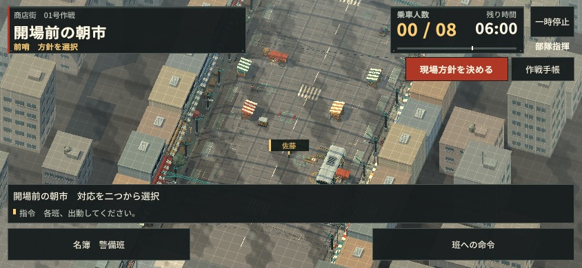

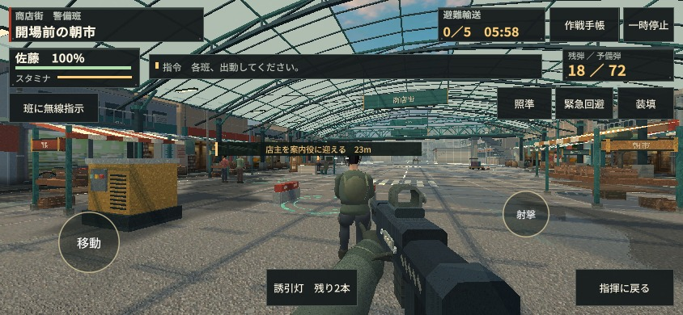

## 避難列を送り出す

朝市の前哨を終えたら「避難隊列」を開いてください。青果店からバス停へ向かう表通りは金色の実線、軒下を回る道は緑の破線です。店主の中野と谷口がどこにいるかを見ながら、付添班と道を選べます。横戸が閉じていても、二人は露店の脇から迂回できます。

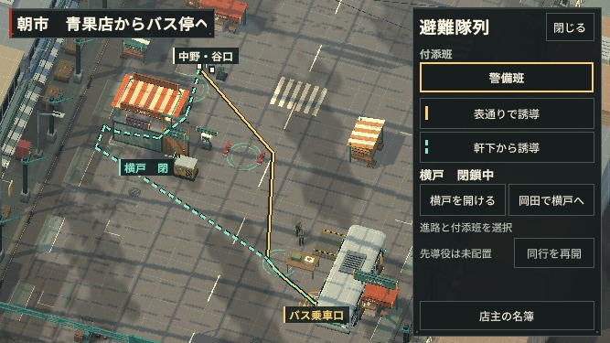

自分で近道を開けるなら「軒下から誘導」を指示し、もう一人の隊員の「○○で横戸へ」を押します。緑の横戸を見ながら操作盤に近づくと「横戸を開ける」が出ます。店のシャッターに沿って立つと、腰前掛けの中野と青い上着の谷口が通り抜けるところを見届けられます。指揮を続けたいときは、地図の「横戸を開ける」で解錠係を派遣してください。

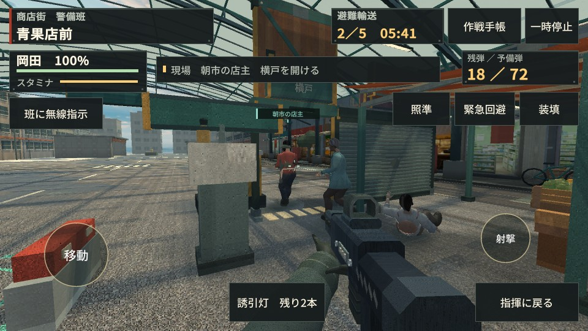

第6作戦「冠水した地下連絡路」では、北改札の歩行列と救護室の介助列を受け持ちます。昇降機を使うには排水と電源が必要です。保守通路を使うときは、担当者を先に防火扉へ送ってください。足を痛めた牧野を担架に乗せたら、その隊員に入って押せます。隊員が向きを変えると前輪も回ります。狭い所では、壁から前輪を離して曲がってください。

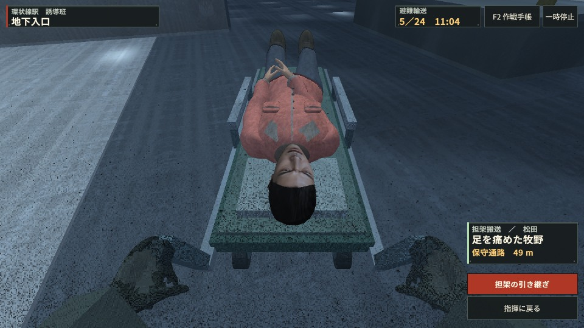

## 館内で住民を救助する

避難が第2区画に入ると「館内の救助を指揮」が開きます。最初の診療棟では、夜間受付で身元を確認し、配電室で病棟に給電してください。酸素ボンベを観察病室に届けると、看護師の黒田を連れ出せます。一人を館内に送り、同じ班の残りの隊員に屋外の誘導を続けさせることもできます。作戦手帳の「館内見取図」には、室名、開いた扉、隊員、住民の位置が出ます。

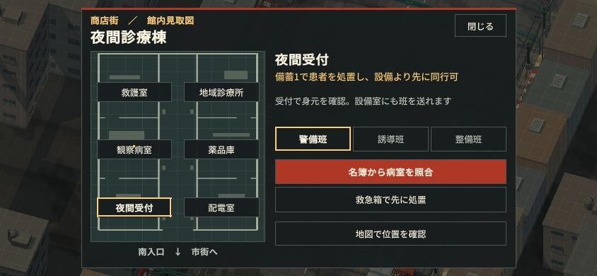

班に複数の場所を回らせるときは、指揮画面の「次の命令を選ぶ」から「経路を描く」を開きます。地図上で2〜4地点と終点での仕事を選んで送信してください。途中で隊員の目線に入ると、僚員が次に向かう地点を一人称でも追えます。

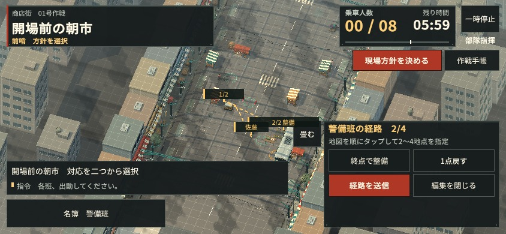

## 操作

| 場面 | Windows・マウス | スマホ横持ち |
| --- | --- | --- |
| 指揮 | 1〜3で班を選択。行き先を右クリック。名簿で兵士を選び、Tabで直接操作 | 名簿から班・兵士を選択。地点をタップして指示。「直接操作」で現場へ |
| 地図 | WASDまたはドラッグで移動。ホイールで拡大縮小、Z・Xで回転。スペースで選択した兵士を表示 | ドラッグで移動。二本指で拡大縮小・回転 |
| 直接操作 | WASDで移動、Shiftで走る。左クリックで射撃、右ボタンで照準、Rで装填、スペースで回避。低い障害物に向かって前進中なら乗り越える | 左親指で移動、右側をなぞって見回す。射撃ボタンは長押し。移動しながら回避ボタンで回避・乗り越え |
| 救助・補給・修理 | 現場に接近してF。住民や感染者に照準を合わせ、1〜3で班に無線指示。Tabで指揮に戻る | 現場で表示される行動ボタンをタップ。班名で照準先を指示。「指揮に戻る」で復帰 |
| 作戦手帳・班装備 | F2で作戦手帳。F3で選択中の班の灯りを使う | 「作戦手帳」で局面・地区・捜索・車列を確認。灯りは担当班に設置を指示できる |
| 停止・再開 | Escで一時停止。F1で操作案内。F12でWindows版の画面を保存 | 「一時停止」から再開・設定・タイトルへ |

設定では移動、装填、回避、現場での行動、視点を切り替えるキーを変更できます。スマホでは射撃ボタンの位置と見回しの感度を調整できます。「照準」をタップすると、サイトをのぞいて狙えます。

群れが乗車口に迫ったら、指揮画面の「設備・資材」から担当者を現場の音源へ送れます。操作中の兵士が装置まで歩いて作動させることもできます。商店街の防犯ベルや駅の非常放送が鳴っている間は、音を聞いた感染者がそちらに向かいます。すでに兵士へ飛びかかっている感染者は攻撃を続けます。

緊急回避で消費したスタミナや装填の途中経過は兵士ごとに残ります。負傷、物資の運搬、住民の介助によって使える行動が変わります。作戦は進行中に自動保存され、一時停止したときにも記録されます。「つづきから」で再開し、失敗した作戦はチェックポイントからやり直せます。Windows版とWeb版は別々に保存します。

## キャンペーン

| 地区 | 作戦 |
| --- | --- |
| 商店街 | 朝市の集合場所、閉店後のアーケード |
| 物流倉庫 | 荷受けヤード、夜勤の整備棟 |
| 環状線駅 | 臨時列車、冠水した地下連絡路 |
| 車両基地 | 河川敷の中継所、最後の車列 |

8作戦はそれぞれ前哨・避難輸送・撤収の順に進みます。前哨と撤収には毎回二つの対応があります。朝市の撤収で負傷した連絡員の今井を搬送すると、次の作戦では今井が集積所に現れ、開設した前方拠点へ補給箱を運びます。

避難輸送で回るのは全38区画です。整備班を次の地区へ先に送り、主力を今の救助に残せます。駅では排水・昇降機・防護柵が電源を共用します。荷受けヤード、夜勤の整備棟、河川敷の中継所、最後の車列では、本線便とは別に迎車の行き先を選べます。迎車を近くの負傷者のために待たせるか、空席を残して発車させるかも指揮官の判断です。

市街捜索では聞き取りと現場の確認を進め、各作戦で二人の行方を追えます。別に8件の任意要請があり、完了した要請は最終報告で読み返せます。

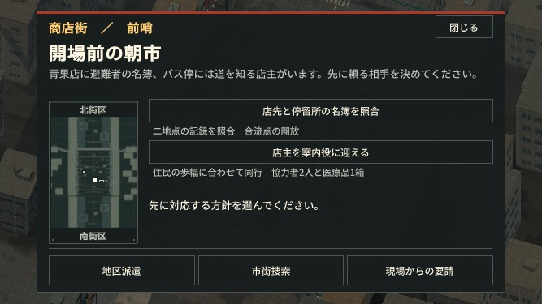

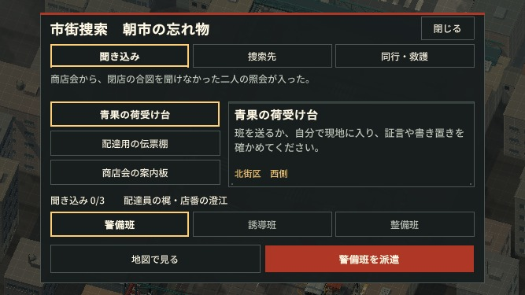

### 救援当直

タイトルの「救援当直」から、4地区の独立した作戦に出動できます。本編と当直は別々に中断・再開できます。

| 当直 | 現場で決めること |
| --- | --- |
| 夜間診療の送り | 診療用の薬箱を運ぶか、救護所を建てて患者を搬送するか。 |
| 故障車の代走 | 荷を別の車へ積み替えるか、連絡橋を直し、運転手を迎えに行くか。 |
| 終電後の捜索 | 駅舎を直接捜すか、非常放送で乗務員を呼び、地下の水を抜くか。 |
| 基地の最終点呼 | 点呼簿と乗車した人を照合し、巡回に出た班長をどの班が迎えに行くか。 |

### 旧版の駅の画面

0.1の環状線駅で、隊員を選ぶ前と直接操作に入った後のWindows版を撮影しました。

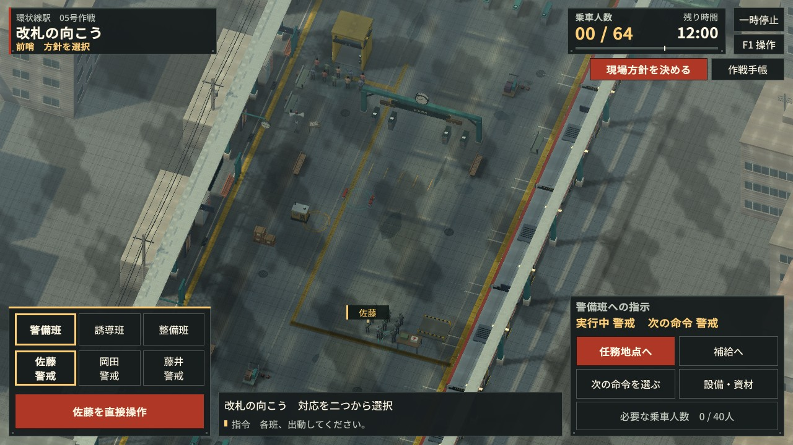

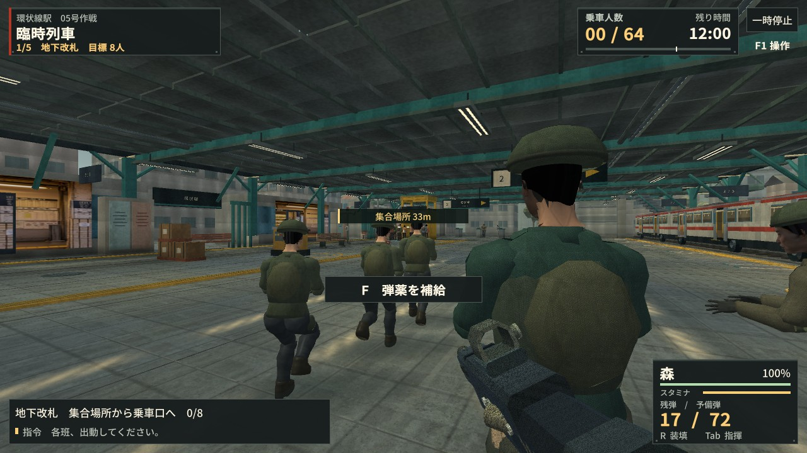

## 制作と検証

Unity 6000.3.28f1で `Game` を開き、`Assets/Scenes/Dispatch.unity` から再生できます。エディタの「避難指令」メニューにWindows版とWeb版のビルドがあります。WebGL Build Supportを追加するとWeb版を出力できます。生成したWeb版を `web-player` に配置して `npm run check` を実行すると、Pagesに配信するファイルが `dist` にそろいます。

Blenderで地区、車両、人物、腕と装備を制作し、人物の歩行をキーフレームから焼き込みました。原画と環境・顔のテクスチャはComfyUIのMoss-imageを使用しています。人物の基礎メッシュはMakeHumanのCC0素材です。日本語の無線はHTS Voice “Mei”で合成し、帯域を絞って無線機の音色を作りました。音声モデルはMMDAgent Project TeamによるCC BY 3.0、書体はNoto Sans JPでSIL OFL 1.1です。[人物の原典と権利表記](art-source/characters/README.md)・[音声・書体のライセンス](Game/Assets/StreamingAssets/Licenses/)

0.5の標準難度で全8作戦と任意要請8件を自動操作したとき、作戦内で約33分50秒が経過しました。初見プレイヤーの所要時間は未計測です。目標は4〜6時間です。

- [企画とMoss-imageの画面案](docs/game-plan.md)
- [実プレイの検証記録](docs/verification.md)
- [GitHub の制作マイルストーン](https://github.com/hayatok/100challenge/milestone/11)
