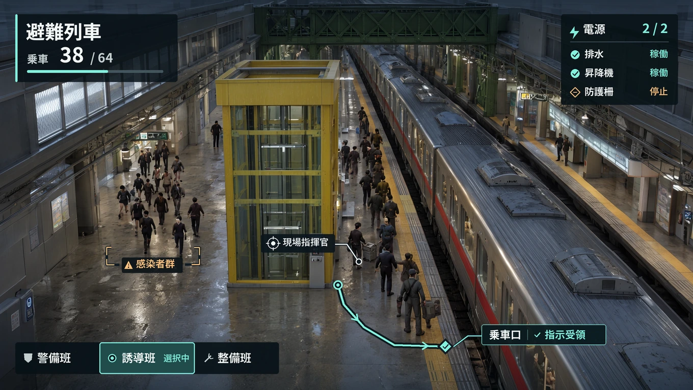
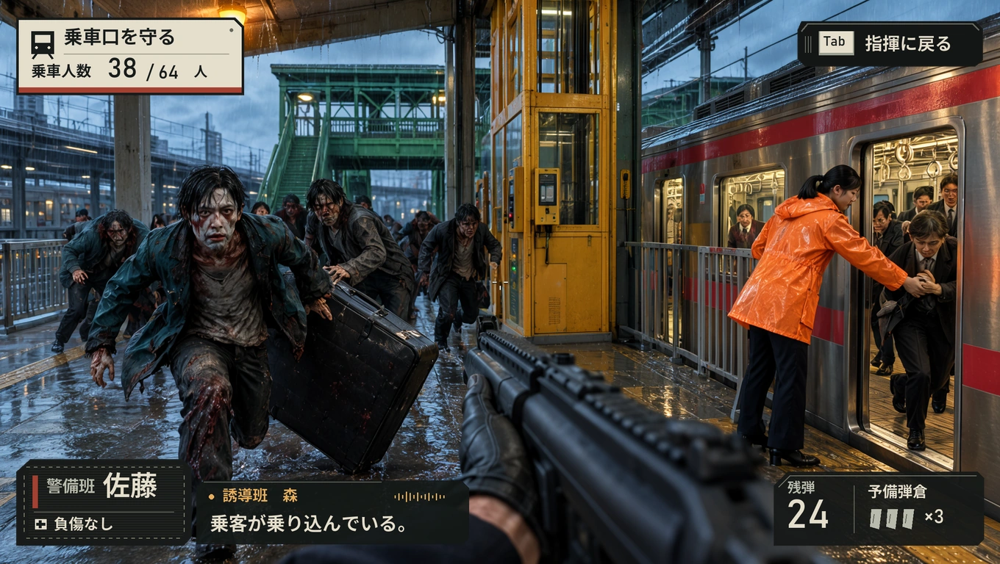
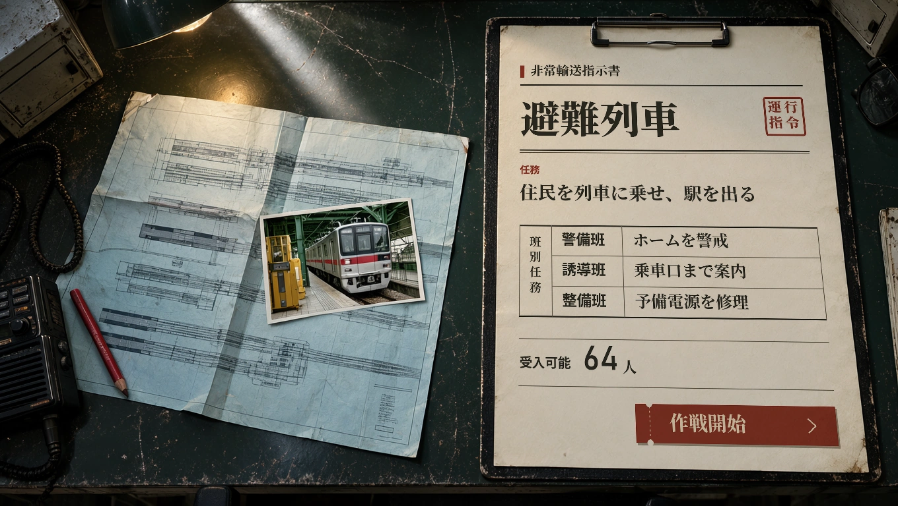
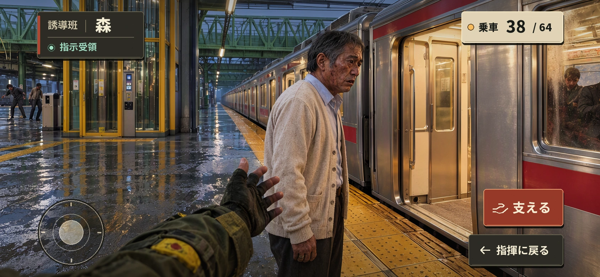

# ゾンビサバイバル　RTS＋FPS 企画案

現代日本の架空の地方都市で、複数の班を指揮して住民を避難させる。作戦はRTSで始まる。班に命令を出したら、その場にいる兵士を一人選び、その兵士の目線で走り、戦い、救助できる。いつでも指揮に戻り、離れた場所の別の兵士へ操作を移せる。Windows PCと横持ちのAndroid・iPhone向けに、一人用の完結したキャンペーンを作る。

駅の指揮画面案。上の運行表示器で避難経路と乗車人数を読み、左下の名簿から兵士を選ぶ。森の足元の印と「森を直接操作」の札が対応する。「38 / 64」は作戦途中の表示例。乗車人数は扉を通った人数から数える設計とする。

## 一つの作戦で両方を遊ぶ

代表任務は駅からの避難。赤帯の電車には今回の避難者用に64人分の空きがある。地下にはまだ人がいて、ホームでは作業員が車内の空いた扉へ乗客を案内している。感染者は改札側から迫る。警備班をどこに残し、誘導班をどこまで進めたかで、次に直接操作できる兵士の位置が決まる。

警備班の佐藤から見て、右に赤帯の電車、正面に黄色い昇降機がある。画面下の無線には、いま乗客を誘導している森の名前が出る。指揮に戻って同じ名前を選べば、その現場に入れる。

| 作戦中の約1分 | プレイヤーの操作 | 同じ時間に進むこと |
| --- | --- | --- |
| RTSで配置する | 警備班にホームの警戒、誘導班に昇降機から乗車口までの誘導、整備班に予備電源の修理を指示する。いま使える二系統は排水と昇降機に回す。 | 三班が同時に動き出す。改札の仮設防護柵は補強装置が止まり、感染者に押されて傾き始める。 |
| 佐藤で食い止める | ホームで入口を見ている佐藤を選んでFPSに入る。柵を抜けた先頭の感染者を止め、列車の扉を空けておく。 | 他の警備兵は持ち場を守る。右手では乗客が列車に入り、整備班の修理も進む。 |
| RTSに戻り、森を選ぶ | 昇降機の到着音が鳴ったら指揮に戻る。誘導班の森が負傷者のそばに着いたのを見て直接操作に入り、その人の肩を支えて乗車口まで運ぶ。 | 佐藤は残った弾でホームの警戒を続ける。森が一人を乗せた瞬間、乗車人数が一人増える。再びRTSに戻り、残った人を待つか発車させるか決める。 |

排水を一時的に止めて、昇降機と防護柵を同時に使う手もある。その間は地下通路に水がたまる。水面が壁の赤線に近づくと地図に警告が出る。赤線に達すると誘導班は人々を通路の手前で待たせる。排水を再開しても、水が引くまでは通れない。地下に最後の数人だけが残る場合と、長い列が残る場合とでは、同じ電源配分でも結果が変わる。

佐藤の位置からは、次の群れと列車の扉が両方見える。森を操作している間、その入口は警備班に任せる。誘導班をまだ地下に残していたなら、森を選んでもホームには出られない。まず班を移動させるか、すでにホームにいる兵士に救助を任せる。発車すると、実際に乗せた人々が車窓を通り過ぎる。

### 兵士を引き継ぐルール

- 行動可能な味方の兵士は所属班や役割を問わず選べる。FPSは選んだ本人の位置・向き・姿勢から始まる。装備、残弾、負傷、運んでいる物や支えている相手はその兵士に属する。
- 直接操作中は一人の移動と行動をプレイヤーが受け持つ。他の兵士は最新の班命令を続け、避難、戦闘、作業、時間経過も続く。救助中の兵士に入った瞬間は相手の肩を支えた姿勢のままで、続けて歩くか、その場で支援を中断するかを選べる。
- 指揮に戻るとカメラは直前の兵士を中心に引く。その兵士は現在地からAI操作に戻る。進行中の救助や装填は同じ進み具合から続け、終えたら班の最新命令に従う。AIが消費した弾や運んだ距離は、次にその兵士を選んだときにも残る。
- 操作中の兵士が戦闘不能になったら、その場所を中心にRTSへ戻る。名簿にその状態を示し、別の行動可能な兵士を選べる。復帰は作戦中の救護ルールに従う。

### 一人称で戦っている間

改札の向こうで数体がこちらを見つけて走り出す。先頭が旅行鞄につまずくと、すぐ後ろの一体はその背に乗り上げ、離れていた一体は脇を抜ける。群れの奥まで一斉に同じ動きをさせない。乾いた通路から濡れたホームへ移る足音と、画面外の隊員の声で横から来る相手の位置も分かるようにする。入力への反応は即座に返し、自分の腕の動きと命中時の相手のよろめきを別々に調整する。

弾薬と救急品の残りは兵士ごとに異なる。ホームを長く守らせるなら、手の空いた隊員を補給所へ回す必要がある。負傷者を担ぐ兵士は両手がふさがるので、先に警備班を呼んでおいた意味がここで出る。発車を遅らせるほど未乗車の人には時間ができる一方、群れと消耗は増え続ける。

## キャンペーンとRTS

製品版の仮の範囲は四地区・全八作戦、初回4〜6時間。序盤の商店街では一つの班を動かし、そのうち二人を順に直接操作する。物流倉庫では整備と運搬に人員を分ける。駅では複数の現場を同時に扱う。終盤は河川沿いの車両基地に、それまで救出した隊員と整えた設備を持ち込み、最後の輸送を完了させる。

- **人員**。隊員を警備・誘導・整備の仕事に割り当てる。負傷者を救護所へ戻すと、その人が回復するまで現場の仕事は遅くなる。班は指定した仕事を続け、通れないときは理由を無線で知らせる。
- **輸送と建設**。倉庫で確保した資材は、運搬担当が拠点に届けると使える。確保した敷地には、負傷者を戻す救護所か、設備を早く直せる修理場を建てられる。移動する車両と建設中の拠点は一人称からも見える。
- **作戦結果**。救出人数、隊員の負傷、持ち帰った資材を次の作戦へ引き継ぐ。損失の多い回にも応援人員で次へ進める。出発できる避難車両をすべて失うと作戦失敗。直前のチェックポイントから再開でき、終了後には作戦冒頭からやり直す選択も用意する。

最終版には難度選択、チュートリアル、中断保存、作戦の再挑戦、結末、スタッフロールを含める。最初の一本はオフラインで通せる仕様とする。

## 現場と指揮の操作

| 操作 | PC | スマホの横持ち |
| --- | --- | --- |
| RTSで班へ命令 | 班と目的地を選び、経路を見て確定する。 | 班と目的地を順にタップして確定する。ドラッグで地図を移動できる。 |
| RTSから個人のFPSへ | 班の名簿か現地の兵士をクリックし、Fキーまたは名前入りの操作ボタンで入る。 | 班の札から兵士を選ぶと地図上に本人の位置が出る。「森を直接操作」などの名前入りボタンで入る。 |
| FPSで移動・視点・射撃 | WASDとマウス。キー割り当てを変更できる。 | 左親指で移動、右で視点と射撃。照準補助とボタン位置を調整できる。 |
| 一人称で班へ指示 | 班の数字キーで選び、画面中央の対象に短い命令を出す。 | 班の札をタップし、中央の対象へ「指示」を押す。視点を保ったまま使える。 |
| FPSからRTSへ | Tabまたは「指揮に戻る」で戻る。別の兵士にも同じ手順で入れる。 | 「指揮に戻る」をタップする。引いた視点で命令を変えたり、次に操作する兵士を選んだりできる。 |

どちらの視点でも世界は同じ速さで動く。RTSでは味方が見ている場所に現在の状態を示し、その外には最後に確認した情報を残す。名簿で選んだだけでは操作は移らない。確定する前にその兵士が倒れたら、理由を示してRTSにとどまる。すでに出した班命令はFPSに入っても続き、未確定の指示は破棄する。

### 画面と音

駅の運行表示器、非常輸送の帳票、兵士の識別票、携行無線機をUIの原形にする。指揮卓の乗車人数は琥珀色、銘板は生成り、筐体はつやを抑えた墨色。列車と共通の朱色を行先の帯と主操作に使う。画面の和文はNoto Sans JP、紙の指示書はNoto Serif JPを使う。PCの静止案では残弾などの数字にBahnschriftを用いた。避難経路の現在地点は二重丸、地図上の確定した経路は実線に矢印、未確定の経路は破線で示す。灯りが消えた設備には「停止」と表示する。

起動時は「つづきから」か「作戦を選ぶ」で出発する。駅の作戦を選ぶと、詰所の机に指示書が開く。出発前には列車の受入人数と三班の担当を記し、帰還後は同じ帳票に実際の乗車人数、帰還した班、持ち帰った資材を記録する。作戦を一時停止すると指揮端末に「再開」と設定を表示し、群れ、作業、無線を止める。他の地区でも隊員の名札と無線の読み方は共通にし、駅の運行表示器はその地区の掲示物に替える。

RTSからFPSへ入る瞬間は名簿の名前をその兵士の識別票に引き継ぐ。無線を受信すると発話者と字幕が点灯し、別の班の声が聞こえる。発車ベルや扉の音と無線が重なる場面は、指示への返事を優先する。揺れと点滅を抑えた設定では名前と枠を静かに切り替える。字幕サイズと音量は個別に変更できる。

森に交代した直後のスマホ画面案。左親指で歩き、右側の空いた部分をなぞって視点を動かす。乗客に手が届くと右下に「支える」が出る。肩を支えて歩く間は射撃操作を外す。「指揮に戻る」はその下の定位置に置く。PCの班の名札と受信表示を、スマホでは左上の一枚の札にまとめる。掲載図は844×390の配置を2倍で書き出したもの。667×375用の確認図では背景の切り抜きとボタン位置を計算し直した。どちらの配置でも「支える」の外枠は112×52、「指揮に戻る」は133×44論理ピクセル。タップ判定、親指の届き方、誤操作は実装後に端末で確かめる。

## 人物を動かすために必要なこと

感染者が倒れたとき、後続は空いた側へ踏み出す。起き上がり中に押されれば、足を着き直して姿勢を立て直す。避難者を助ける隊員は相手の手をつかみ、先に体重を引き受けてから一緒に車両の段差を上がる。どの瞬間に視点を切り替えても、同じ隊員が同じ乗客を支え続ける。

近距離の隊員・感染者には複数人のモーション収録と手付け修正を予定する。歩行から走行、よろめき、転倒、復帰へ途中で遷移できるようにし、手と足の接地点を段差に合わせる。Blenderで体格、濡れた衣服、乗車口の高さをそろえ、Unityで別の速度・進入角でも足滑りや手の貫通が見えないかを録画する。Moss-imageは美術の基準画と看板素材の案に使い、人物と駅は360度から見られる3D資産として作る。実在の企業ロゴと画面に読める駅名は製品素材を作る段階で整理する。

## 端末と品質目標

ゲーム本体はUnity 6000.3系・URPを想定する。隊員、感染者、避難者の位置と命令は二視点で共有する。スマホでは遠景の骨の更新頻度、影、雨粒、反射を減らす。人数や通行判定を画質設定に連動させると作戦の難度まで変わるため、遊びに使う状態は共通に持つ。[UnityのURP負荷調整](https://docs.unity3d.com/6000.3/Documentation/Manual/urp/configure-for-better-performance.html)

最初の比較機はRTX 3060級のWindows PC、iPhone 15 Pro、Snapdragon 8 Gen 2・メモリ8 GB級のAndroidを候補とする。駅に感染者150体と三つの班、乗客の列がいる状態を負荷試験として作る。30分後のフレーム時間の95パーセンタイルをPCで16.7ms以下、スマホで33.3ms以下に収めるのが初期目標。視点切替時の最大停止時間、入力遅延、メモリ、発熱も記録する。端末は未選定で、これらは一度も実機で計測していない。

| 制作の節目 | 判断する材料 |
| --- | --- |
| 操作を通す | 駅でRTSから佐藤に入り、指揮へ戻って森を操作し、もう一度佐藤へ戻る。二人の位置・装備・残弾・負傷、班の命令、救助の進み具合を切り替え前後で記録する。戦闘不能時の復帰と、PC・スマホで感染者150体がいるときの切替時間も確認する。 |
| 駅を完成品質で遊ぶ | 両端末で初見各5人に、誘導班への指示、佐藤の直接操作、指揮への復帰、森に交代しての救助を試してもらう。各群4人以上が口頭説明なしで意図した二人を操作できるかを見る。録画では取り違え、入力を受け付けるまでの間、乗客を支える手や段差を踏む足のずれを確認する。 |
| 本制作〜出荷 | 駅一地区の実績から残りの地区数と人員を決める。全作戦の通し、セーブ復元、フォーカス喪失と着信からの再開、実機での連続プレイ、字幕と音、難度差を出荷用ビルドで確認する。 |

大作級を目指すうえで最初に仕上げるのは、駅の混雑を俯瞰した直後、そこで選んだ一人の目線に入る瞬間。服の濡れ具合、顔の向き、手が支えている相手が近距離でもつながり、その場で最初の入力が効くところまで、PCとスマホの実プレイ映像で確かめる。

図版はMoss-imageの原画に日本語の操作表示を組み込んだ静止画。実装、モーション収録、試遊は次工程。制作PCではUnity 6000.3.28f1、Blender 5.3とMoss-imageを確認した。Unityのモバイル用モジュール、iPhone用ビルド経路、対象実機の確保は初回制作の作業に含める。進捗は[Issue #241](https://github.com/hayatok/100challenge/issues/241)に記録する。
