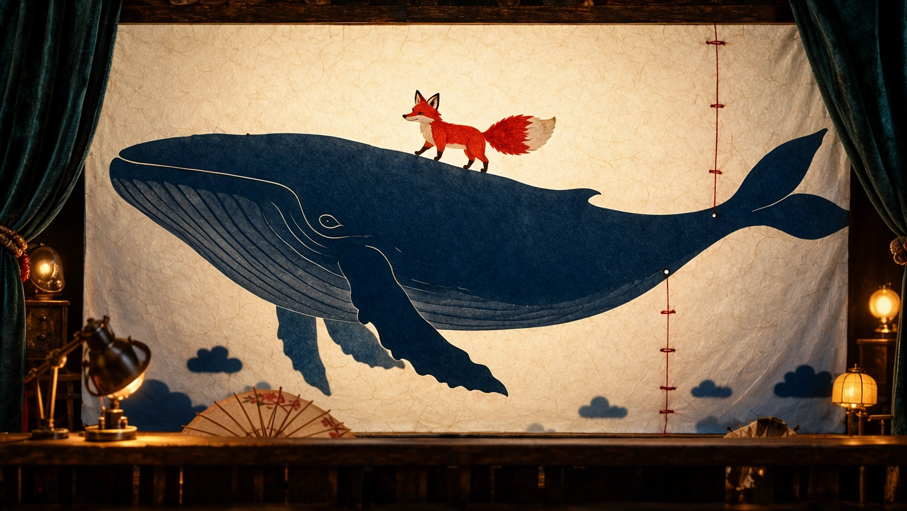
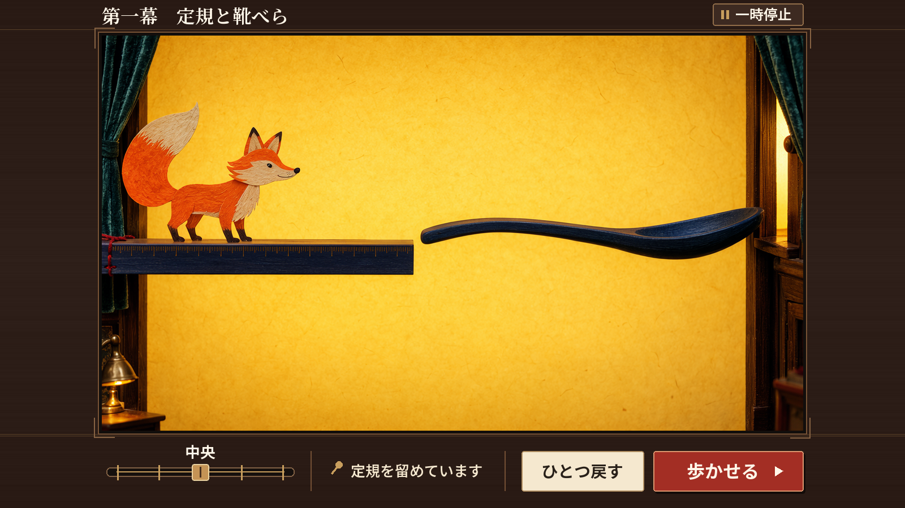

# 影継ぎ座（かげつぎざ）

閉館後の影絵小屋で、切り絵の仔ぎつねが一匹、幕に取り残されている。プレイヤーは最後まで残った照明係。灯りを動かし、道具の影を一つだけ赤い糸で幕に縫い留め、仔ぎつねを家の形に切り抜いた窓へ送り届ける。

終幕の美術案。第二の灯りが点くと、鯨の丸い背が、半開きの傘から生まれた影だと分かる。この種明かしまでを一つの場面として作る。

横持ちのAndroid・iPhoneとWindows PC向け。短い謎をじっくり解きたい人を想定する。一人用、オフラインで最後まで遊べる買い切り型を制作上の前提とする。価格と配信先は未定。

## 最初に遊ぶ「定規と靴べら」

Moss-imageの舞台画に日本語の操作表示を組んだ静止画。幕の左右に入口と出口がある。左袖に掛かった定規の影と、右袖から伸びる靴べらの影の間には、仔ぎつねがまたげない隙間がある。

1. 灯りを中央から右へ一目盛りずらす。靴べらの影が左へ大きく動く。定規も左へ逃げるので、隙間が少し残る。もう一目盛り動かすと、今度は靴べらが出口から外れる。灯りに近い道具ほど影の動く距離が長い。
2. 灯りを中央に戻して、定規の影をタップする。赤い縫い目が付き、その位置で止まる。灯りを再び右隣の目盛りへ動かすと、今度は靴べらだけが左へ寄り、両端が重なる。
3. 「歩かせる」で仔ぎつねが道を試す。つながった上縁を駆け、届かない所では片方の前足を伸ばす。成功すると、板を踏む硬い音が靴べらの澄んだ金属音に変わる。

定規を入口に深く掛けすぎると、その分だけ先端が届かない。失敗時は隙間を見せてから仔ぎつねを直前の袖か中継台へ戻し、照明と糸はそのままにする。逆に、先に靴べらを出口へ留めて定規を運ぶ解き方も通る。次の一手を考える時間に制限はない。

### 一手のルール

- 灯りは舞台下のレールに沿って動く。五つの目盛りの間も影を滑らかに描き、手を離すと最寄りの目盛りに収まる。目盛りを直接押しても同じ位置へ動く。
- 一度に留められる影は一つ。同じ影を押すとほどける。別の影を押すと、前の影は現在の灯りに合う位置へ戻り、新しい影がそこに留まる。影が重なる場合は道具名の札からも選べる。
- 歩行中は灯りと糸を固定する。「ひとつ戻す」で一手前の灯り・糸・出発地点を復元する。中継台に着けば、そこを次の出発地点にできる。
- PCはドラッグとクリックに加え、左右キーで灯りを動かせる。Tabで道具やボタンを選び、Enterで決定する。スマホで指が舞台を隠す間も、灯りは下端のレールから操作できる。

### 最初の場面は解けるか

幕の幅を100とした水平断面で調べた。左袖の端は20、右袖の始まりは83。定規の影の長さを35、靴べらの影の長さを39とし、隣の足場との重なりがすべて1以上なら渡れる。この計算は高さや傾斜を含まない。

| 灯りの位置 | 左端 | 左寄り | 中央 | 右寄り | 右端 |
| --- | ---: | ---: | ---: | ---: | ---: |
| 定規の影の左端 | 21 | 18 | 15 | 12 | 9 |
| 靴べらの影の左端 | 69 | 62 | 55 | 48 | 41 |

二つの影の位置を独立に選んだ25通りのうち、定規が左寄りか中央、靴べらが右寄りの2通りで道がつながった。糸を使わずに灯りだけを動かした5通りでは、いずれも道が途切れた。実物の曲線でも足が滑らず、隙間の理由が見て分かるかは試遊で確かめる。

## 三幕の上演

一景は数分、全三幕・15景、初見で45〜75分を仮の規模とする。最初の三景を仕上げて、解く時間と美術一点にかかる工数を測ってから景数を決める。

| 幕 | 代表する場面 | 上達すると見えるもの |
| --- | --- | --- |
| 一幕「楽屋の忘れ物」 | 定規と靴べらを渡す。次の景では、手前の大きな影を先に留めると、奥の短い影を入口に合わせやすい。 | 道具の奥行きから、灯りを動かす前に影の移動量を読める。 |
| 二幕「窓辺の町」 | 物干し竿で低い中継台に渡すか、傘の傾斜で屋根裏の窓を目指す。窓では客席から見えなかった二匹分の足跡を見つける。 | 今いる足場をいつ手放せるかが分かり、同じ道具で寄り道ができる。 |
| 三幕「鯨が眠る夜」 | 傘の影を幕に吊った鯨の腹と尾に合わせ、丸い背を作る。仔ぎつねがそこを渡り、中継台に着いたら傘をほどいて、家の窓へ続く最後の橋を掛ける。 | 序盤で覚えた「ほどく」が終幕の決め手になる。幕が上がり、鯨を作っていた傘と紙の腹が姿を現す。 |

終幕では仔ぎつねが窓の向こうのもう一匹に鼻先を合わせる。二匹がお辞儀をすると客電が点く。クリアした景は番組表から再演できる。見つけた足跡は番組表の余白に刷り足される。寄り道の数にかかわらず結末まで遊べる。

## 光、音、文字

美術は薄い和紙、藍色の切り紙、古い木枠、真鍮の灯りでそろえる。小さい画面でも仔ぎつねの向きが分かるよう、尾の先を白くし、踏み出した前足の形を横から見せる。留めた影には粗い縫い目を三つ付ける。似た色の影が重なっても、縫い目と道具名でどちらを留めたか分かる。

| 画面 | 文字と枠 | 反応 |
| --- | --- | --- |
| 開幕・番組表 | 閉じた緞帳に明朝の題字。木枠の外に「はじめから」、記録があれば「つづきから」を置く。 | 選んだ幕の灯りが一つ点く。 |
| 舞台 | 上端に幕題と一時停止。下端に灯り、留めた道具の名前、「ひとつ戻す」「歩かせる」を並べる。 | 針が通る小さな音と一瞬の糸の張りで固定を伝える。仔ぎつねの前足が止まった場所には文字を重ねない。 |
| 幕間・再演 | 紙の番組表に終えた景を刷り、「次の景へ」「もう一度」を置く。 | 活字が一度沈み、短い拍手が返る。再演を選ぶとすぐに幕が開く。 |
| ポーズ・設定 | 舞台を暗くし、明るい紙面に「舞台に戻る」、音量、文字サイズ、動きを減らす設定を並べる。 | 離席時は歩行と音を止める。復帰後は本人が再開する。「動きを減らす」では灯りと縫い目の静止表示で伝える。 |

題字はNoto Serif JP、道具名と操作はNoto Sans JPを候補とする。操作面には共通UIの和紙色と朱色を用い、舞台に接する枠だけを濃い木色と真鍮色にする。主操作には朱の面と輪郭、キーボードで選んだ項目には二重枠を付ける。最小画面でも44論理ピクセル相当の操作域を確保し、幕の照明が明滅しても文字の明るさを保つ。

足音は道具ごとに録り分ける。渡り切ったときだけ二つの足音に短い旋律が重なる。音を切っても、前足・縫い目・次の景への切り替わりで同じ結果を読める。

## 制作順と完成条件

| 段階 | 作るもの | 次へ進む条件 |
| --- | --- | --- |
| 最初の三景 | 灯りを動かすだけの一景、定規と靴べら、留め替えと中継台。定規の景には完成版向けの音・美術・UIを入れる。 | スマホとPCで初見各5人を目安に試遊。各群4人以上が口頭の助けなしで定規の景を解き、失敗例の隙間を指して直し方を説明できる。総当たりが続く場合は投影距離と舞台配置を調整する。 |
| 全幕を通す | 同じ舞台枠で三幕を制作。寄り道、番組表、再演、中断保存、終幕とクレジットをつなぐ。 | 初回起動から終幕、アプリ終了から中継台の再開、各景の再演を通す。工数が合わなければ似た解き方の景から減らす。 |
| 出荷候補 | 日本語フォントの字形と配布条件、生成素材・音源の利用条件を確認する。Windows、Android、iPhoneで配布用ビルドを試す。 | 対象を明記した実機で最も重い場面を各15分計測。フレーム時間の95パーセンタイルは標準PCで16.7ms、最低対象スマホで33.3ms以下を仮目標にする。操作の欠落、進行不能、セーブ消失があれば修正して再試験する。 |

Moss-imageで各幕の構図と素材見本を作り、Blenderで紙人形、灯り、傘などの道具を同じ舞台寸法にそろえる。Unityでは目盛りごとの輪郭から画面の影と歩行面を作る。傘の骨や鯨の目は模様として描き、歩ける上縁は太さと明暗で区別する。PCの追加照明や布の揺れにもこの判定を共用する。スマホでは小さい横画面と切り欠き、PCではキーボードだけでの再演を確認する。

制作PCではUnity 6000.3.28f1、Blender 5.3、Comfy DesktopのMoss-imageを確認した。Unity Editorのビルド用モジュールはWindows用のみ。最初の三景の制作時にAndroid Build Supportと付属ツールをそろえ、iOSはMac・XcodeかUnity Build AutomationからiPhoneへ入れる経路を確保する。実機の機種、遊びやすさ、性能、制作日程は未確定。[Androidの開発環境](https://docs.unity3d.com/6000.3/Documentation/Manual/android-sdksetup.html)・[iOSの開発環境](https://docs.unity3d.com/6000.3/Documentation/Manual/ios-environment-setup.html)

図版2枚はComfyUIで開いていたMoss-imageワークフローを使って新規生成した舞台画に基づく。「定規と靴べら」の操作表示は別途組版した。企画段階で確認したのは静止画と水平断面の計算まで。制作の進捗は[Issue #239](https://github.com/hayatok/100challenge/issues/239)に記録する。
