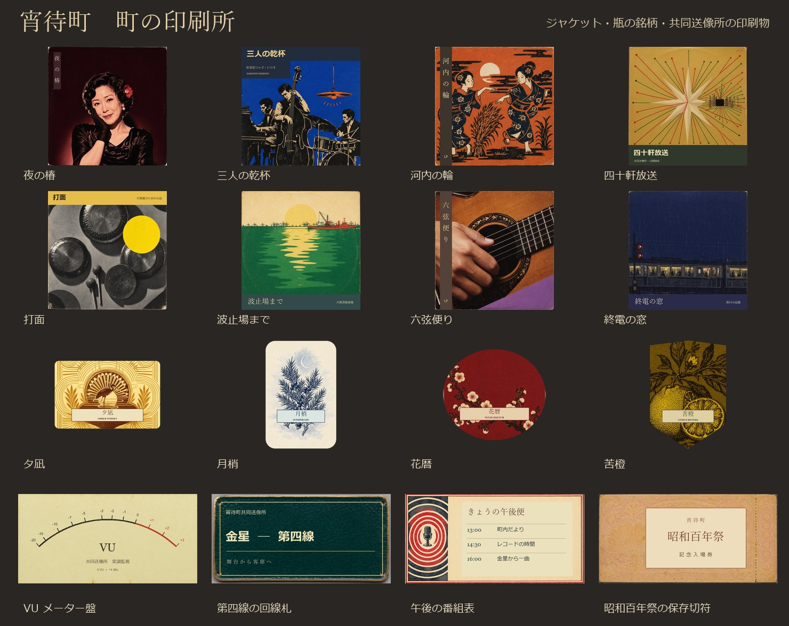

# 宵待町の美術資料

[美術制作資料 v0.8（PDF、15ページ）](Kinsei-Art-v0.8.pdf)で、舞台の基準画、作業する手、舞台マイクの造形、楽屋口と真壁の衣裳を、ゲームに入れたときの見え方と比較できる。

v0.9までにGPT Imageで6点、Windows機のComfyUIとMOSS-Imageで71点を生成した。美術チームはそのうち75点を採用した。各目録に、3D制作の参照にしたものとゲームでプレイヤーに見せるものの用途を記した。

|資料|採用数|使い方|
|---|---:|---|
|[GPT Imageの基準画と場面画](GPT-Image.md)|5|金星の舞台、堺から中継につなぐ奏者、卓上小物の印刷、二通りの翌朝。|
|[金星のポスターと客席の張地](moss/README.md)|2|壁のポスターに印刷を貼り、客席の座面に赤い型押しビニールを張る。|
|[金星の美術資料](atelier/README.md)|16|看板と印刷面をゲームに使い、衣装・小道具の寄り画像を3D制作の資料にする。|
|[ロータス、針音堂、共同送像所](district/README.md)|16|店舗ごとの商売道具、開店から店仕舞いまでの絵コンテ、店の人が使う印刷物。|
|[町の印刷所](printworks/README.md)|16|棚に並ぶLPの表紙8種、酒瓶の紙ラベル4種、共同送像所の計器盤・回線札・番組表・記念切符。初校2点を採用から外した。|
|[窓の奥と宵の空](nightscape/README.md)|6|上階の窓から透ける台所、修理机、カーテン、鉢植え。二枚の夜空から、方角によって雲底の色が異なる空を作った。|
|[金星の舞台マイク](microphone/README.md)|1|GPT Imageの設計画を採寸の参考にして金網・外枠・ねじと配線をモデル化。赤い金星の銘板は設計画から取り出して現物に貼った。|
|[金星の楽屋口](backstage/README.md)|8|通し札、衣裳札、歌手の額装写真、防音戸の張地の4点を通路に使う。残る4点は通路の照明、材料と戸を引く動作の参照。|
|[宵待高架線の客室と停留所](railway/README.md)|5|車内の路線札、長椅子のモケット、昇降口の見本硬券を3Dの設備に貼った。夜の客室と昇降機の原画を照明と車窓の参照に使う。|

3D人物の検査画像では、同じ人物を正面、斜め、背面から比較できる。[喫茶店主の澄子と送像所の村瀬](residents/README.md)。ゲーム内の光、視点、文字の重なりはWindows版のプレイ記録に掲載している。[金星と通りの実機画像・動画](../evidence/v03/README.md)。

針音堂に並ぶ『夜の椿』と『三人の乾杯』の衣裳と髪形を、金星の専属歌手とピアニストに起こした。歌手の金糸の縁取り、椿の花櫛、伴奏者のジャケットと鍵盤に置く手を確認できる。[舞台衣裳の制作画像と寸法](stagecast/README.md)。

真壁が戸を引くと、上げた腕と同じ側の袖山と裾に張りが出る。濃紺の杉綾を真上から照らしたときと、背中を横から照らしたときで糸の見え方を比較した。[真壁の背広の正面・側面・背面と襟の接写](makabe/README.md)。
