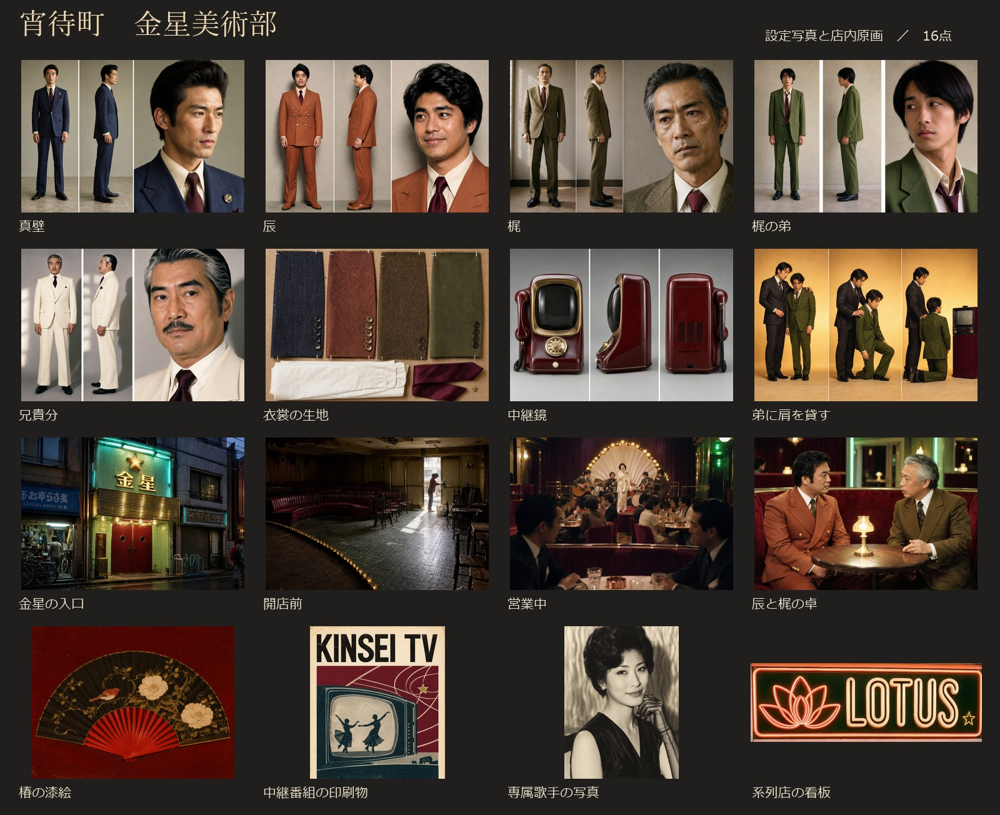

# 金星美術部・設定写真と店内原画

舞台照明の蜂蜜色、客席の葡萄色、入口の青緑を、同じ店の昼・夜、衣裳、宣伝物でどう使い分けるかを検討した。基準画は [GPT Image のタイトル原画](../GPT-Image.md)。このフォルダーの設定写真と原画はすべてローカルの MOSS-Image で生成した。ゲームのスクリーンショットはプロジェクトの evidence を参照。



## 店に掛ける原画

|Unity Resources キー|仕上がり|画面に残したもの|
|---|---:|---|
|[KinseiAtelier/camellia](../../Game/Assets/Resources/KinseiAtelier/camellia.png)|1024 × 768|朱の骨、黒地の椿、小鳥を描いた扇。客席の葡萄色から金色の花に目が移る。|
|[KinseiAtelier/broadcast](../../Game/Assets/Resources/KinseiAtelier/broadcast.png)|768 × 866|受像機の中の踊り手と「KINSEI TV」。生成された不正確な小活字を下端ごとトリミングした。|
|[KinseiAtelier/chanteuse](../../Game/Assets/Resources/KinseiAtelier/chanteuse.png)|768 × 1024|楽屋で保管されてきた出演者の宣材写真。黒い手袋を頬に添え、真珠と頬骨に光を集めた。|
|[KinseiAtelier/lotus-sign](../../Game/Assets/Resources/KinseiAtelier/lotus-sign.png)|960 × 328|近隣店の蓮と「LOTUS」のネオン。撮影風の生成結果から看板の四隅を指定し、正面から貼れる長方形に補正した。|

## 衣裳合わせ

|人物|写真で確認する箇所|
|---|---|
|[真壁](plates/makabe.jpg)|濃紺の二つ釦、暗い臙脂のタイ、片側に光る襟章。横顔と正面で肩の傾きを比較。|
|[辰](plates/tatsu.jpg)|銅色のダブルスーツ。左右の金釦、量のある髪、口角に表れる親しみ。|
|[梶](plates/kaji.jpg)|オリーブ系の毛織、目元とこめかみの年齢感。|
|[梶の弟](plates/otouto.jpg)|苔色にゆとりをもたせた肩、着崩した襟、兄よりも細い輪郭。|
|[兄貴分](plates/elder.jpg)|淡いアイボリーの上着と太い肩線。暗い客席からも追跡相手を識別する。|
|[生地見本](plates/swatches.jpg)|四人分を同じ光で並べ、織りと色の差、共通の下地と釦を比較。|

## 美術と立ち位置

|設定写真|用途|
|---|---|
|[中継鏡](plates/relay.jpg)|曲面ブラウン管、筐体の奥行きと背面の通気、真鍮の部品を検討する小道具資料。|
|[肩を貸す](plates/assistance.jpg)|弟を支える二人の身長差と、中継鏡の側で膝を下ろす位置を検討する連続ポーズ。|
|[通りからの金星](plates/facade.jpg)|夜の道路から「金星」、庇、入口の暖色が見える順序を確認。両隣の小看板には架空の字形があるため、ゲーム用の文字原稿には屋号のみを使う。|
|[開店前](plates/daylight.jpg)|扉から入る自然光。客席の掃除をする時間の椅子と通路。|
|[辰と梶の卓](plates/table-read.jpg)|会話用の低い目線と卓上灯。衣裳の色で左右の人物を識別する。|
|[営業中](plates/evening.jpg)|目線の高さに近い客席の会話から、奥の出演者と電球の貝殻へ抜ける構図。|

## 再生成

既設の ComfyUI とモデルの版・ファイル名は [元の MOSS 生成記録](../moss/README.md) に準拠。専用ポート 8192 で起動した ComfyUI に対して次を実行する。ワークフォルダーに生成直後の PNG と実行イベントを記録する。素材ごとに固定したプロンプト・seed・解像度は generate.py、30 ステップ、CFG 2.5、er_sde/simple の元グラフは ../moss/poster-api.json にある。名前をコマンド末尾に指定すると個別再生成できる。

```powershell
python generate.py --port 8192 --work "$env:TEMP/kinsei-atelier-picked"
python prepare.py "$env:TEMP/kinsei-atelier-picked"
```

prepare.py は Pillow を使用する。索引の見出しとキャプションには Windows の游明朝・メイリオを使う。設定用の写真は全解像度の JPEG に仕上げ、ゲームに読み込む四点には上記の処理を適用する。[実行台帳](runs.json) に ComfyUI が発行した prompt ID、実行秒数、生成直後と収録後の SHA-256 を記録した。


