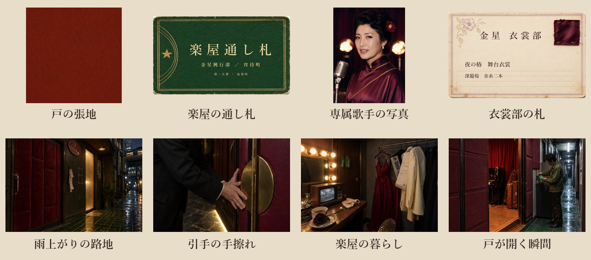

# 金星の楽屋口

金星の西側では、街の人が見る歌手の写真と、裏方が使う通し札を同じ通路に置いた。扉を開けるとホールの舞台脇へ光がつながる。上段はゲーム内の四つの面、下段は場所と動作を設計するために作った参照画である。



|素材|現物への使い方|
|---|---|
|張地|濃い赤に型押しした合成皮革を引戸の外側に張る。真壁の掌が当たる曲面の取手、戸車と真鍮の蹴板は別に立体で作った。|
|通し札|印刷部が緑の地と星の輪郭の上に「楽屋通し札」と番号を金色で組む。仲間が札口に着くと、21 × 12 cmの札が棚に出る。|
|歌手の写真|舞台で歌う『夜の椿』の歌手を、葡萄色の立ち襟、金糸二本、赤い花櫛、真珠の耳飾りで撮影した設定。通路の48 × 66 cmの額に収めた。|
|衣裳札|右上に同色の布見本を留め、屋号、演目と金糸の本数を組み直した。額の下に24 × 15 cmの札を置く。|

照明の当たりを探る[雨上がりの路地](studies/alley-evening.jpg)、真鍮の握り方と手擦れを調べた[引手](studies/door-hand.jpg)、出演者の持ち物を決める[楽屋](studies/greenroom.jpg)、室内から外の色温度差を見る[開いた戸](studies/door-open.jpg)を制作した。楽屋の鏡台は設定画に描いた場所で、v0.7で通行できる区間は西の路地からホールの舞台脇まで。

既設のWindows機でComfyUIとMOSS-Image INT8を使い、原画8点を生成した。番号と日本語はWindows標準の游明朝で紙面に組み込んだ。所要時間、出力ID、原画のSHA-256は[作業記録](runs.json)、全プロンプト、画像寸法とseedは[発注表](plates.json)に収録した。

```powershell
python -B draw.py --port 8196 --work "$env:TEMP/kinsei-backstage-art"
python -B finish.py "$env:TEMP/kinsei-backstage-art"
```
