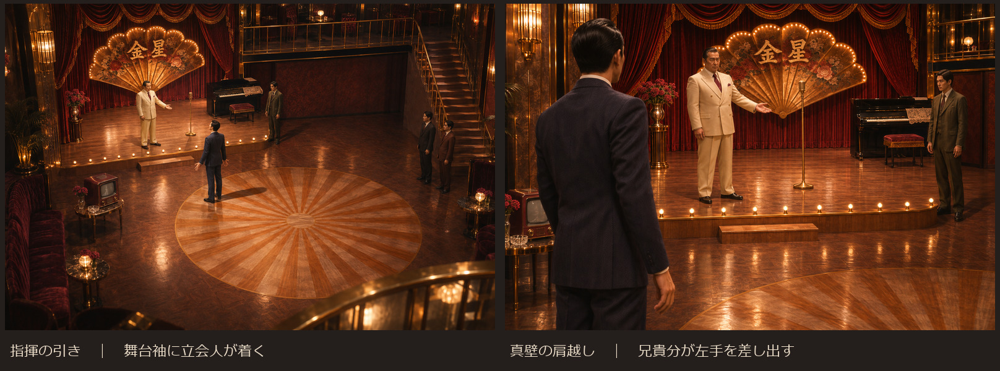

# 舞台袖に立会人が着いた夜

制作はOpenAI GPT Image（Codex組み込み）。原画を2回に分けて生成した。[実プロンプトと参照順](prompts.json)を収録。

1. [指揮の引き](stage-overlook.png)を採用。放射状の床の左端に濃紺の真壁、浅い段の上に白服の兄貴分、ピアノ脇に立会人を置いた。右の階段と桟敷、左手前の卓上受像機まで見渡せる。指揮視点の人の間隔と舞台の段差を検討する資料。
2. [真壁の肩越し](stage-shoulder.png)を採用。1枚目を直接の参照画像に指定した。差し出した左手、舞台縁の電球、ピアノと立会人を同じ側に残し、手前に真壁の杉綾の背と下げた手が入る。受像機は画面左端に一部が見える。TPSの距離で顔・手・舞台床を読むための資料。

位置関係は[立会人到着の指揮画面（Windows v0.6）](../../evidence/v06/tv-map-stage.png)、人物の距離・楽器・桟敷は[舞台で勝負が始まった場面（Windows v0.6）](../../evidence/v06/amber-stage.png)、幕や金属の色は[既存のタイトル原画](../../Game/Assets/Resources/Art/kinsei-key.png)を参照した。二つの実機画像は進行の異なる時点で撮影されたもの。新作は勝負の直前に設定をそろえた美術原画。

引きで右の階段下に見える見物人二人は、肩越しでは画面の外にいる。原画間をつなぐ基準は白服の兄貴分、ピアノ脇の立会人、舞台縁の位置で、人物間の実寸は実機の舞台で決める。

|ファイル|寸法|SHA-256|
|---|---|---|
|stage-overlook.png|1536 × 1024|ebd9a49926db2acb524e57dd36e43b48f7480c0372a53594bf9bb72c46e2c23f|
|stage-shoulder.png|1536 × 1024|b0c679f67c58742487110346e15149a7fe93276f84a61b0c455e40ba54497233|
|two-views.jpg|1616 × 600|d56e36b0149a700a1488c133d35d362b26ed75d928304dc54b4af0ada6a66b82|
