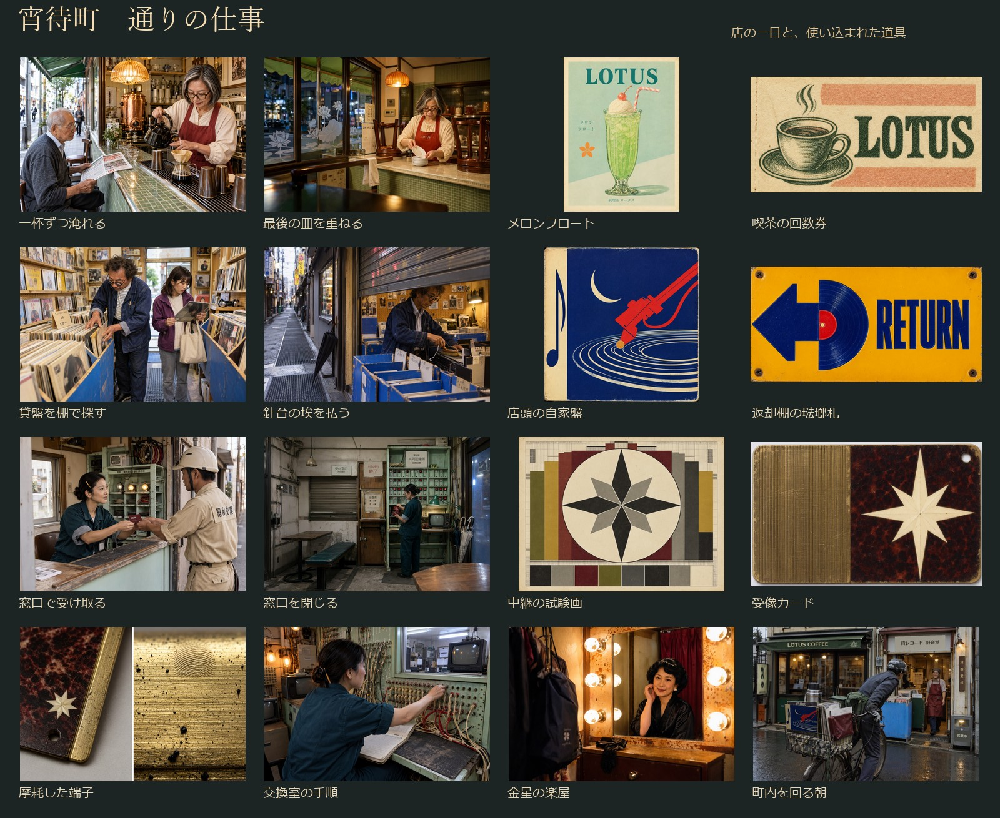

# 宵待町　通りの仕事

金星の周囲で一晩の興行を支える三店舗を、開店中と店仕舞いの一組ずつで描いた。喫茶店は手を伸ばせば届くカウンター、貸盤店はレコードを水平に抜ける棚間、送像所はカード一枚を渡せる窓口が人と人の距離を決める。画像はすべて MOSS-Image で生成した設定写真または制作原画。プレイヤーの画面記録はアプリの evidence に収録する。



## 店の原画

Unity のキーは `KinseiDistrictArt/` に以下のファイル名の拡張子を除いて続ける。寸法は展示面の目安。

|店舗|原画|想定する物と大きさ|
|---|---|---|
|純喫茶ロータス|[フロートの絵](../../Game/Assets/Resources/KinseiDistrictArt/lotus-float.png)|クリームソーダの緑を窓外へ見せる、幅30 × 高さ40 cmの厚紙広告。|
|純喫茶ロータス|[コーヒー券](../../Game/Assets/Resources/KinseiDistrictArt/lotus-voucher.png)|会計皿に置く10 × 5 cmの回数券。卓上の見本札にも使える。|
|貸レコード店針音堂|[自家盤ジャケット](../../Game/Assets/Resources/KinseiDistrictArt/needle-sleeve.png)|幅31.5 cmの角形ジャケット。朱の針とクリームの同心円を面陳列に使う。|
|貸レコード店針音堂|[返却棚の札](../../Game/Assets/Resources/KinseiDistrictArt/needle-return.png)|幅32 × 高さ16 cm。黄土に紺の矢印が貸し出しの流れと返却口を分ける。|
|共同送像所|[試験画](../../Game/Assets/Resources/KinseiDistrictArt/relay-test.png)|幅28 × 高さ21 cmの点検用紙。ブラウン管用の4対3の枠にも納まる。|
|共同送像所|[受像カード](../../Game/Assets/Resources/KinseiDistrictArt/relay-card.png)|横85 × 縦53 mm。左の接点、位置合わせ穴、星章で向きがわかる。|

## 店主と来客

|店|営業中|人が帰った後|
|---|---|---|
|純喫茶ロータス|[朝の一杯](plates/lotus-open.jpg)　赤い前掛けの店主と、新聞を持つ常連。|[皿を重ねる](plates/lotus-close.jpg)　視線をすりガラス越しに外へ移す。琥珀のペンダントとタイルで場所をつなぐ。|
|貸レコード店針音堂|[盤を扱う](plates/needle-open.jpg)　店主は棚の見出しをめくり、隣の客はジャケットを手に取る。青い二列の棚が二人の間隔を決める。|[店仕舞い](plates/needle-close.jpg)　青い什器と擦れた棚の角に、最後の作業灯が当たる。|
|共同送像所|[受付](plates/relay-open.jpg)　配送員と作業着の担当者が腰高の窓口を挟む。|[窓口の裏](plates/relay-close.jpg)　窓口を閉めても、カードの整理と中継設備の待機が続く。|

## 町内を結ぶもの

- [端子の摩耗](plates/contact-wear.jpg)は、受像カードの使用痕と接点の形を拡大して見るための資料。
- [交換室](plates/patch-room.jpg)は、照明が届く範囲、作業者の手が届く配線盤と帳面の関係を検討する。
- [金星の楽屋](plates/greenroom.jpg)は、[歌手の宣材写真](../../Game/Assets/Resources/KinseiAtelier/chanteuse.png)にある短い髪、真珠、黒いサテンを身支度に引き継ぐ。
- [町内を回る朝](plates/lane-round.jpg)は、自転車と配達袋の大きさで一人が一度に運べる品数を示す。

## 制作と再生成

[金星ポスターの実行環境](../moss/README.md)と同じ ComfyUI、MOSS-Image INT8、Qwen3.5 9B、Flux2 VAE を使用。実行時に確認した ComfyUI のコミットは `2c75dc1b379a59e0880619d029607af5169a62ef`。専用のローカルサーバーのポートは8193。元のノード接続を金星の生成スクリプトから読み、プロンプト、解像度、seed、保存先を [render.py](render.py) で指定した。CFG 2.5、30ステップ、er_sde、simpleで生成した。

```powershell
python -B render.py --port 8193 --work "$env:TEMP/kinsei-district-selected"
python -B prepare.py "$env:TEMP/kinsei-district-selected"
```

フロート広告の疑似小活字は同じ紙面の無地部分で補修し、「メロン」「フロート」「純喫茶 ロータス」を游明朝で組み直した。屋号の英字と図版は生成原画のまま収録した。閉店後の送像所写真では、壁の四つの掲示に実際の文言をメイリオで入れた。配達の写真にも店舗名・受付札を組み、前籠の一枚には収録した自家盤ジャケットを貼ってショット間の品物を揃えた。

ショット単位の名前をどちらのコマンドにも渡せる。全点で仕上げると [台帳](runs.json) に実行ID・実行秒数・生成時と収録時のSHA-256を保存する。設定写真は全解像度JPEG。索引を組む際は Windows の游明朝とメイリオ、画像の仕上げには Pillow を使う。


