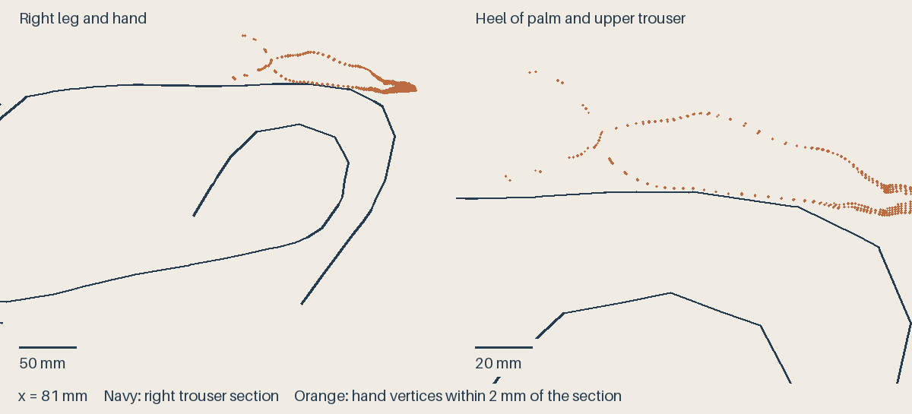

# 降参する二人の膝と右手

紺谷・浦の降参を、構えと歩行の両方からUnity 6000.3.28f1のPlay Modeで実行した。袖の最終版で4系列・604フレームを再測定した。前版と比べ、手とズボンの交差に関わる4列の値が変わった。左右の靴底と膝の高さ、移行中の最大交差は同じだった。[全フレームの測定値](frames.csv)

|開始姿勢|移行中の右手とズボンの最大交差|その時刻|床からの左膝衣服の最小高さ|靴の最小高さ 左／右|
|---|---:|---:|---:|---:|
|構え|1.024 mm|1.117秒|0.57 mm|−0.01／−0.01 mm|
|毎秒1.6 mの歩行|1.020 mm|1.117秒|0.56 mm|0.30／0.00 mm|

2.5秒の静止姿勢では、左靴が床上0.30 mm、右靴が0.00 mm、左膝の衣服が0.57 mm。右掌中央とズボン上面の垂直間隔は1.13 mm、全手頂点と膝の最近接距離は1.09 mm。静止時の局所面法線による食い込みは0.00 mm。右図は同じ姿勢を拡大したもの。どちらも人物の原点から右へ81 mmの断面で、紺線がズボン、橙点が断面の前後2 mm以内にある手の頂点。



## 測定条件

- 60 Hzで44フレーム準備し、降参の直前を0秒とした。以後2.5秒まで1/60秒ごとに記録。床はワールドY=0、人物の位置と向きは降参開始時に固定。視線の目標は人物生成時の右0.34 m・前方1.65 m・高さ1.56 mに置いた。各系列で途中時刻の0.4、0.867、1.3秒を収録した。
- 踝は人物ローカルの位置、膝骨はワールドの高さ、靴底は表示中の左右各556頂点の最低高さ。膝周囲は変形前Y=0.34～0.65 mの衣服を選び、実衣服をBakeMeshした後の高さを使用。
- 右手との交差は右腰・右膝のボーン8／9を主ウェイトとする三角形を使う。右袖は対象外。手頂点から上・下へ伸ばした線が両方とも奇数回交差し、三次元の最近接三角形の外向き法線でも内側だった場合に、その面への最短距離を記録した（CSVの nearestDepth、単位m）。開口や接線に近い断面を除く。upperDepth は同じX/Zの上面からの垂直距離で、傾いた面で値が大きくなる。局所面法線による静止時の値とは判定対象が異なる。
- CSVは29列。袖口の継ぎ目 cuffSeamMm はmm、その他の距離はm、時間は秒。左右の袖と手の境界を全フレームで照合し、4系列とも最大値はCSVの記録精度で0.000000 mmだった。fingerDistance と handSigned は手首先端側の頂点を指定時刻で測定し、その他のフレームはNaN。lipPct は開口のブレンド値、eyeL／eyeR は左右の眼の上下倍率。

## 再現

Windows、プロジェクト指定版のUnity Editor、Python 3とNumPy・Pillow 10.1以降を使用する。このフォルダで次を実行する。

```powershell
.\run.ps1
```

[起動スクリプト](run.ps1)が一時フォルダにGameの独立コピーを作り、[人物の測定コード](YieldProof.cs)と[ズボンの交差判定](TrouserSection.cs)をそのコピーのEditorフォルダに配置する。Unityの自動起動を独立コピー内で止めて四人の測定用インスタンスを作り、バッチ実行後に[断面描画](section.py)を実行する。出力先には frames.csv、knee-section.png、Unityログ、断面再生成用の final-surfaces.bin ができる。Unityの場所を指定する場合は `./run.ps1 -Unity 'Unity.exeのフルパス'` を使用する。

|照合対象|SHA-256|
|---|---|
|[降参動作](../../../Game/Assets/Kinsei/Cast/KinseiActor.HallYield.cs)|18d638e048e706f410ca4b15c90d4084e9db6f3f6e25afe2c1fc48c128fe1af3|
|[袖口改修後の衣装](../../../Game/Assets/Kinsei/Cast/KinseiActor.HallWardrobe.cs)|a6c3f976d89e657da4facac8ec17fa86ccd5222b1a5d95fd48d8ce4b42859249|
|測定CSV|e28b753d4db0bc4208ce89afb234d6db2b2f481dbae7a26a49a6d0f41dcbef37|
