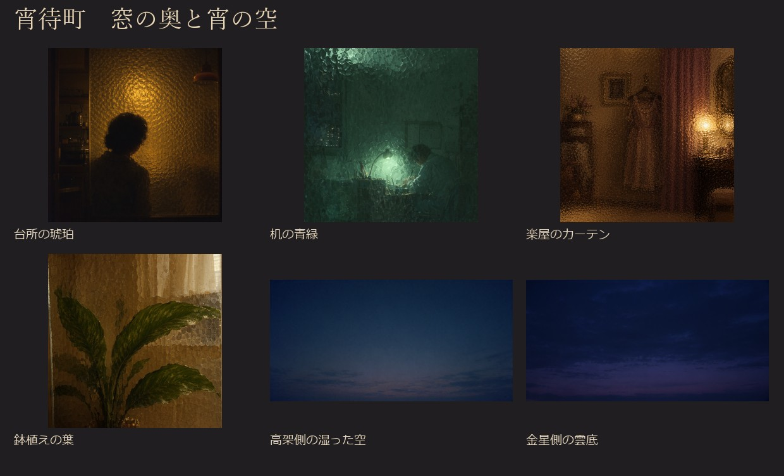

# 宵待町　窓の奥と宵の空

高架の向こうに見えていた既存の集合住宅を基準に、その前後に距離の異なる生活階と屋上を足した。型板ガラスの明かりには、小さな台所、修理机、カーテン、鉢植えの四つの原画を使う。金星の裏方にはカーテンと葉影、ロータス側には暖かい台所、共同送像所周辺には冷たい机の光が混じる。



## 配置

- 三軒の生活階は入口より約1.4 m奥に引いた。建物幅は5.0〜5.8 m。庇の上から屋根までの高さは約2 mで、店と店の間にある高架の見通しを残す。
- 金星は既存の外壁に約2.4 m幅の出窓を二基付けた。上階のガラス、額縁、格子、水切りは前後に別々の位置を持つ。台所と楽屋の窓にはガラス面より手前に小さな引き紐が下がる。
- 店名板の裏には支持金具、庇には弛む短い配線、生活階の端には屈曲した竪樋を置いた。金星の縦看板は既存の筐体に金具と小型の接続箱を加えた。
- 高架の奥は既存11棟の座標に合わせて一部の窓に奥行きを付け、さらに後方の約55〜61 mに階段室・給排気のある建物を配置した。人物や建物は空気層の画像に焼き込んでいない。

## 描画と統合

C# は `Game/Assets/Kinsei/World/KinseiWorld.Nightscape.cs`、シェーダーとテクスチャは `Game/Assets/Resources/KinseiNightscape/` に配置する。既存の `KinseiWorld.Construct()` の `BatchArchitecture();` 直前に `BuildNightscape();` を追加し、既存の `KinseiWorld.OnDestroy()` に `nightAssets?.Release();` を追加する。

空は中心 (0, 0, −12)、半径73 mの実メッシュ。既存カメラのソリッドカラークリアを維持したまま、深度テストを使って外に見える部分に描画する。メインカメラの遠方クリップは110 m、中継・楽屋カメラは24 m以下。ガラスは発光を控えた Standard マテリアルと四面のアトラスを共有する。

近景は四つのマテリアル別メッシュにまとめ、共通の親一個を既存の `overhead` に登録した。指揮に切り替えると生活階、出窓、架線の支えが庇と一緒に消える。遠景四メッシュと空一メッシュを合わせ、追加 Renderer は9個。全て静的に構築し、追加のコライダーと毎フレームの処理はない。外の二灯は半径5.0 mと4.8 mの影なし頂点ライト。室内の反射プローブ、Fog と環境光は既存設定を用いる。

## 生成と確認

ローカル ComfyUI のコミット `2c75dc1b379a59e0880619d029607af5169a62ef`、RTX 4070 Ti、専用ポート8195で6点を生成し6点を採用。全体のモデル実行時間は120.43秒。4枚のガラスは各768角で生成、実装時は各面に8pxの複製ガターを置いた1536角の `UpperGlass.png` にまとめた。2枚の空は方角を分け、継ぎ目をなじませ、天頂の経度差を消した2048 × 512の `EveningAir.png` にした。両方とも実装側で読み込む。

[ノードグラフ](graph.json)、[プロンプトと固定seed](render.py)、[仕上げ](finish.py)、[6件の実行ID・SHA-256](runs.json)を収録する。仕上げにPillowとNumPyを使う。空のワークフォルダーを与えると全件を再生成できる。

```powershell
python -B render.py --port 8195 --work "$env:TEMP/kinsei-sky-selected"
python -B finish.py "$env:TEMP/kinsei-sky-selected"
```

Unity 6000.3.28f1同梱Roslynで、新しい partial クラスと呼出しを含むプロジェクトのC#一式を一時コピーからコンパイルした。前版の実機画像「elevated-train-final.png」の暗部と比較して設計した。上の索引は原画の確認用。Windowsプレイヤーでの見え方、シェーダーの実機コンパイル、指揮切替、FPSは統合後の検証対象。
