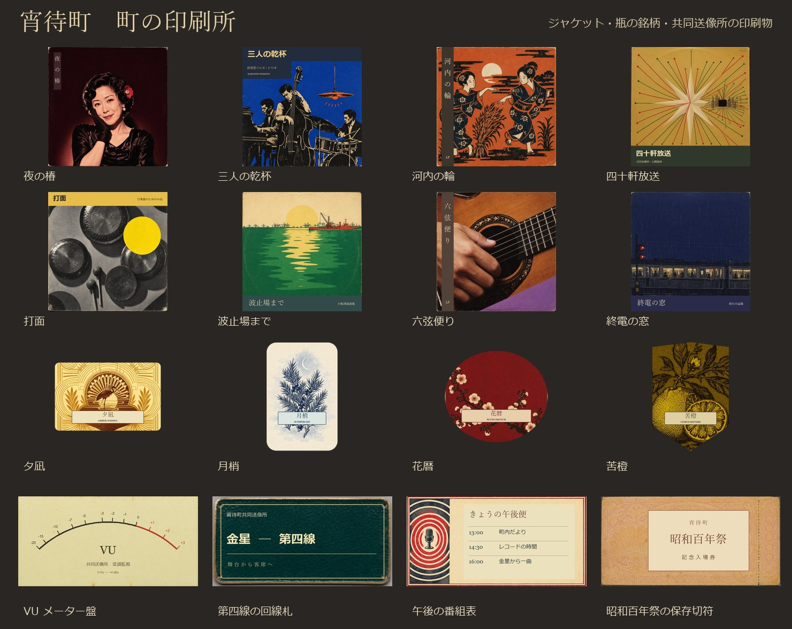

# 宵待町・町の印刷所

針音堂の面陳列、金星のバックバー、共同送像所の卓上を近くで見ると何が読めるかを基準に制作した。MOSS-Image の原画から紙の繊維・版ズレ・銘柄絵・経年を残し、店で読む文字と機器の目盛は実際の日本語と数値で組んだ。下の索引は印刷物の仕上げ見本。プレイヤーのキャプチャはアプリの実機検証記録を参照。



ローカルMOSSで18点を生成し、16点を採用した。実行時間の合計は381.8秒。歌手の初校は右端に別の顔が重なったため、追加生成した単独肖像を採用した。ジンは二案を比較し、店頭の小瓶でも枝と三日月が読み取れ、架空の文字が混じらない銅版画調の初校を選んだ。

## 針音堂のレコード

幅31.5 cmの正方形ジャケットを想定。上・下は画像の見た目、列は左から。英字キーと正確な座標は [UV 台帳](atlas.json) に収録。

|段|1列|2列|3列|4列|
|---|---|---|---|---|
|上|singer『夜の椿』・金星専属歌手|trio『三人の乾杯』・和ジャズ|folk『河内の輪』・民謡|forty『四十軒放送』・共同送像所の公開録音|
|下|percussion『打面』・打楽器|harbor『波止場まで』・港の器楽集|guitar『六弦便り』・ギター独奏|nighttrain『終電の窓』・夜の器楽集|

## 金星の瓶と送像所の印刷物

|アトラス・段|左|右|
|---|---|---|
|Bottles 上|amber「夕凪」横長の角丸紙ラベル。ウイスキー。|gin「月梢」縦長の丸肩ラベル。ジュニパーのジン。|
|Bottles 下|plum「花暦」楕円ラベル。梅のリキュール。|bitters「苦橙」盾形ラベル。柑橘のビターズ。|
|Station 上|meter アナログVU盤。黒から赤へ変わる0 VUを境に、−20〜+3 dBを表示。|line 金星と第四線を結ぶ琺瑯札。|
|Station 下|schedule「きょうの午後便」。13時の町内放送、14時半の貸盤番組、16時の金星中継。|ticket 昭和百年祭の記念入場券。物語の前年を保存した紙片。|

酒名と銘柄絵はいずれも作品用。VU盤は前面へ可動の指針を重ねられるよう、目盛と盤面だけを収録。目盛は表示レベルの電圧比に応じて間隔を決めた。

## Unity のUV

`KinseiPrintworks/Sleeves` は 4096 × 2048、`KinseiPrintworks/Bottles` は 2048 × 2048、`KinseiPrintworks/Station` は 2048 × 1024。各セルの四辺に8ピクセルの複製ガターを設けた。テクスチャのインポート上限は Sleeves を4096、他を2048とする。

台帳の `uv` は Unity 左下原点の `[x, y, width, height]`。上段左は画像の左上、UnityでのYは大きい。酒瓶ラベルの `tight_uv` は透明な余白を除いた外接矩形。ラベルの形を残すには透明を扱えるマテリアルに貼り、矩形の内側でも角のアルファを尊重する。印刷面の裏側を見せるためのミラー反転は行っていない。

## 再生成

ComfyUI コミット `2c75dc1b379a59e0880619d029607af5169a62ef` の既設バックエンド、RTX 4070 Ti、ローカル専用ポート8194を使用。[ノードグラフ](graph.json) は MOSS-Image INT8、Qwen 3.5、Flux2 VAE、30ステップ、CFG 2.5、er_sde/simple。図版ごとに変わるプロンプト・seed・寸法は [render.py](render.py)、採用原画、組版、裁ち型、ガターは [finish.py](finish.py) にある。

```powershell
python -B render.py --port 8194 --work "$env:TEMP/kinsei-press-selected"
python -B finish.py "$env:TEMP/kinsei-press-selected"
```

生成器は既にPNGと実行記録の揃った図版をスキップする。全18点を新しく生成する場合は空の作業フォルダーを指定する。

仕上げは Pillow と Windows の游明朝、メイリオ、Georgia、Arial を使用。[実行記録](runs.json) は不採用を含む全生成の ComfyUI ID、seed、実行時間、元PNGの SHA-256 を記録する。原画から仕上げる際には [UV 台帳](atlas.json) のアトラス SHA-256 と照合できる。

