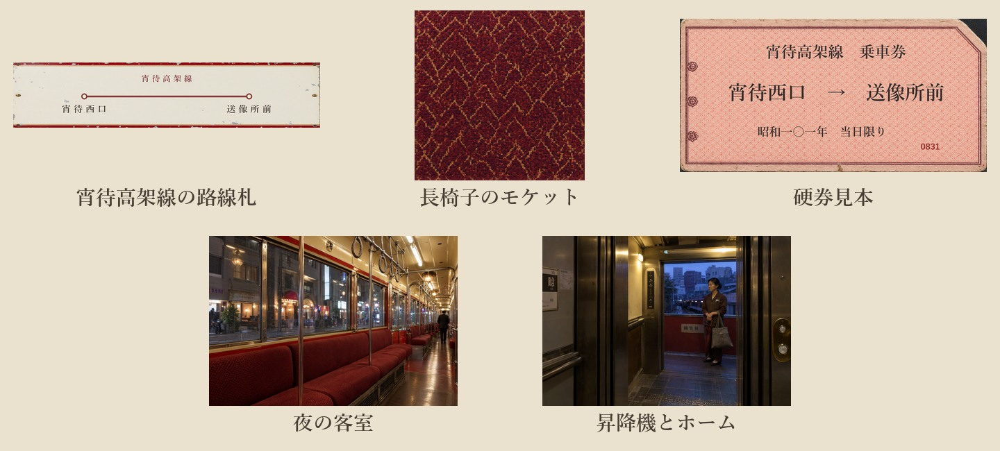

# 宵待高架線の客室と停留所



二駅を結ぶ赤い線と琺瑯のかすれが、腰板の赤と同じ車内で読めるようにした。駅名は「宵待西口」と「送像所前」。ComfyUIのMOSS-Imageで原画5点を生成し、路線札と硬券には游明朝で正しい駅名を組んだ。長椅子の起毛地は赤い階段状の織り模様を残し、端を線形光量でなじませて隣の面に繰り返せるようにした。

- 路線札は窓の上にある横1.08 × 縦0.23 mの面、硬券は昇降口にある横0.24 × 縦0.12 mの見本に使用。車内の長椅子は独立した3D形状にモケットを張る。
- [夜の客室](studies/car-at-night.jpg)は蛍光灯、木の窓枠、吊革と車窓の高さの参照画。[昇降機の原画](studies/lift-arrival.jpg)はホームからの青い光と籠の暖色を比べる資料。実機の窓からは真壁が歩いた同じ街の3Dモデルを見る。
- [発注表](plates.json)にseedと寸法、[作業記録](runs.json)に5件の実行ID、生成時間とSHA-256を収録。[仕上げ](finish.py)で札の文字、布の継ぎ目、図版一覧を再制作できる。

```powershell
python -B ../backstage/draw.py --port 8197 --plates plates.json --prefix kinsei-rail --work "$env:TEMP/kinsei-rail-art"
python -B finish.py "$env:TEMP/kinsei-rail-art"
```
