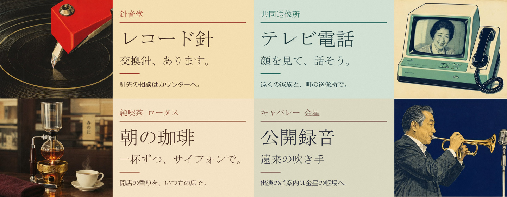

# 宵待高架線の車内額面広告

製版原稿は2048×800 px、各枠1024×400 px（横縦比2.56）。左上から、針音堂のレコード針、共同送像所のテレビ電話、純喫茶ロータスの朝の珈琲、キャバレー金星の公開録音を掲載した。昭和の商業印刷を想定した各図案をComfyUIのローカルMOSS-Imageで個別に生成し、日本語の店名・見出し・本文はMS明朝とメイリオで後組版した。用紙外の台紙・亜鉛枠は3D側の担当。原画の二次使用を伴う既存商標やフォントファイルの同梱はない。

原画、プロンプトID、SHA-256はoriginals/、seedと発注文はplates.json、全採否・アトラスSHA・UVの目録はcatalog.json。4点とも初稿採用。赤い針先と円盤の溝、受話器と画面の顔、サイフォンの丸い下球とカップ、吹き手の顔とマイクをそれぞれ確認した。

生成には既存のart-source/backstage/draw.pyとnightscape/graph.jsonを使用。ローカルMOSS-Imageのモデルmoss_image_sft_int8_convrot.safetensors、Qwen CLIPとFlux2 VAEは同グラフの設定に従う。再生成は draw.py --plates plates.json --port 8197 --prefix kinsei-transit-ads --work originals で行う。既に生成済みの原画からは python finish.py <仕上げ先> でゲーム用TransitAds.png、index.jpg、catalog.jsonを再作成できる。

Unityの統合先はKinseiPrintworks/CarAdvertisements。左下基準のUVでoffsetは左上(0,.5)、右上(.5,.5)、左下(0,0)、右下(.5,0)。各区画のスケール(.5,.5)。PrintCellsで各辺8pxの内側を使う。絵と文字の左右は枠ごとに交互。既存の車内に貼った後の距離と照度はWindows実機で確認する。
