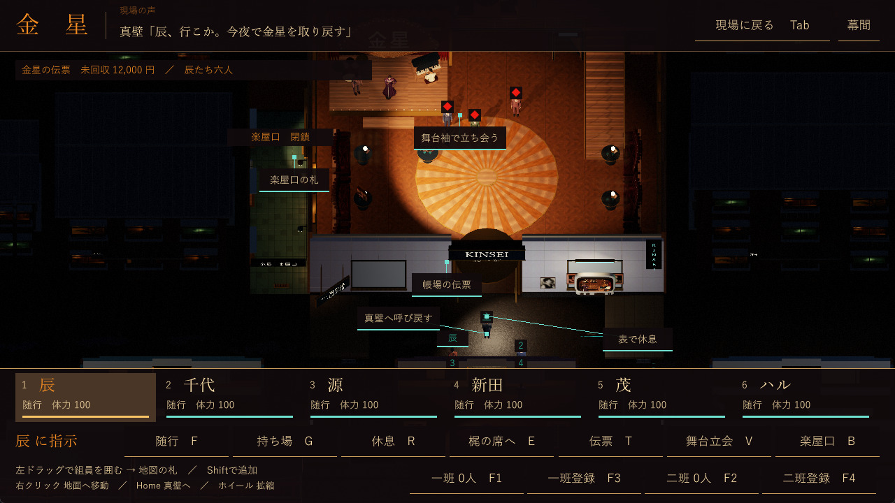
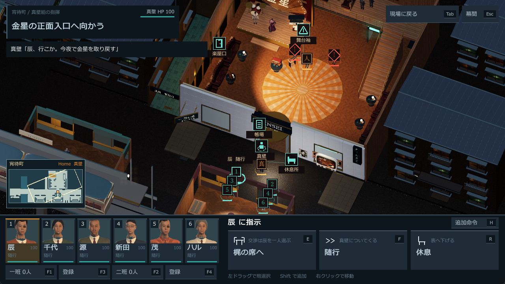

# 指揮画面の新旧比較

同じ表通りで Tab を押したときの Windows 版を比較した。v1.9では、入口の真壁と六人が最初の地図に収まる。顔札を選ぶと、右側の命令がその組員に合わせて変わる。下の画像はいずれもゲームの実行画面。

| v1.8 | v1.9 |
| --- | --- |
|  |  |

## 地図からの指示

- 地図の「2」を選び、帳場の印を右クリックすると千代が伝票を取りに向かった。
- 左ドラッグで辰・源・茂を囲んで休息を指示し、Shiftを押してもう一列を囲むと六人でホールへ移動した。顔札から千代と新田の二人を一班に登録し、別の組員を選んでから呼び戻す操作も確認した。
- 小地図の縁をまたいで囲んだときは、外側に見えていた千代と新田だけが休息した。先に源を選んでからShiftを押して囲むと、源も引き続き班に残った。
- 小地図をクリックして西側へ移り、真壁の位置に戻った。入店後に地図を開くと中継卓と通用口が見えた。源を中継卓に送ると、地図に経路が出て右の派遣欄に名前が載った。別の回では新田に用心棒の浦を指名し、その後、通用口へ送った。

[源を中継卓へ派遣した画面](hall.jpg) · [新田を通用口へ送った後の画面](hall-orders.jpg)

## 真壁の操作と表示サイズ

現場に戻り、肩越しで構えて横移動と後退を行い、構えを解いて走り、停止した。ホールでは射撃の命中と幕間への切り替えも確認した。[現場の画面](field.jpg) · [移動の実機録画](motion.webp)

1280×720、1920×1080、1024×768で指揮と現場を切り替え、顔札・命令・幕間を確認した。撮影には個別の一時セーブ先を使用した。[フルHDのホール](full-hd.jpg) · [1024×768の表通り](compact.jpg)
